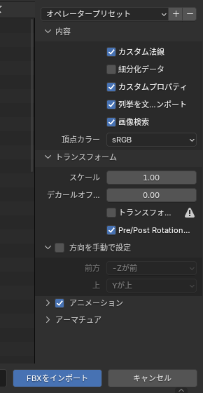
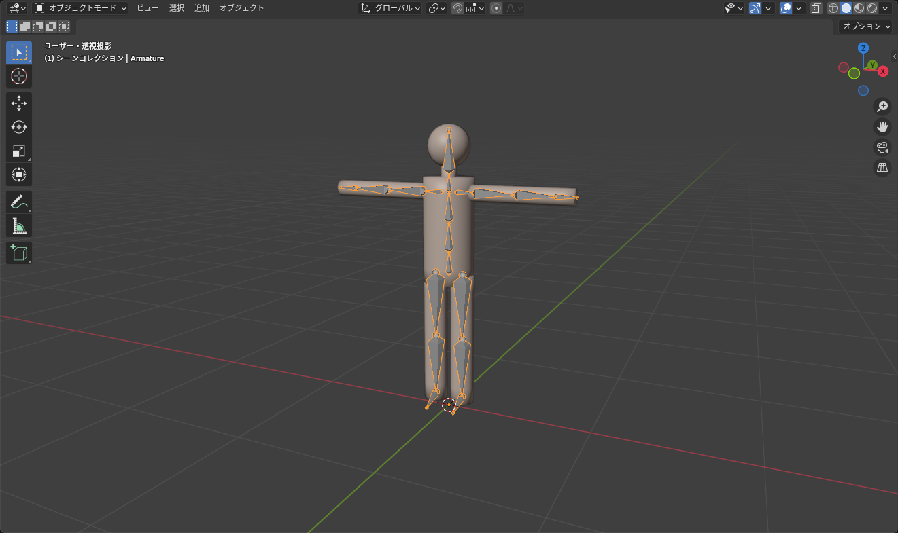

## この章で作るもの

この章では、既製のアバターに合わせた **上着（シャツ）** を 1 着作り、Unity で着せるところまでを通して行います。

1. アバターを読み込む（この記事）
2. [服の形を作る](/learn/avatar-clothing/base-shape)
3. [UV 展開とテクスチャ](/learn/avatar-clothing/uv-texture)
4. [ウェイトを体から転送する](/learn/avatar-clothing/weight-transfer)
5. [FBX に書き出す](/learn/avatar-clothing/export-fbx)
6. [Unity で着せる（Modular Avatar）](/learn/avatar-clothing/unity-setup)

## 必要なもの

- Blender 4.5
- **アバターの FBX ファイル**。BOOTH などで購入したアバターは、Unity パッケージ（.unitypackage）の中に FBX が入っていることが多い。Unity にインポートしたあと、`Assets` フォルダの中から `.fbx` を探す
- アバターと一緒に配布されているテクスチャ（見た目の確認用。なくても作業はできる）
- Unity と VRChat SDK（最後の記事で使う）

::: warning
購入したアバターの **利用規約** を確認してください。「改変可」でも「改変したモデルの配布は不可」など、できることが決まっています。自分で着る分には問題ないことがほとんどですが、作った衣装を配布・販売する場合は、アバターのメッシュを含めてはいけないのが普通です。
:::

## FBX を読み込む

1. **ファイル > 新規 > 全般** で新しいファイルを開き、最初からある立方体・カメラ・ライトを削除する（<kbd>A</kbd> → <kbd>X</kbd>）
2. **ファイル > インポート > FBX (.fbx)**（File > Import > FBX）
3. アバターの FBX を選ぶ。右側の設定は次を確認して **FBX をインポート**

*設定は既定のままでほぼ問題ない。アーマチュアの項目だけ確認する*

| 設定 | 値 |
|---|---|
| トランスフォーム > スケール | 1.0（既定） |
| アーマチュア > ボーン方向を自動化（Automatic Bone Orientation） | オフのまま。オンにするとボーンの向きが変わり、Unity に戻したときにずれる |
| アーマチュア > 主ボーン軸 / 副ボーン軸 | 既定のまま |

読み込むと、アバターの体（複数のメッシュに分かれていることが多い）とアーマチュアが表示されます。

*この記事では簡単な人型モデルを使っている。実際のアバターも構成は同じ*

## 確認すること

### 大きさと向き

- 身長が 1 〜 2 m くらいになっているか（サイドバー <kbd>N</kbd> の寸法で確認）。100 倍や 0.01 倍になっていたら、インポート時のスケールが合っていない
- 正面（<kbd>Numpad 1</kbd>）から見て、アバターがこちらを向いているか（-Y が前）

### アーマチュアの状態

アーマチュアを選んでサイドバーを見ると、**回転 X が 90°、スケールが 0.01** のようになっていることがあります。Unity と Blender の座標系の違いで、FBX 読み込み時にこうなります。

このままでも作業はできますが、服のメッシュをこのアーマチュアに合わせるとき面倒なので、**アーマチュアと体のメッシュを選んで <kbd>Ctrl</kbd>+<kbd>A</kbd> > 全トランスフォーム** を適用しておきます。

::: tip
適用の前に、アーマチュアの **回転とスケールの値をメモ** しておいてください。書き出すときに同じ状態に戻す必要はありませんが、トラブル時に「元がどうだったか」がわかると原因を追いやすくなります。
:::

### マテリアルとテクスチャ

テクスチャが一緒に読み込まれていれば、<kbd>Z</kbd> > マテリアルプレビューで色が付きます。ピンク色のときは画像が見つかっていませんが、服を作るだけなら無視して構いません。

## 作業しやすく整える

### コレクションに分ける

アウトライナーで **Avatar** コレクションを作り、読み込んだものをすべて入れます。服はあとで **Clothing** コレクションに入れます（[アウトライナーとコレクション](/learn/basics/outliner)）。

### 不要なパーツを隠す

髪・アクセサリー・元から着ている服など、作業に関係ないメッシュは目のアイコンで隠します。**体のメッシュとアーマチュアだけ** 表示しておくと、服を合わせやすくなります。

### 選択できないようにする

アバターの体を誤って動かさないように、アウトライナーのフィルターで「選択可能」のアイコンを表示し、体のメッシュの矢印アイコンをオフにしておくと安全です。服の形を作るときに体を複製する場面があるので、そのときだけ戻します。

## 元の服のメッシュについて

多くのアバターは、体と服が別のメッシュになっています。新しい服を作るときは、**元の服を隠して体だけを見ながら** 作ります。元の服は削除せず、隠しておくだけにしてください（寸法の参考になります）。

体のメッシュが服の下で省略されている（肌が無い）アバターもあります。その場合は、元の服の表面を参考に服を作ります。

## 保存

ここまでできたら `shirt_project.blend` のような名前で保存します。以降の記事はこのファイルから続けます。
