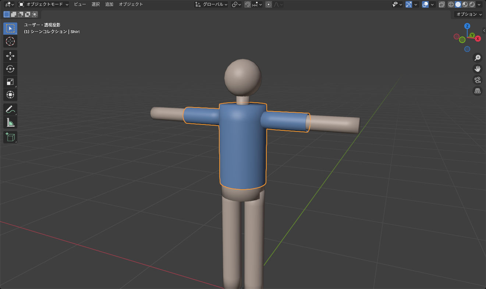
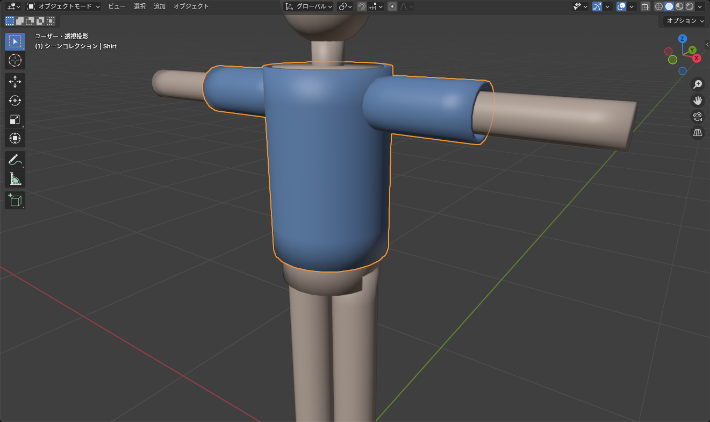

## 2 つの作り方

服の作り方は大きく 2 つあります。

| 方法 | 向いているもの | 特徴 |
|---|---|---|
| **体を複製して作る** | 体にフィットする服（シャツ、タイツ、水着、ボディスーツ） | 体の形とウェイトをそのまま流用できる。最初はこれ |
| ゼロから作る | 体から離れる服（スカート、コート、マント） | 自由だが、形合わせとウェイトが大変 |

この記事では **体を複製して作る** 方法でシャツを作ります。

## 1. 体の一部を複製する

1. 体のメッシュを選んで <kbd>Tab</kbd> で編集モードに入る
2. 面選択モード（<kbd>3</kbd>）で、シャツで覆う範囲の面を選ぶ
   - <kbd>Alt</kbd>+クリックで胴体の面ループを選び、<kbd>Ctrl</kbd>+<kbd>Numpad +</kbd> で広げると速い
   - <kbd>Alt</kbd>+<kbd>Z</kbd> の透過表示にしてボックス選択すると、背中側も一度に選べる
3. <kbd>Shift</kbd>+<kbd>D</kbd> で複製し、右クリックで **その場に置く**
4. <kbd>P</kbd> > **選択** で別オブジェクトに分離する

*分離したオブジェクトは体と同じ名前に .001 が付く。アウトライナーで「Shirt」に変える*

5. <kbd>Tab</kbd> でオブジェクトモードに戻り、新しいオブジェクトを選んで名前を `Shirt` にする。**Clothing** コレクションに移す（<kbd>M</kbd>）

::: tip
分離したオブジェクトには、体の **頂点グループ（ウェイト）** と **アーマチュアモディファイアー** がそのまま付いています。これが「体を複製する」方法のいちばんの利点で、この時点でもうボーンについてきます。
:::

## 2. 体から少し浮かせる

複製したままだと体と完全に重なっていて、Unity で表示したときにチラつきます（Z ファイティング）。

1. `Shirt` を選んで <kbd>Tab</kbd> で編集モードに入り、<kbd>A</kbd> で全選択
2. <kbd>Alt</kbd>+<kbd>S</kbd>（収縮/膨張）を押し、`0.005` と入力して <kbd>Enter</kbd>

面の向きに沿って均等に 5 mm ふくらみます。体がどこからも透けなければ OK です。

## 3. 厚みを付ける

1. オブジェクトモードで `Shirt` を選び、モディファイアーで **ソリッド化**（Solidify）を追加
2. **幅** を `0.01`、**オフセット** を `1`（外側に厚く）にする
3. ふちに厚みが見えるようになる

*裾や袖口に厚みが出て、1 枚の板ではなく布に見える*

::: warning
ソリッド化は **適用しないまま** にしておきます。FBX 書き出しのときに自動で適用されます。適用してしまうと内側の面が増えて、あとの編集が面倒になります。
:::

## 4. 形を整える

ここからは服らしい形にしていきます。

### 裾・袖口を切りそろえる

- 不要な面（手首より先、腰より下など）を面選択で選んで <kbd>X</kbd> > **面** で削除
- 裾の辺ループを <kbd>Alt</kbd>+クリックで選び、<kbd>S</kbd> → <kbd>Z</kbd> → `0` で水平にそろえる

### ゆったりさせる

体にぴったりではなく少しゆとりを持たせたいところは、**プロポーショナル編集**（<kbd>O</kbd>）をオンにして頂点を動かします。ホイールで影響範囲を変えながら、お腹まわりや袖を少し外に出します。

### 襟や袖口を足す

- 襟: 首まわりの辺ループを選んで <kbd>E</kbd> で押し出し、少し外側・上に動かす
- 袖口の折り返し: 袖口の辺ループを <kbd>E</kbd> で押し出し、<kbd>S</kbd> で少し広げる

### 左右対称に作る

体が左右対称なら、服も片側だけ編集して **ミラー** モディファイアーで反対側を作れます。複製した段階で両側がある場合は、片側（X < 0）の面を削除してからミラーを掛け、**ミラーオブジェクト** にアバターのアーマチュア（原点がワールド原点にあるもの）を指定します。ミラーは **ソリッド化より上** に置きます。

## 5. 貫通を確認する

ポーズを付けて、体が服を突き抜けないか確かめます。

1. アーマチュアを選んで <kbd>Ctrl</kbd>+<kbd>Tab</kbd> でポーズモードへ
2. 腕や腰のボーンを <kbd>R</kbd> で曲げる
3. 突き抜ける場所があれば、ポーズモードのまま `Shirt` を選んで <kbd>Tab</kbd> で編集モードに入り、その部分の頂点を <kbd>Alt</kbd>+<kbd>S</kbd> で少し膨らませる
4. 終わったらポーズモードで全選択して <kbd>Alt</kbd>+<kbd>R</kbd> で戻す

::: tip
関節の内側（脇、肘の内側）は、曲げると体が服に食い込みやすい場所です。そこだけ少し余裕を持たせておくと、Unity で動かしたときに目立ちません。完全には防げないので、程々で切り上げます。
:::

## 6. スケールを適用する

`Shirt` を選んで <kbd>Ctrl</kbd>+<kbd>A</kbd> > **全トランスフォーム**。体から分離した直後は 0 / 0° / 1 になっているはずですが、途中でオブジェクトごと拡縮していたらここで戻します。

## 次へ

ここまでで、ボーンについてくる形のあるシャツができています。次は [UV 展開とテクスチャ](/learn/avatar-clothing/uv-texture) で色を付けます。
