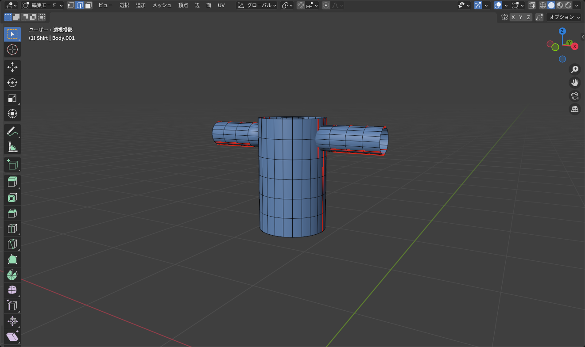
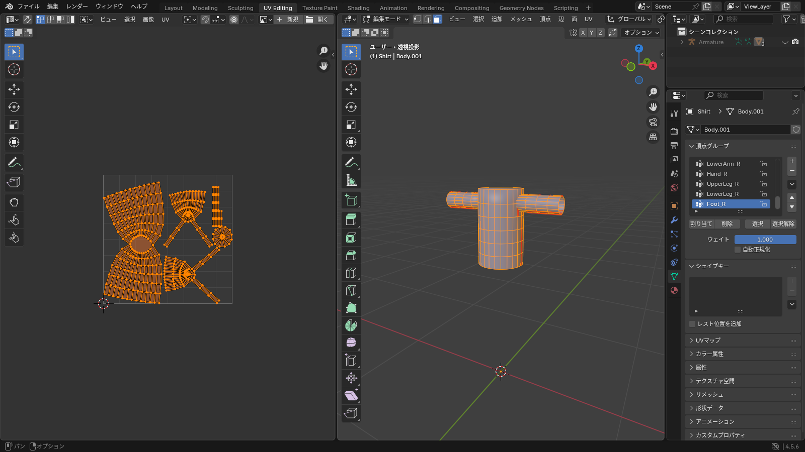

## 体の UV は使えない

体を複製して作った服には、体の UV がそのまま残っています。しかしアバターの体のテクスチャは体用のものなので、服には **新しく展開し直します**。

## 1. シームを付ける

`Shirt` を選んで <kbd>Tab</kbd> で編集モードに入り、辺選択モード（<kbd>2</kbd>）にします。本物のシャツの縫い目と同じ場所にシームを入れるのが基本です。

| 場所 | 理由 |
|---|---|
| 両脇の下から裾まで（縦） | 前身頃と後身頃を分ける |
| 肩の線 | 前後を分ける |
| 袖の付け根（一周） | 袖を切り離す |
| 袖の下側（縦） | 袖を筒から帯に開く |
| 襟の付け根（一周） | 襟を分ける |

辺を選んで <kbd>Ctrl</kbd>+<kbd>E</kbd> > **シームをマーク**。<kbd>Alt</kbd>+クリックのループ選択で一周ずつ付けていきます。


*赤い線がシーム。目立つ前面にはシームを置かない*

::: tip
ミラーモディファイアーを使っているなら、片側にシームを付けるだけで反対側にも反映されます。展開も片側だけで済み、両側が同じ UV になります（模様も左右対称になります）。左右で違う模様にしたいときは、先にミラーを適用してから展開します。
:::

## 2. 展開する

1. <kbd>A</kbd> で全選択
2. <kbd>U</kbd> > **アングルベースで展開**（Unwrap > Angle Based）
3. **UV Editing** ワークスペースに切り替えて結果を見る


*前身頃・後身頃・袖・襟に分かれていれば成功*

確認するポイントは [UV 展開](/learn/materials/uv-unwrap) と同じです。

- ストレッチ表示で赤いところがないか
- 島が重なっていないか
- 大きく見える部分（前身頃）に広い面積が使われているか

必要なら UV エディターで **UV > パック**（Pack Islands）を実行して、きれいに並べ直します。

## 3. マテリアルを作る

1. マテリアルプロパティで **新規** を押し、名前を `Shirt` にする
2. 複製元の体のマテリアルが残っていたら、スロットから **−** で消す。残すのは `Shirt` 1 つだけ

::: warning
体から複製したメッシュには **体のマテリアルスロット** が残っています。スロット一覧で `Body` のようなマテリアルを選び、編集モードで「選択」を押して何も選ばれないことを確認してから消してください。残したまま書き出すと、Unity で空のマテリアルスロットが増えます。
:::

## 4. テクスチャを描く

### 下敷きを書き出す

UV エディターで **UV > UV 配置をエクスポート**、サイズを 2048 にして `shirt_uv.png` を書き出します。

### 画像を作る

画像編集ソフトで `shirt_uv.png` を開き、次のように描きます。

1. UV の線のレイヤーを一番上にして、不透明度を下げる
2. 下に新しいレイヤーを作り、服の色で塗りつぶす
3. 前身頃の島にボタン、ポケット、模様などを描く
4. 袖口・裾の島には縫い目や折り返しの線を描く
5. UV の線のレイヤーを非表示にして、`Shirt_Color.png` として書き出す

::: tip
Blender の中で下塗りをするなら、**Texture Paint** ワークスペースで新しい画像を作り、ドローブラシで色分けします。細かい模様は画像編集ソフトの方が楽です（[画像テクスチャ](/learn/materials/image-texture)）。
:::

### 貼る

1. **Shading** ワークスペースで、シェーダーエディターに **画像テクスチャ** ノードを追加
2. **開く** で `Shirt_Color.png` を選び、**カラー** を **ベースカラー** につなぐ
3. <kbd>Z</kbd> > マテリアルプレビューで確認

## 5. 厚みの内側の色

ソリッド化で付けた厚みの内側は、表と同じ UV が使われます。表の模様が裏側にも出るので、裏地の色を変えたいときは、ソリッド化モディファイアーの **マテリアル > オフセット** で別のマテリアルスロットを指定します。マテリアル数が増えるので、気にならなければそのままで構いません。

## ファイルの整理

ここまでで作ったファイルを、1 つのフォルダにまとめておきます。

```
Shirt/
├── shirt_project.blend
├── shirt_uv.png          ← 下敷き（配布には不要）
└── Textures/
    └── Shirt_Color.png   ← Unity に持っていく
```

次は [ウェイトの転送](/learn/avatar-clothing/weight-transfer) で、体の動きに正しくついてくるようにします。
