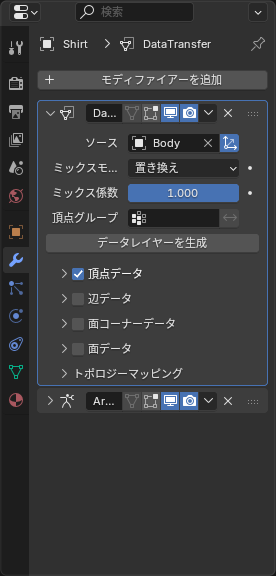
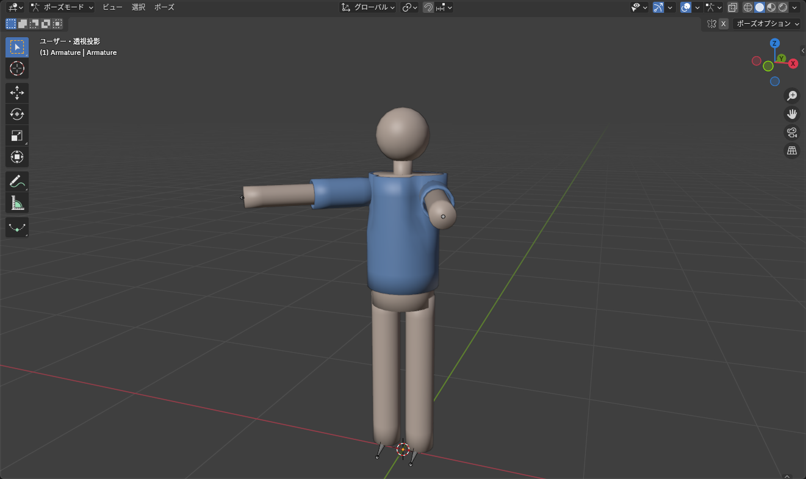

## なぜ転送するのか

体を複製して作った服には、複製した時点のウェイトが付いています。しかし、形を整えるうちに次のことが起きます。

- 押し出しで足した襟や袖口には、ウェイトが **ない**（どのボーンにも付いていない）
- プロポーショナル編集で動かした頂点のウェイトは、体の同じ場所と **ずれる**

結果として、動かしたときに襟が置き去りになったり、体と服が別々に動いて貫通したりします。これを直すのに、**体のウェイトを服に写し直す** のがいちばん確実です。

自動ウェイト（<kbd>Ctrl</kbd>+<kbd>P</kbd> > 自動のウェイトで）でも動きますが、体と服で計算結果が微妙に違うため、関節で貫通しやすくなります。**服のウェイトは体から転送する** のが定石です。

## 方法 1: データ転送モディファイアー（おすすめ）

転送元（体）が隠れていると動かないので、体を表示しておきます。

1. `Shirt` を選び、モディファイアーで **データ転送**（Data Transfer）を追加
2. **ソース** にアバターの体のメッシュを指定
3. **頂点データ** にチェックを入れ、その中の **頂点グループ** を選ぶ
4. マッピングを **最近接面を補間**（Nearest Face Interpolated）にする
5. **データレイヤーを生成**（Generate Data Layers）ボタンを押す。服に体と同じ名前の頂点グループが作られる
6. モディファイアーの順番を **アーマチュアより上** に動かす

*「データレイヤーを生成」を押し忘れると、頂点グループがないので何も転送されない*

この時点でポーズを付けると、服が体と同じように動くはずです。

### 適用する

転送がうまくいっているのを確認したら、データ転送モディファイアーを **適用** します。適用せずに書き出しても FBX 書き出し時に適用されますが、ウェイトを手で直したいときは先に適用しておく必要があります。

::: warning
ミラーモディファイアーを使っている場合、データ転送は **ミラーより下** に置きます（ミラーで作られた反対側にも転送されるように）。順番は上から ミラー → データ転送 → ソリッド化 → アーマチュア です。
:::

## 方法 2: ウェイトペイントモードの「ウェイトを転送」

モディファイアーを使わない方法です。

1. オブジェクトモードで **体** を選び、<kbd>Shift</kbd>+クリックで **服** を選ぶ（服がアクティブ）
2. ウェイトペイントモードに入る
3. ヘッダーの **ウェイト > ウェイトを転送**（Weights > Transfer Weights）
4. 左下のパネルで **頂点マッピング** を **最近接面を補間** に、**ソースレイヤーの選択** を **名前順** に、**宛先レイヤー** を **すべてのレイヤー** にする

一度きりの転送ならこちらが手早いです。

## 確認する

1. アーマチュアを選び、<kbd>Ctrl</kbd>+<kbd>Tab</kbd> でポーズモードへ
2. 腕を上げる、腰を曲げる、脚を上げる、の 3 つくらいを試す
3. 服が体と一緒に動き、突き抜けないことを確認

*体と服のウェイトが同じなら、曲げても間隔が保たれる*

## 手直しが必要なとき

襟や袖口など、体にない部分は **近くの体の部分から補間** されるので、たいてい問題ありません。それでもおかしいときは [ウェイトペイント](/learn/rigging/weight-paint) で直します。

- 襟が首についてこない → `Neck` のグループを選び、襟をウェイト 1 で塗る
- 袖口が手に引っ張られる → `Hand_L` のグループを選び、袖口をウェイト 0 で塗る
- 境目がガタつく → **ウェイト > スムーズ** を数回

直し終わったら **ウェイト > すべて正規化** と **ウェイト > 制限**（制限数 4）を実行しておくと、Unity で安全です。

## 不要な頂点グループを消す

転送すると、体の頂点グループが **すべて** 服にも作られます。服に関係ないボーン（脚、指など）のグループは空のまま残っています。空のグループがあっても Unity での動作には影響しないので、そのままで構いません。整理したいときは、頂点グループ一覧で選んで **−** で消します。Cats アドオンには空のグループをまとめて消す機能（Remove Zero Weight Bones）があります。

## よくあるつまずき

- **転送しても何も変わらない**: 「データレイヤーを生成」を押していないか、ソースの体が非表示です
- **服が元の位置に戻ってしまう**: データ転送モディファイアーがアーマチュアより下にあります。順番を入れ替えてください
- **一部だけ変な方向に引っ張られる**: 転送元の体のウェイトが、そもそもその部分で変です。体を直すか、その部分だけ手で塗ります
- **ミラーした側のウェイトがおかしい**: ミラーより上にデータ転送があります。下に移動してください
