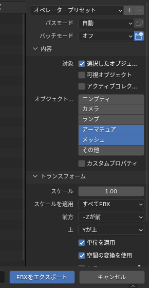

## 書き出す前のチェック

書き出してから Unity で気づくと、Blender に戻ってやり直しになります。先に次を確認します。

| 確認 | 方法 |
|---|---|
| スケール・回転が適用されている | 服を選び、サイドバーで 0 / 0° / 1 になっているか。違えば <kbd>Ctrl</kbd>+<kbd>A</kbd> > 全トランスフォーム |
| 重複頂点がない | 編集モードで全選択 → <kbd>M</kbd> > 距離で |
| 法線がそろっている | オーバーレイ「面の向き」で全部青。違えば <kbd>Shift</kbd>+<kbd>N</kbd> |
| ウェイトがある | ポーズを付けてついてくる |
| マテリアルスロットが服のものだけ | 体のスロットが残っていれば削除 |
| 名前が英語 | オブジェクト名、マテリアル名、頂点グループ名 |
| 三角形数 | 統計オーバーレイで確認。目安は 1 着 1〜2 万 |
| ポーズが戻っている | ポーズモードで全選択 → <kbd>Alt</kbd>+<kbd>R</kbd>、<kbd>Alt</kbd>+<kbd>G</kbd> |

## 何を書き出すか

**服のメッシュ** と **アバターのアーマチュア** の 2 つです。体のメッシュは含めません。

- Modular Avatar は、服が持っているアーマチュアをアバターのアーマチュアに統合します。そのため、服はアバターと **同じ名前のボーンを持つアーマチュア** と一緒に書き出す必要があります
- アバターのアーマチュアをそのまま一緒に書き出せば、名前も構造も同じなので、そのまま統合できます

1. オブジェクトモードで `Shirt` を選ぶ
2. <kbd>Shift</kbd>+クリックでアーマチュアを選ぶ
3. ファイル > エクスポート > FBX (.fbx)

## 書き出し設定


*一度設定したら、右上の「オペレータープリセット」の + で保存しておくと次から選ぶだけで済む*

| 項目 | 値 | 理由 |
|---|---|---|
| **内容 > 対象** | 選択したオブジェクト | 体や他のものを含めない |
| **トランスフォーム > トランスフォームを適用** | **オフ**（既定） | 実験的な機能で、アーマチュアでは正しく動かないことがわかっている |
| **内容 > オブジェクトタイプ** | アーマチュア、メッシュ | ライトやカメラは不要 |
| **トランスフォーム > スケール** | 1.00 | |
| **トランスフォーム > スケールを適用** | FBX すべて（FBX All） | Unity で Scale が 1 になる |
| **トランスフォーム > 前方 / 上** | -Z が前 / Y が上（既定） | Unity の座標系に合う |
| **トランスフォーム > 単位を適用** | オン | |
| **トランスフォーム > 空間の変換を使用** | オン | |
| **ジオメトリ > モディファイアーを適用** | オン（シェイプキーがあるときはオフ） | ソリッド化・ミラーが反映される。アーマチュアは除外される |
| **ジオメトリ > スムージング** | 面 | 法線の情報が正しく渡る |
| **アーマチュア > リーフボーン追加** | **オフ** | オンだと `_end` ボーンが増えて Unity でごちゃつく |
| **アーマチュア > プライマリボーン軸 / セカンダリボーン軸** | Y / X（既定） | |
| **ベイクアニメーション** | オフ | アニメーションは入れない |

ファイル名を `Shirt.fbx` にして **FBX をエクスポート** を押します。

::: warning
**シェイプキーがあるメッシュ** は、「モディファイアーを適用」をオンにすると **シェイプキーが書き出されません**。その場合は、先にソリッド化などを手で適用します（Blender はシェイプキーのあるメッシュにモディファイアーを適用できないので、一時的にシェイプキーを退避する必要があります）。書き出し時は「モディファイアーを適用」をオフにします。シェイプキーを使わない服なら、オンのままで構いません。
:::

## 書き出したファイルを確認する

書き出した FBX を、**別の新しい Blender ファイル** に読み込んでみると、Unity で起きることをある程度確認できます。

- 服とアーマチュアが読み込まれる
- 大きさが元と同じ
- ポーズモードでボーンを動かすと服がついてくる

::: tip
Unity 側で「大きさが 100 倍」になったら、「スケールを適用」が **FBX すべて** 以外になっているか、Blender 側でスケールが未適用です。「向きが横倒し」なら、Blender 側でアーマチュアの回転が未適用です。
:::

## テクスチャも一緒に

FBX にはテクスチャは含めません（含められますが、Unity では別ファイルの方が扱いやすい）。[UV 展開とテクスチャ](/learn/avatar-clothing/uv-texture) で作った `Textures/Shirt_Color.png` を、FBX と同じフォルダに置いておきます。

```
Shirt/
├── Shirt.fbx
└── Textures/
    └── Shirt_Color.png
```

次は [Unity で着せる](/learn/avatar-clothing/unity-setup) に進みます。
