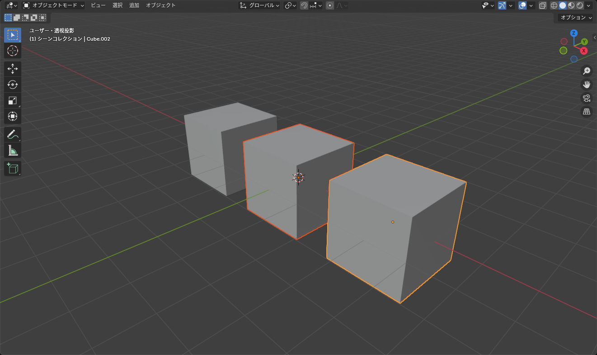
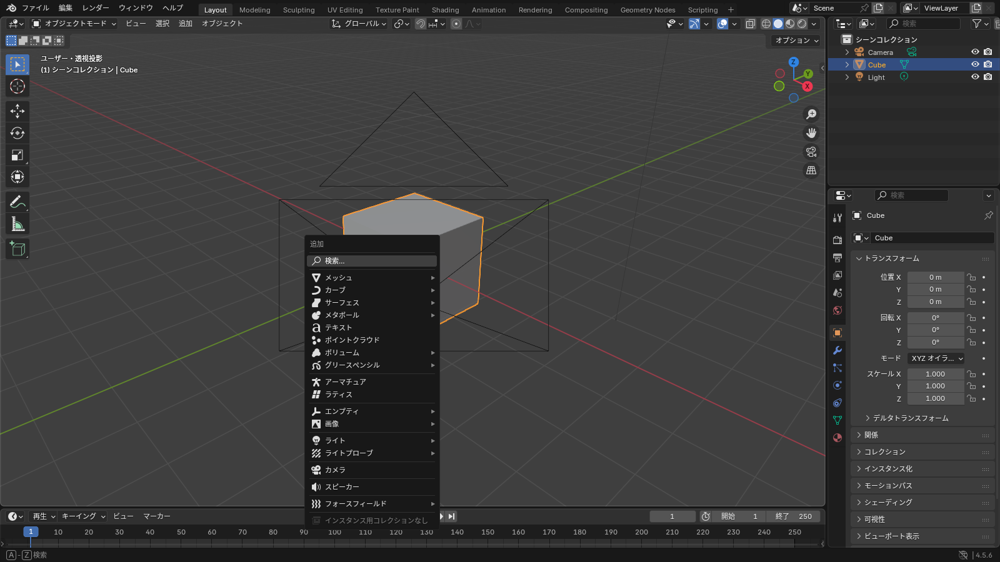

## 選択する

Blender 4.5 の標準設定では **左クリックで選択** します。

| 操作 | 動き |
|---|---|
| クリック | そのオブジェクトだけを選択 |
| <kbd>Shift</kbd>+クリック | 選択に追加。すでに選択中のものを Shift+クリックすると選択から外れる |
| 何もないところをクリック | 選択解除 |
| <kbd>A</kbd> | 全選択 |
| <kbd>Alt</kbd>+<kbd>A</kbd> | 全選択解除 |
| <kbd>Ctrl</kbd>+<kbd>I</kbd> | 選択を反転 |
| 左ドラッグ | ボックス選択（ツールバーの「選択」が「ボックス選択」のとき） |
| <kbd>B</kbd> | ボックス選択（一時的） |
| <kbd>C</kbd> | サークル選択。ホイールで半径を変え、右クリックか <kbd>Esc</kbd> で終了 |

このページの操作（選択・追加・削除・複製）は、下の 3D ビューで順番に試せます。

::: practice select
:::

### 「選択」と「アクティブ」の違い

複数選択すると、**最後に選択したもの** が「アクティブオブジェクト」になり、他より明るいオレンジの枠で表示されます。

*薄いオレンジが選択中、濃いオレンジがアクティブ。プロパティに表示されるのはアクティブなもの*

プロパティに表示されるのも、親子付け（<kbd>Ctrl</kbd>+<kbd>P</kbd>）で親になるのも、アクティブオブジェクトです。「選択の順番が結果に影響する」操作が Blender には多いので、この違いは早めに覚えておくと迷いません。

::: tip
アウトライナーで名前をクリックしても選択できます。小さいものや重なっているものは、アウトライナーから選ぶ方が確実です。
:::

## 追加する

3D ビューポートにマウスを置いて <kbd>Shift</kbd>+<kbd>A</kbd> を押すと、追加メニューが出ます。

*メッシュ > 立方体、円柱、UV 球などがモデリングの出発点になる*

よく使うのは **メッシュ**（Mesh）の中の次の 4 つです。

| 名前 | 用途 |
|---|---|
| 平面（Plane） | 板状のもの、地面 |
| 立方体（Cube） | 箱型のもの。ボックスモデリングの出発点 |
| 円柱（Cylinder） | 腕・脚・筒状のもの |
| UV 球（UV Sphere） | 頭、ボール |

追加した直後、画面左下に **「立方体を追加」** のような小さなパネルが出ます。ここで大きさや分割数を変えられます。他の操作をするとこのパネルは消えるので、分割数を変えたいときは追加した直後に行ってください（<kbd>F9</kbd> で開き直せます）。

::: warning
新しいオブジェクトは **3D カーソル**（赤白の輪）の位置に追加されます。変なところに追加されたら、<kbd>Shift</kbd>+<kbd>S</kbd> > **カーソル → ワールド原点** でカーソルを中央に戻してから追加し直してください。
:::

## 削除する

選択して <kbd>X</kbd> を押し、「削除」を選びます。<kbd>Delete</kbd> キーなら確認なしで削除されます。

## 複製する

| キー | 動き |
|---|---|
| <kbd>Shift</kbd>+<kbd>D</kbd> | 複製。マウスを動かして位置を決め、クリックで確定。<kbd>Esc</kbd> か右クリックで同じ位置に置く |
| <kbd>Alt</kbd>+<kbd>D</kbd> | リンク複製。見た目は同じだが **メッシュデータを共有** する。片方を編集すると両方変わる |

同じパーツ（ボタン、リベットなど）をたくさん置くときはリンク複製が便利です。あとで片方だけ変えたくなったら、**オブジェクト > 関係 > シングルユーザー化 > オブジェクトとデータ** で切り離せます。

## 統合する

複数のオブジェクトを選んで <kbd>Ctrl</kbd>+<kbd>J</kbd> を押すと、**アクティブオブジェクト** に他をまとめて 1 つのオブジェクトにします。名前やモディファイアーはアクティブ側のものが残ります。

## 隠す

| キー | 動き |
|---|---|
| <kbd>H</kbd> | 選択したものを隠す |
| <kbd>Shift</kbd>+<kbd>H</kbd> | 選択したもの以外を隠す |
| <kbd>Alt</kbd>+<kbd>H</kbd> | 隠したものをすべて表示 |

アバターの服を作るときは、体を隠して服だけ編集したり、その逆をしたりを頻繁に行います。アウトライナーの目のアイコンでも同じことができます。
