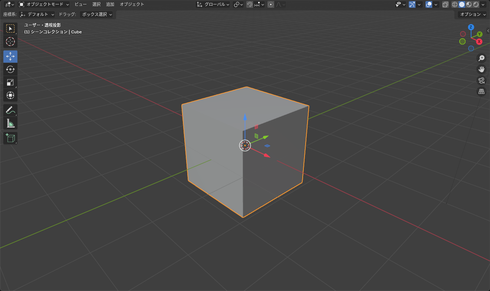
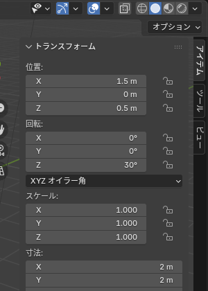
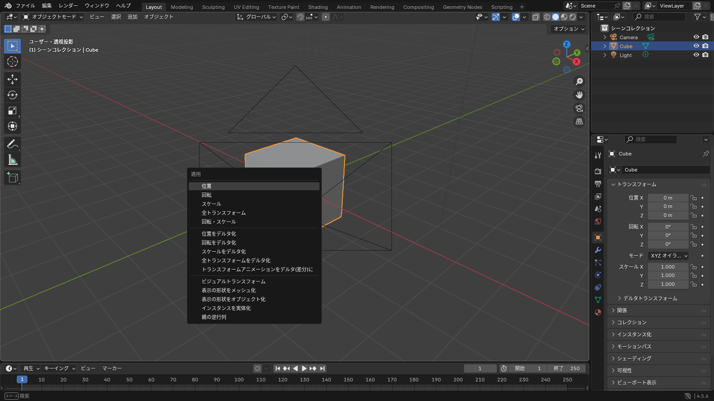

## 3 つのキー

3D ビューポートにマウスを置き、オブジェクトを選択してキーを押します。マウスを動かして調整し、**左クリックで確定**、**右クリックか <kbd>Esc</kbd> でキャンセル** です。

| キー | 操作 | 日本語 UI の表記 |
|---|---|---|
| <kbd>G</kbd> | 移動（Grab / Move） | 移動 |
| <kbd>R</kbd> | 回転（Rotate） | 回転 |
| <kbd>S</kbd> | 拡大縮小（Scale） | スケール |

ツールバーの「移動」「回転」「スケール」ツールを選ぶと、オブジェクトに **ギズモ**（矢印や輪）が表示され、ドラッグでも操作できます。

*矢印をドラッグすると軸に沿って動く。中央の白い円をドラッグすると自由に動く*

## 軸を固定する

キーを押した直後に <kbd>X</kbd> / <kbd>Y</kbd> / <kbd>Z</kbd> を押すと、その軸に沿ってだけ動きます。

- <kbd>G</kbd> → <kbd>Z</kbd>: 上下にだけ移動
- <kbd>R</kbd> → <kbd>Z</kbd>: Z 軸を中心に回転（上から見て回る）
- <kbd>S</kbd> → <kbd>Shift</kbd>+<kbd>Z</kbd>: Z 軸 **以外**（XY 平面）で拡縮。平べったくするときに

軸のキーをもう一度押すと、グローバル軸（ワールドの XYZ）とローカル軸（オブジェクト自身の XYZ）が切り替わります。

## 数値で正確に動かす

キーを押したあと、そのまま数字を入力すると正確な量で変形できます。

- <kbd>G</kbd> → <kbd>Z</kbd> → `1.5` → <kbd>Enter</kbd>: Z 方向に 1.5 m 移動
- <kbd>R</kbd> → <kbd>X</kbd> → `90` → <kbd>Enter</kbd>: X 軸で 90° 回転
- <kbd>S</kbd> → `0.5` → <kbd>Enter</kbd>: 半分の大きさに

<kbd>Ctrl</kbd> を押しながら動かすと、きりのよい値（1 m、5° など）にスナップします。<kbd>Shift</kbd> を押しながらだと細かく動きます。

## サイドバーで直接入力する

<kbd>N</kbd> でサイドバーを開くと、「アイテム」タブに位置・回転・スケールの数値があります。クリックして値を入力すれば、その通りの状態になります。

*値の上でドラッグしても変えられる。X の欄で下にドラッグすると X / Y / Z をまとめて入力できる*

## トランスフォームの適用

オブジェクトモードで移動・回転・スケールしても、**メッシュの頂点は動いていません**。オブジェクト全体が「位置・回転・スケール」という値を持ち、それを通して表示されているだけです。

これが問題になるのは、次のようなときです。

- スケールを 2 にしたオブジェクトに「厚さ 0.01」のソリッド化モディファイアーを付けると、厚さが 0.02 になる
- Unity に書き出したとき、スケールが 100 や 0.01 になっていて大きさがおかしい
- 回転したままのオブジェクトにミラーを掛けると、鏡の向きがずれる

<kbd>Ctrl</kbd>+<kbd>A</kbd> > **全トランスフォーム**（All Transforms）を実行すると、今の位置・回転・スケールがメッシュに焼き込まれ、値は 0 / 0° / 1 に戻ります。

*アバターの服を作るときは、書き出す前に必ず「回転とスケール」または「全トランスフォーム」を適用する*

::: warning
**スケールが 1 以外のまま編集モードに入らない** のがコツです。オブジェクトを置いて大きさを決めたら、すぐに <kbd>Ctrl</kbd>+<kbd>A</kbd> > **スケール** を適用してから編集を始めてください。
:::

## よくあるつまずき

- **動かしたつもりが回っている**: キーを押し間違えています。右クリックでキャンセルして押し直してください
- **軸に沿って動かない**: ギズモの矢印ではなく中央をドラッグしています。矢印をつかむか、<kbd>G</kbd> のあとに軸キーを押してください
- **動かすと他のものまで動く**: 親子関係があります。親を動かすと子も一緒に動きます。子だけ動かしたいなら子を選択してください
