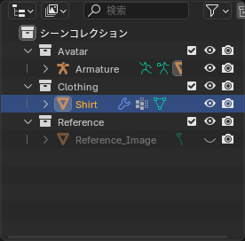

## アウトライナーの見方

画面右上の **アウトライナー** には、シーンに含まれるものが階層で表示されます。


*三角を押すと中を展開。右側の目とカメラのアイコンで表示 / レンダリングの切り替え*

| アイコン | 意味 |
|---|---|
| 目 | ビューポートでの表示 / 非表示。クリックで切り替え、ドラッグでまとめて切り替え |
| カメラ | レンダリングに含めるかどうか。モデリングだけなら気にしなくてよい |
| チェックボックス | コレクションを丸ごと除外する。除外したコレクションは計算もされないので、重いシーンで便利 |
| 矢印（カーソル） | 選択できるかどうか。背景や参考用のモデルを誤って動かさないようにロックする |

アイコンが足りないときは、アウトライナー右上の **フィルター**（漏斗のアイコン）から表示するものを増やせます。「選択可能」のアイコンはここでオンにします。

## コレクション

**コレクション** はオブジェクトをまとめるフォルダのようなものです。アバターの作業では、次のように分けておくと見失いません。

```
Scene Collection
├── Avatar        ← 元のアバター（体・アーマチュア）
├── Clothing      ← 作っている服
└── Reference     ← 参考画像など
```

### 作る・移動する

- **新規作成**: アウトライナーの空いているところを右クリック > **新規コレクション**
- **オブジェクトを移動**: 3D ビューポートで選択して <kbd>M</kbd>。一覧から移動先を選ぶ。「新規コレクション」を選ぶとその場で作れる
- **ドラッグ**: アウトライナー上でオブジェクトを別のコレクションへドラッグしても移動できる

### 名前を変える

アウトライナーで名前をダブルクリック、または 3D ビューポートで <kbd>F2</kbd> を押すと名前を変えられます。

::: tip
名前は **英語** で付けてください（`Shirt`、`Skirt_L` など）。Unity に持っていったとき、日本語の名前は扱いにくいことがあります。また、左右対称のパーツは `_L` / `_R` のように末尾で区別すると、後のミラー系の機能で認識されます。
:::

## 親子関係

アウトライナーでは、子は親の下に入れ子で表示されます。アーマチュアに親子付けされたメッシュは、アーマチュアの下に並びます。

- **親子付け**: 子 → 親の順に選択して <kbd>Ctrl</kbd>+<kbd>P</kbd>。最後に選んだ（アクティブ）ものが親になる
- **解除**: 子を選んで <kbd>Alt</kbd>+<kbd>P</kbd> > **トランスフォームを維持してクリア**（Clear and Keep Transformation）

親を動かすと子も一緒に動きます。アバターのアーマチュアを動かすと、親子付けされた体や服も付いてくるのはこの仕組みです。

## 隠す・ロックする

編集したいもの以外を隠すのは、作業を速くする基本です。

| 方法 | 動き |
|---|---|
| 目のアイコン | クリックしたものを非表示 |
| 目のアイコンを <kbd>Ctrl</kbd>+クリック | それ以外を全部非表示 |
| 3D ビューポートで <kbd>H</kbd> / <kbd>Alt</kbd>+<kbd>H</kbd> | 選択物を隠す / 全部表示 |

::: warning
アウトライナーの **チェックボックス（除外）** を外したコレクションは、3D ビューポートで <kbd>Alt</kbd>+<kbd>H</kbd> を押しても表示されません。「あるはずのものが出てこない」ときは、コレクションのチェックが外れていないか見てください。
:::

## 要らないデータを消す

削除したはずのマテリアルや画像が、ファイルの中に残っていることがあります。**ファイル > クリーンアップ > 未使用データブロック**（File > Clean Up > Unused Data-Blocks）で、どこからも使われていないデータをまとめて消せます。アウトライナーの表示モードを「孤立データ」にすると、何が残っているか確認できます。
