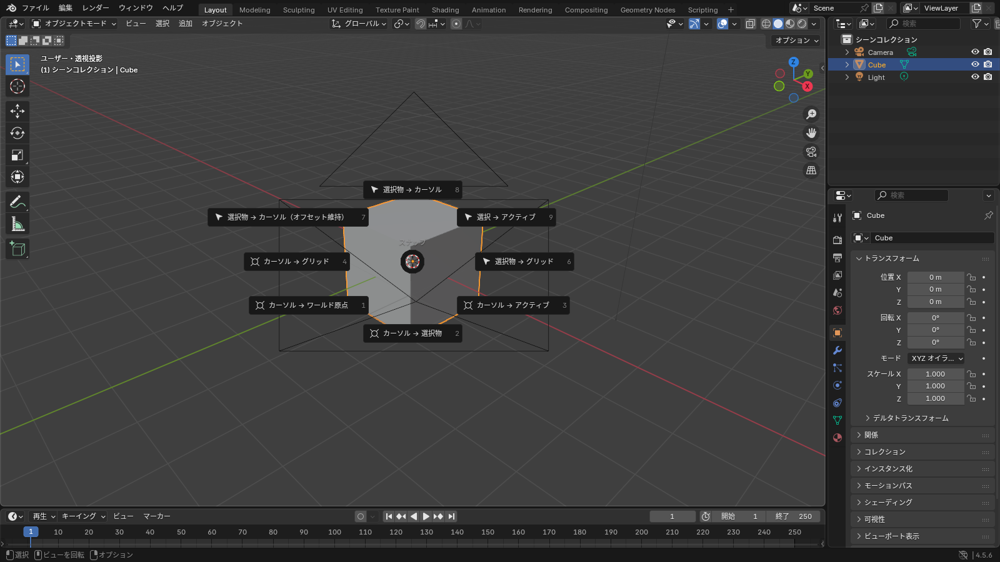
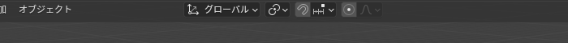

## 原点

オブジェクトには **原点**（小さなオレンジの点）があります。回転やスケールの中心で、位置の値もこの点の座標です。

立方体を編集モードで片側に伸ばすと、原点は元の場所に残ります。すると「見た目の中心」と「原点」がずれて、回転したときに思った場所で回らなくなります。

直すときは、オブジェクトモードで **オブジェクト > 原点を設定**（Object > Set Origin）から選びます。

| 項目 | 動き |
|---|---|
| 原点をジオメトリへ移動 | 原点をメッシュの中心に動かす。いちばんよく使う |
| 原点を 3D カーソルへ移動 | 原点を 3D カーソルの位置に動かす。回転の中心を決めたいときに |
| ジオメトリを原点へ移動 | メッシュの方を原点に寄せる |

::: tip
アバターの服の原点は、**ワールド原点（0, 0, 0）に置いておく** のが無難です。体のメッシュと同じ原点にしておくと、Unity に持っていったときに位置がずれません。<kbd>Shift</kbd>+<kbd>S</kbd> > **カーソル → ワールド原点** のあと、**原点を 3D カーソルへ移動** でそろえられます。
:::

## 3D カーソル

赤白の輪が **3D カーソル** です。新しいオブジェクトはここに追加され、ピボットを「3D カーソル」にするとここを中心に回転できます。

<kbd>Shift</kbd>+<kbd>S</kbd> でスナップのパイメニューが開きます。

*「カーソル → 選択物」「選択物 → カーソル」の 2 つを覚えればほとんど足りる*

| 項目 | 動き |
|---|---|
| カーソル → ワールド原点 | 3D カーソルを (0, 0, 0) に戻す |
| カーソル → 選択物 | 選択したものの中心にカーソルを動かす |
| 選択物 → カーソル | 選択したものをカーソルの位置に動かす |

<kbd>Shift</kbd>+右クリックで、クリックした場所にカーソルを置くこともできます。意図せずカーソルが動いてしまったら「カーソル → ワールド原点」で戻します。

## ピボットポイント

複数のものを回転・拡縮するとき、**何を中心にするか** がピボットポイントです。3D ビューポートのヘッダー中央にあるプルダウンで切り替えます。

*左がピボットポイント、その右の磁石アイコンがスナップ*

| 項目 | 動き |
|---|---|
| 中点（Median Point） | 選択したものの平均の位置。既定値 |
| 個々の原点（Individual Origins） | それぞれが自分の原点を中心に回る・縮む。ボタンを一斉に小さくするときなどに |
| 3D カーソル | カーソルを中心に |
| アクティブ要素 | アクティブなものを中心に |

編集モードでも同じ考え方です。「個々の原点」にして面を選んで <kbd>S</kbd> を押すと、面がそれぞれ自分の中心に向かって縮みます。

## スナップ

ヘッダーの **磁石アイコン** をオンにすると、動かしたものが他の要素に吸い付きます。横のプルダウンで「何に」吸い付くかを選びます。

| スナップ先 | 用途 |
|---|---|
| 増分 | グリッドに合わせて動く |
| 頂点 | 別のメッシュの頂点にぴったり合わせる |
| 面 | 面の上に沿わせる。服を体の表面に沿わせるときに使う |

磁石をオンにしなくても、移動中に <kbd>Ctrl</kbd> を押している間だけスナップが効きます。普段はオフにしておき、必要なときだけ <kbd>Ctrl</kbd> を押す使い方が楽です。

## プロポーショナル編集

<kbd>O</kbd> で **プロポーショナル編集** をオンにすると、選択した頂点だけでなく **周囲の頂点もなだらかに** 一緒に動きます。服のシルエットをふんわり調整するときに便利です。

- 移動中にホイールを回すと、影響する範囲（円）の大きさが変わる
- ヘッダーの横のアイコンで、減衰の形（スムーズ、シャープなど）を選べる

::: warning
プロポーショナル編集を **オンにしたまま忘れる** と、1 点を動かしただけで周りが全部ついてきて驚きます。思った以上に動くときは、ヘッダーの同心円のアイコンがオンになっていないか確認してください。
:::
