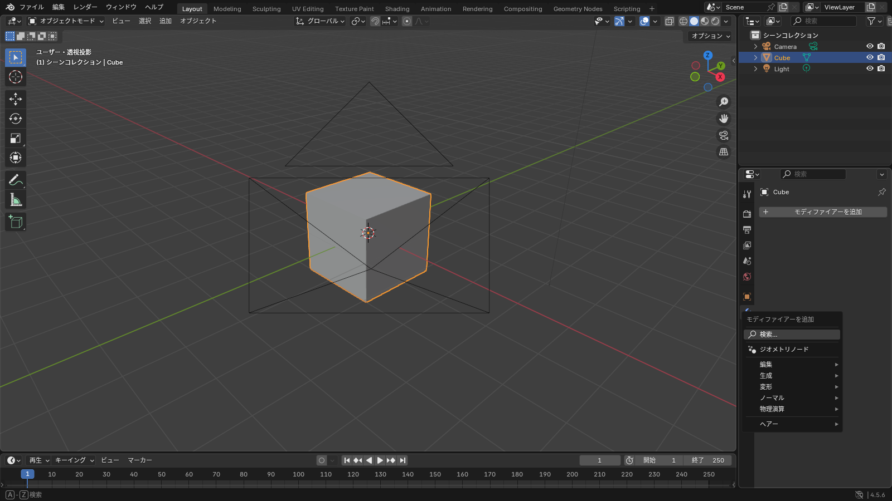
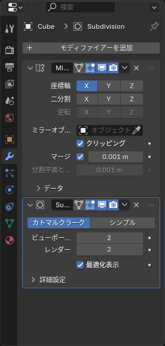

## モディファイアーとは

**モディファイアー** は、メッシュに「後から掛ける加工」です。元のメッシュは変えずに、結果だけが表示されます。

- 掛けた加工は、いつでもオフにしたり外したりできる
- 数値を変えると結果がすぐ変わる
- 最後に **適用**（Apply）すると、結果が本物のメッシュになる

「左右対称に作る」「なめらかにする」「厚みを付ける」といった作業を、モディファイアーに任せるのが Blender の基本的な進め方です。

## 追加する

1. オブジェクトを選択する
2. プロパティの **モディファイアープロパティ**（スパナのアイコン）を開く
3. **モディファイアーを追加** を押して、一覧から選ぶ

*「生成」「変形」などの分類に分かれている*

## 最初に覚える 4 つ

### ミラー（Mirror）

片側だけ作ると、反対側に鏡写しが作られます。左右対称のものはほとんどこれで作ります。

- **軸**: 既定は X。左右対称なら X のまま
- **クリッピング**: オンにすると、中央の頂点が反対側へ突き抜けなくなる。基本オン
- **マージ**: 中央で接する頂点をくっつける。基本オン

ミラーの基準は **オブジェクトの原点** です。原点がメッシュの中央にないと、鏡が変な場所にできます。

### サブディビジョンサーフェス（Subdivision Surface）

メッシュを細かく分割してなめらかにします。少ない頂点でカーブを作るときに使います。

- **ビューポート** と **レンダー** のレベルを別々に設定できる。作業中は 1 か 2 で十分
- 角をとがらせたい場所には、ループカットで辺を近くに足す（詳しくは [ミラーとスムーズ](/learn/modeling/mirror-smooth)）

### ソリッド化（Solidify）

板状のメッシュに厚みを付けます。服は「面」だけで作ってソリッド化で厚みを出すと、作業が楽で頂点数も抑えられます。

- **幅**: 厚さ。アバターの服なら 0.005 ～ 0.02 くらい
- **オフセット**: どちら側に厚くするか。-1 で内側、1 で外側

### アーマチュア（Armature）

ボーンでメッシュを動かすためのものです。<kbd>Ctrl</kbd>+<kbd>P</kbd> で親子付けすると自動で追加されます。詳しくは [リギング](/learn/rigging) で扱います。

*上から順に適用される。ミラー → サブディビジョンの順にしないと、中央に継ぎ目が出る*

## 順番が大事

モディファイアーは **上から順に** 処理されます。順番を入れ替えると結果が変わります。

| よい順番 | 悪い順番 |
|---|---|
| ミラー → ソリッド化 → サブディビジョン | サブディビジョン → ミラー（中央がなめらかにつながらない） |
| ミラー → アーマチュア | アーマチュア → ミラー（動かすと左右が壊れる） |

順番は、各モディファイアーの右上の「︙」をドラッグするか、メニューの「上へ移動 / 下へ移動」で入れ替えます。

## 表示の切り替えと適用

各モディファイアーの上部には、小さなアイコンが並んでいます。

| アイコン | 意味 |
|---|---|
| 編集モード | 編集モード中も結果を表示する |
| ビューポート | 3D ビューポートに結果を表示する。重いときはオフにする |
| レンダー | レンダリングに含める |

**適用** は、モディファイアーの「v」メニュー（または上にマウスを置いて <kbd>Ctrl</kbd>+<kbd>A</kbd>）から行います。適用すると元に戻せないので、必ず保存してから行ってください。

::: warning
FBX に書き出すときは、**書き出し設定の「モディファイアーを適用」** で自動的に適用されるため、作業用の .blend では適用しないままにしておくのがおすすめです。あとから厚みや分割数を変えられます。ただし **アーマチュアのモディファイアーは適用しません**（適用すると動かなくなります）。
:::

## よくあるつまずき

- **ミラーの反対側が出ない**: 原点がメッシュの端にあります。**オブジェクト > 原点を設定 > 原点を 3D カーソルへ移動**（カーソルは中央に）で直します
- **ミラーで中央が割れる・重なる**: 「クリッピング」と「マージ」をオンにします。すでに中央線を越えた頂点があるなら、編集モードで中央の頂点を選んで <kbd>S</kbd> → <kbd>X</kbd> → `0` で X = 0 にそろえます
- **サブディビジョンで全体が丸くなりすぎる**: 分割の前に、角にしたい場所の近くにループカットで辺を足します
