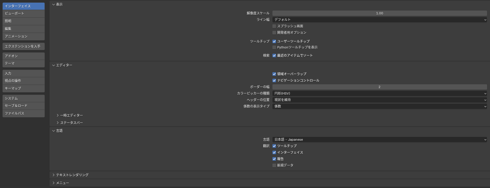
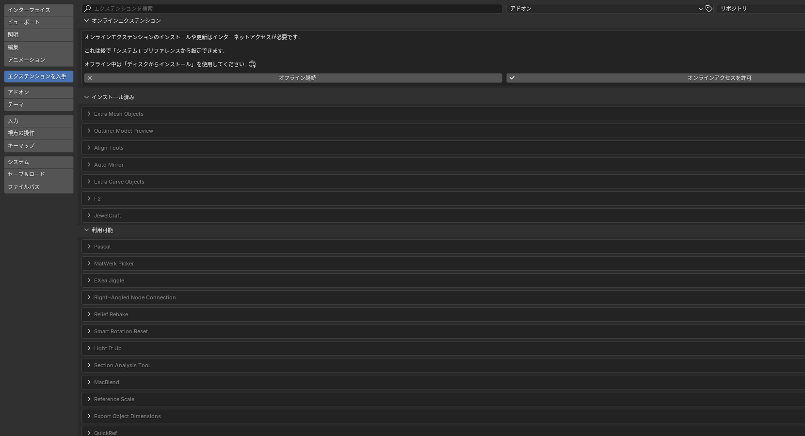

## どのバージョンを入れるか

このサイトは **Blender 4.5 LTS** を前提にしています。LTS（長期サポート版）は 2 年間バグ修正が続き、アドオンの対応も安定しているので、普段の作業にはこれを選びます。

- ダウンロード: [blender.org/download/lts/](https://www.blender.org/download/lts/) から **4.5 LTS** を選ぶ
- Windows なら「Windows Installer」（.msi）を使うのが簡単です。インストール先はそのままで構いません
- Steam 版や Microsoft Store 版もありますが、アドオンの導入手順が公式サイト版と少し変わるので、最初は公式サイト版をおすすめします

::: tip
新しいバージョン（5.x）が出ていても、慌てて乗り換える必要はありません。5.x では画面の一部や機能の場所が変わるので、このサイトの手順と違うところが出てきます。4.5 で一通りできるようになってから移るのが楽です。
:::

## 日本語にする

Blender は最初は英語で起動します。次の手順で日本語にします。

1. 上部メニューの **Edit > Preferences**（編集 > プリファレンス）を開く
2. 左の **Interface**（インターフェイス）タブを選ぶ
3. **Translation**（翻訳）の **Language**（言語）で **日本語 (Japanese)** を選ぶ
4. 下の **Tooltips**（ツールチップ）と **Interface**（インターフェイス）にチェックが入っていることを確認する
5. ウィンドウを閉じると自動で保存されます（左下の「プリファレンスを保存」が出ていれば押す）

*「新規データ」のチェックは外したままにする。オブジェクトやボーンの名前が日本語で作られるのを防ぐため*

::: warning
**「新規データ」（New Data）にはチェックを入れない**でください。チェックを入れると、新しく作ったオブジェクトやマテリアルの名前が「立方体」「マテリアル」のように日本語で付きます。Unity や VRChat に持っていくときに名前が文字化けしたり、英語のチュートリアルと見比べにくくなったりします。
:::

## 最初に見直しておく設定

同じプリファレンスの中で、次の 2 つだけ確認しておきます。どちらも後から変えられます。

| タブ | 項目 | おすすめ | 理由 |
|---|---|---|---|
| 入力 | テンキーを模倣 | テンキーのないノート PC ならオン | 数字キーで視点を切り替えられる（代わりに編集モードの 1 / 2 / 3 が使えなくなる） |
| 入力 | 3 ボタンマウスを再現 | ホイールボタンのないマウスならオン | <kbd>Alt</kbd>+左ドラッグで視点を回せる |

マウスは **ホイールボタン（中ボタン）付き** のものを強くおすすめします。視点の操作で常に使います。

## このサイトでのメニューの書き方

記事の中では、日本語 UI のメニュー名を書き、必要に応じて英語を括弧で添えます。例: 「ファイル > インポート > FBX（File > Import > FBX）」。英語 UI で使っている人は括弧の中を見てください。

メニューの場所がわからなくなったら、<kbd>F3</kbd> を押して機能名を入力すると、どこにある機能でもその場で実行できます。

## アドオン（エクステンション）の入れ方

Blender 4.2 以降は、アドオンを **エクステンション** として公式サイトから直接インストールできます。

1. **編集 > プリファレンス > エクステンションを入手**（Edit > Preferences > Get Extensions）を開く
2. 初回は「オンラインアクセスを許可」を押す
3. 検索欄にアドオン名を入力し、**インストール** を押す

*ここに無いもの（GitHub で配布されているものなど）は、右上の「v」メニューの「ディスクからインストール」で ZIP ファイルを選ぶ*

どのアドオンを入れるかは [アドオン一覧](/addons) を見てください。最初のうちは何も入れなくて大丈夫です。
