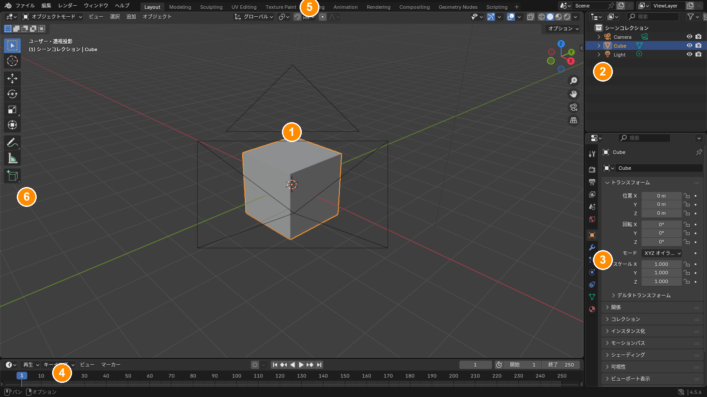
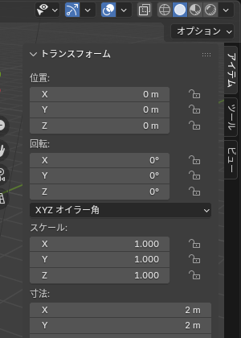

## 起動直後の画面

Blender を起動して「全般（General）」を選ぶと、立方体・カメラ・ライトが置かれたシーンが開きます。画面はいくつかの **エリア** に分かれていて、それぞれ別の役割を持っています。

*① 3D ビューポート ② アウトライナー ③ プロパティ ④ タイムライン ⑤ ワークスペースタブ ⑥ ツールバー*

| 番号 | 名前 | 役割 |
|---|---|---|
| ① | 3D ビューポート | モデルを見て、動かし、形を作る場所。ほとんどの作業はここで行う |
| ② | アウトライナー | シーンにあるオブジェクトの一覧。表示 / 非表示、親子関係、コレクション（フォルダ）の管理 |
| ③ | プロパティ | 選択中のものの設定。左のタブで「オブジェクト」「モディファイアー」「マテリアル」などを切り替える |
| ④ | タイムライン | アニメーション用。モデリングだけならほぼ使わない |
| ⑤ | ワークスペース | 作業内容に合わせた画面構成の切り替え。「Layout」「Modeling」「UV Editing」「Shading」などがある |
| ⑥ | ツールバー | 3D ビューポートの左にある道具箱。選択・移動・回転などのツールを切り替える |

## 3D ビューポートのヘッダー

3D ビューポートの上端には、今の状態を示す重要なものが並んでいます。

- **モード**（左端のプルダウン）: 「オブジェクトモード」「編集モード」など。**今どのモードにいるかで、同じキーを押しても起きることが変わります**。迷ったらまずここを見る
- **ビュー / 選択 / 追加 / オブジェクト** メニュー: ショートカットで行う操作は、すべてここからも実行できる
- 右側のアイコン群: 表示の切り替え（ワイヤーフレーム・ソリッドなど）、オーバーレイ、透過表示

## サイドバー（N パネル）

3D ビューポートにマウスを置いて <kbd>N</kbd> を押すと、右側に **サイドバー** が出ます。「アイテム」タブに、選択中のオブジェクトの位置・回転・スケールが数値で表示されます。値を直接入力して正確に動かすときに使います。

*数値の上でドラッグすると連続的に変えられ、クリックすると直接入力できる*

<kbd>T</kbd> はツールバーの表示 / 非表示です。狭い画面で作業するときに閉じると広く使えます。

## エリアの操作

- **大きくする**: エリアにマウスを置いて <kbd>Ctrl</kbd>+<kbd>Space</kbd>。もう一度押すと元に戻る
- **境界を動かす**: エリアの境目をドラッグ
- **種類を変える**: 各エリアの左上にあるアイコンをクリックして、別のエディター（UV エディター、シェーダーエディターなど）に切り替える
- **分割 / 統合**: エリアの角をドラッグ。うっかり分割してしまったら、角を逆方向にドラッグして隣とくっつける

::: tip
レイアウトを壊してしまったら、上部の **ファイル > 新規 > 全般** で新しいファイルを開けば元に戻ります。作業中のファイルなら、ワークスペースタブを右クリックして別のものに切り替えるだけでも直ることが多いです。
:::

## よく使うキー

| キー | 動き |
|---|---|
| <kbd>F3</kbd> | 機能の検索。名前を打ち込めば、メニューの場所を知らなくても実行できる |
| <kbd>Ctrl</kbd>+<kbd>Z</kbd> | 元に戻す。編集モードの操作もオブジェクトモードの操作も戻せる |
| <kbd>Tab</kbd> | オブジェクトモードと編集モードの切り替え |

::: warning
Blender は **マウスがどのエリアにあるか** でキーの効き先が決まります。3D ビューポートで効くはずのキーが効かないときは、マウスがアウトライナーやプロパティの上にないか確認してください。
:::
