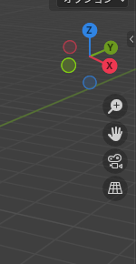
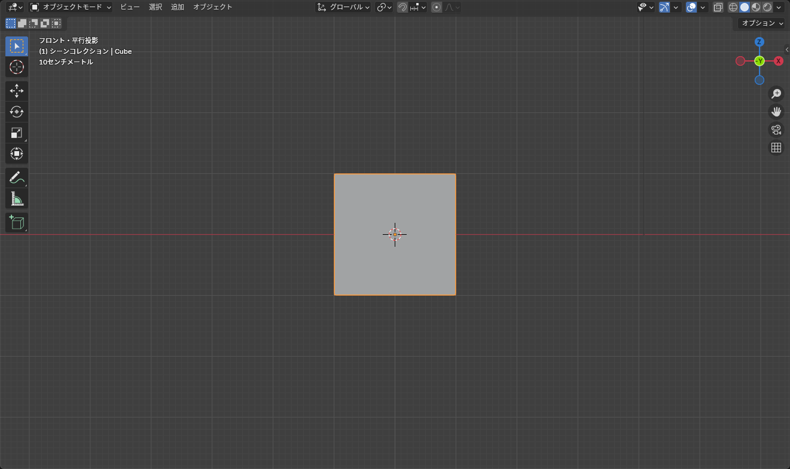

## マウスでの基本操作

視点の操作は **ホイールボタン（中ボタン）** が中心です。3D ビューポートにマウスを置いて操作します。

| 操作 | 動き |
|---|---|
| ホイールボタンをドラッグ | 視点を回す（オービット） |
| <kbd>Shift</kbd>+ホイールボタンをドラッグ | 視点を平行移動（パン） |
| ホイールを回す | ズーム |
| <kbd>Ctrl</kbd>+ホイールボタンをドラッグ | なめらかにズーム |

ホイールボタンのないマウスやトラックパッドの場合は、[インストールと日本語化](/learn/getting-started/install) で説明した「3 ボタンマウスを再現」をオンにすると、<kbd>Alt</kbd>+左ドラッグで回せます。

下の 3D ビューで、実際にマウスを動かして試せます。

::: practice navigation-mouse
:::

## ナビゲーションギズモ

3D ビューポートの右上にある、X / Y / Z の丸が付いた軸がナビゲーションギズモです。マウスだけで視点を操作できます。

*丸をクリックするとその軸の方向から見る。ドラッグすると視点が回る*

- **X / Y / Z の丸をクリック**: その方向から見た平行投影に切り替わる。同じ丸をもう一度押すと反対側から
- **ギズモをドラッグ**: 視点を回す
- 下に並ぶアイコンは、上から **ズーム**、**平行移動**、**カメラ視点**、**透視 / 平行投影の切り替え**

## テンキーでの視点切り替え

正確な形を作るときは、正面・横・上から見ることが多くなります。テンキーで一発で切り替えられます。

| キー | 視点 |
|---|---|
| <kbd>Numpad 1</kbd> | 前（正面）から |
| <kbd>Numpad 3</kbd> | 右から |
| <kbd>Numpad 7</kbd> | 上から |
| <kbd>Ctrl</kbd>+<kbd>Numpad 1</kbd> / <kbd>3</kbd> / <kbd>7</kbd> | それぞれの反対側から |
| <kbd>Numpad 5</kbd> | 透視投影と平行投影の切り替え |
| <kbd>Numpad .</kbd> | 選択したものを画面の中心に表示 |
| <kbd>Home</kbd> | シーン全体を表示 |

::: practice navigation-numpad
:::

*左上に「前・平行投影」と表示される。テンキーで視点を切り替えると自動で平行投影になる*

::: tip
テンキーのないキーボードでは、プリファレンスの **入力 > テンキーを模倣** をオンにすると、上の数字キーで同じ操作ができます。ただし編集モードで頂点 / 辺 / 面の選択モードを切り替える <kbd>1</kbd> <kbd>2</kbd> <kbd>3</kbd> が使えなくなるので、ヘッダーのボタンで切り替えることになります。
:::

## 透視投影と平行投影

- **透視投影**（Perspective）: 遠くのものが小さく見える、目で見たのと同じ見え方。全体の雰囲気を確認するときに
- **平行投影**（Orthographic）: 遠近感がなく、寸法通りに見える。左右対称に作るときや、正確に位置を合わせるときに

左上の「ユーザー・透視投影」「前・平行投影」という表示で、今どちらなのかがわかります。

## 表示の切り替え

<kbd>Z</kbd> を押すと、表示方法を選ぶパイメニューが出ます。

| 表示 | 用途 |
|---|---|
| ワイヤーフレーム | 線だけで表示。裏側の頂点も見える |
| ソリッド | 標準の表示。モデリング中はこれ |
| マテリアルプレビュー | マテリアルやテクスチャを確認する |
| レンダー | ライトを含めた最終的な見え方 |

<kbd>Alt</kbd>+<kbd>Z</kbd> は **透過表示** の切り替えです。ソリッド表示のまま裏側が透けて見えるようになり、裏側の頂点も選択できます。編集モードで「選択したつもりなのに裏の頂点が選ばれていなかった」というときはこれをオンにします。

## 選択したものが見つからなくなったら

- <kbd>Numpad .</kbd> で選択中のものを中心に表示
- 何も選べない / 遠すぎるときは <kbd>Home</kbd> で全体を表示してから、アウトライナーで目的のオブジェクトをクリック

::: warning
ホイールでズームしているのに近づけなくなったら、ズームの中心がオブジェクトから外れています。目的のものを選んで <kbd>Numpad .</kbd> を押すと、ズームの中心が選択物に移って再びズームできます。
:::
