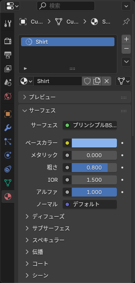
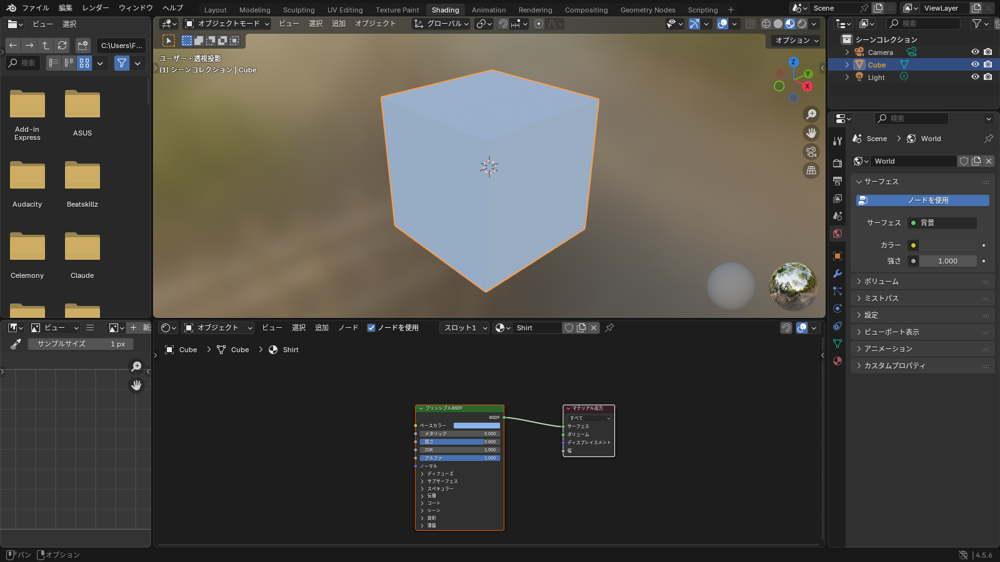

## マテリアルとは

**マテリアル** は、メッシュの表面の「色」「つや」「透明度」などをまとめた設定です。1 つのオブジェクトに複数のマテリアルを割り当てて、部分ごとに色を変えることもできます。

## 作る

1. オブジェクトを選択する
2. プロパティの **マテリアルプロパティ**（赤い球のアイコン）を開く
3. **新規** を押す

*名前欄をダブルクリックして「Shirt」のように英語の名前を付ける*

新しいマテリアルには **プリンシプル BSDF**（Principled BSDF）というシェーダーが入っています。現実の素材をだいたい表現できるので、普段はこれだけで足ります。

## 見た目を確認する

ソリッド表示ではマテリアルの色が反映されません。<kbd>Z</kbd> > **マテリアルプレビュー** に切り替えると、色や質感を確認できます。

## プリンシプル BSDF の主な項目

| 項目 | 意味 | 布・服での目安 |
|---|---|---|
| ベースカラー（Base Color） | 基本の色。画像テクスチャをつなぐこともできる | 好きな色 |
| メタリック（Metallic） | 金属かどうか。0 か 1 のどちらかにする | 0（ボタンなど金属パーツだけ 1） |
| 粗さ（Roughness） | 表面のざらつき。0 で鏡のよう、1 でつやなし | 0.7〜0.9 |
| アルファ（Alpha） | 透明度。1 で不透明 | 1 |
| 放射（Emission） | 自ら光る。発光するパーツに | 使わない |

::: tip
VRChat では Blender のマテリアルは **そのまま持っていけません**。Unity 側で改めてマテリアル（liltoon などのシェーダー）を作ります。Blender で凝った質感を作っても無駄になるので、ここでは **色とテクスチャの確認用** と割り切ってください。
:::

## Shading ワークスペース

上部の **Shading** タブに切り替えると、下半分に **シェーダーエディター** が開きます。マテリアルの中身がノード（箱）とつなぎ線で表示されます。

*プロパティで設定した項目と、ノードの項目は同じもの。どちらで変えても連動する*

画像テクスチャをつなぐときはこの画面を使います（次の記事で扱います）。

## 複数のマテリアルを割り当てる

1 つのオブジェクトの一部だけ色を変えるには、**マテリアルスロット** を増やします。

1. マテリアルプロパティの右上の **+** を押してスロットを追加し、**新規** で 2 つ目のマテリアルを作る
2. <kbd>Tab</kbd> で編集モードに入り、色を変えたい面を選ぶ
3. スロット一覧で 2 つ目のマテリアルを選び、**割り当て**（Assign）を押す

スロット一覧の **選択**（Select）を押すと、そのマテリアルが割り当てられている面がすべて選ばれます。

::: warning
マテリアルの数は VRChat のパフォーマンスランクに影響します（PC では **8 個までが Good**、アバター全体で）。服 1 着に 1〜2 個を目安にして、色の違いはテクスチャで表現してください。
:::

## マテリアルを他のオブジェクトにコピーする

同じマテリアルを別のオブジェクトにも使いたいときは、マテリアルプロパティの名前欄の左にある球のアイコンをクリックして、一覧から選びます。別のファイルからコピーする必要はありません。

複数のオブジェクトに一括で付けたいときは、付けたいもの → すでに付いているもの（アクティブ）の順に選んで、**オブジェクト > データのリンク/転送 > マテリアルをリンク**（Object > Link/Transfer Data > Link Materials）です。

## よくあるつまずき

- **色を変えても見た目が変わらない**: ソリッド表示です。<kbd>Z</kbd> > マテリアルプレビューにしてください
- **一部だけ色が変わらない**: その面に別のスロットが割り当てられています。編集モードで面を選び、目的のスロットを選んで「割り当て」を押してください
- **ピンク色になる**: 画像が見つかりません。[保存・読み込み](/learn/getting-started/files) の「テクスチャの扱い」を見てください
