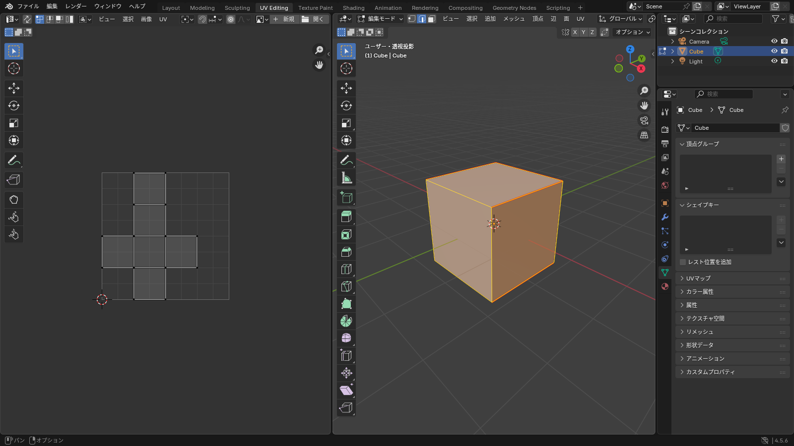
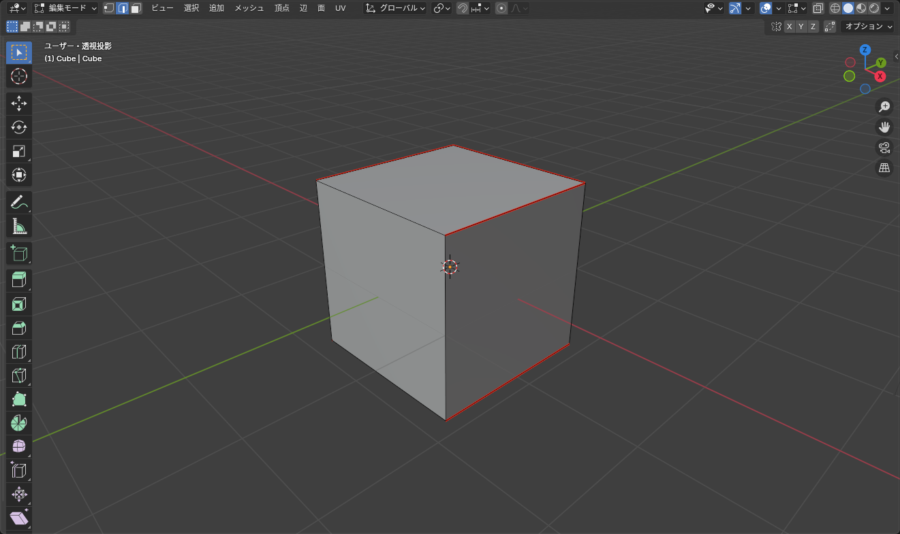
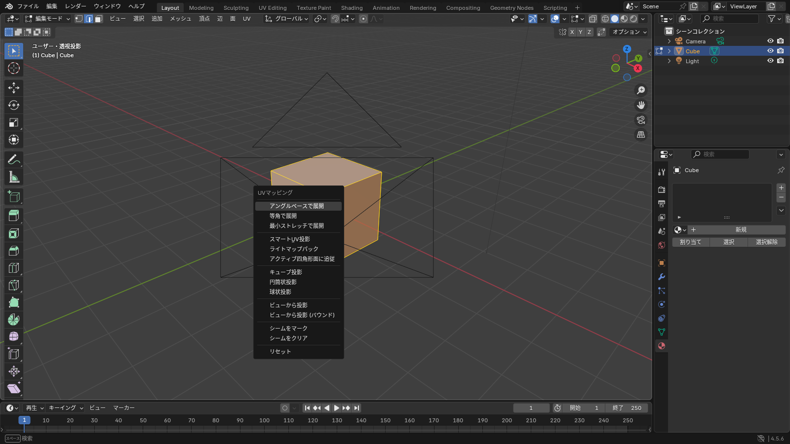

## UV とは

画像テクスチャは平面ですが、メッシュは立体です。メッシュを **切り開いて平面に広げたもの** が UV で、「メッシュのどの面が画像のどの部分に対応するか」を決めます。

服の型紙と同じです。縫い目（シーム）を決めて切り開き、平らに並べます。

## UV Editing ワークスペース

上部の **UV Editing** タブに切り替えると、左に **UV エディター**、右に 3D ビューポート（編集モード）が並びます。

*3D ビューポートで面を選ぶと、UV エディターに対応する部分が表示される*

## 手順

### 1. シームを付ける

**シーム**（Seam）は切り開く線です。辺選択モード（<kbd>2</kbd>）で辺を選び、<kbd>Ctrl</kbd>+<kbd>E</kbd> > **シームをマーク**（Mark Seam）を選びます。シームは赤い線で表示されます。

*目立たない場所（服なら脇の下、内側）にシームを置く*

- <kbd>Alt</kbd>+クリックでループ選択してからマークすると、一周まとめて付けられる
- 間違えたら **シームをクリア**（Clear Seam）
- 筒状のものは、縦に 1 本シームを入れると帯状に開く

### 2. 展開する

全選択（<kbd>A</kbd>）して <kbd>U</kbd> を押し、**アングルベースで展開**（Unwrap > Angle Based）を選びます。

*「スマート UV 投影」は自動でシームを決める。結果は荒いが、とりあえず貼りたいときに*

| 項目 | 用途 |
|---|---|
| アングルベースで展開（Angle Based） | シームに沿って展開する。基本はこれ |
| 等角で展開 / 最小ストレッチで展開 | 展開の計算方法が違うだけ。アングルベースでゆがむときに試す |
| スマート UV 投影（Smart UV Project） | 角度で自動分割。小物や、テクスチャを描き込まないパーツに |
| キューブ投影 / 円筒状投影 | 箱・筒を手早く展開する |

### 3. 結果を確認する

UV エディターに展開結果が表示されます。確認するポイントは 2 つです。

- **ゆがみ**: UV エディターの **オーバーレイ > ストレッチ**（Stretching）をオンにすると、ゆがみの大きい場所が赤く表示される。赤いところにシームを足して展開し直す
- **重なり**: 島（アイランド）同士が重なっていないか。重なっていると、同じ画像の場所を 2 か所で使うことになる

::: tip
UV エディターの上部で **UV > パック（Pack Islands）** を実行すると、島をすき間なく並べ直してくれます。4.x のパックは回転や並べ方の設定が充実しているので、展開したあと一度かけるときれいに収まります。
:::

## UV エディターでの操作

UV エディターでも <kbd>G</kbd> / <kbd>R</kbd> / <kbd>S</kbd> で島を移動・回転・拡縮できます。3D ビューポートと同じキーです。

- **島を選ぶ**: UV エディターのヘッダーで選択モードを「アイランド」にして、クリック
- **ピン留め**（<kbd>P</kbd>）: 固定しておきたい頂点を留める。もう一度展開しても動かなくなる
- **同期選択**（ヘッダーの矢印アイコン）: オンにすると、3D ビューポートと UV エディターの選択が連動する

## テクスチャの解像度と UV のサイズ

UV の島が大きいほど、その面に多くのピクセルが使われてきれいになります。目立つ場所（服の前面）を大きく、見えない場所（内側）を小さくするのが基本です。

VRChat ではテクスチャのサイズがメモリに影響します（PC では **75 MB までが Good**）。服 1 着なら **2048 × 2048 を 1 枚** に収めるのを目安にしてください。

## 展開結果を書き出す

**UV > UV 配置をエクスポート**（Export UV Layout）で、展開した線を PNG で書き出せます。これを画像編集ソフト（GIMP、Photoshop、Krita など）で下敷きにして色や模様を描きます。

## よくあるつまずき

- **展開したら一直線や 1 点になる**: シームがなく、閉じた形を無理やり開いています。シームを足してください
- **島がバラバラに細かい**: 「スマート UV 投影」の角度が小さすぎます。「アングルベースで展開」を使うか、角度制限を大きくしてください
- **3D ビューポートで選んでも UV に出ない**: UV エディターの「同期選択」がオフのときは、3D ビューポートで選択した面だけが表示されます。全選択してください
