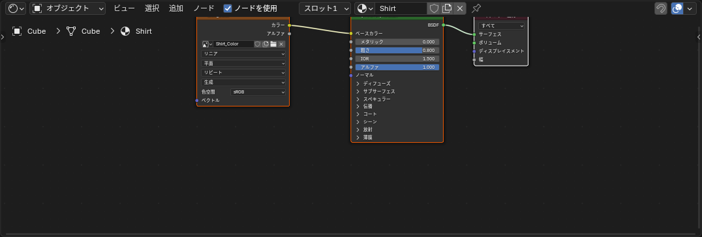
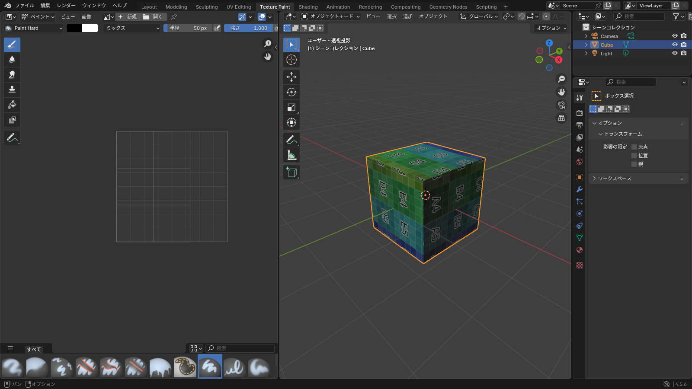

## 画像をマテリアルに貼る

UV 展開が済んでいれば、画像を貼るのは数ステップです。

1. **Shading** ワークスペースに切り替える
2. シェーダーエディターで <kbd>Shift</kbd>+<kbd>A</kbd> > **テクスチャ > 画像テクスチャ**（Texture > Image Texture）を追加する
3. ノードの **開く** を押して画像ファイルを選ぶ
4. 画像テクスチャの **カラー** 出力を、プリンシプル BSDF の **ベースカラー** につなぐ

*つなぎ線は出力の丸から入力の丸へドラッグする*

マテリアルプレビュー（<kbd>Z</kbd>）で、画像が貼られているのを確認します。

::: tip
**Node Wrangler** アドオンを入れておくと、画像テクスチャノードを選んで <kbd>Ctrl</kbd>+<kbd>T</kbd> を押すだけで、テクスチャ座標・マッピングのノードがつながった状態で作られます。[アドオン一覧](/addons) を参照してください。
:::

## 新しい画像を作る

まだ画像がない場合は、Blender の中で空の画像を作れます。

1. 画像テクスチャノードの **新規** を押す
2. 名前（`Shirt_Color` など）、サイズ（2048 × 2048）、色を決めて **OK**

作った画像は **まだファイルとして保存されていません**。画像エディターかテクスチャペイントの画面で **画像 > 保存**（Image > Save As）を実行するまで、Blender を閉じると消えます。

## テクスチャペイント

Blender の中で、メッシュに直接色を塗ることができます。細かい模様は外部ソフトで描く方が楽ですが、ベースの色分けや下塗りには便利です。

1. **Texture Paint** ワークスペースに切り替える
2. 右の 3D ビューポートがテクスチャペイントモードになる。左の画像エディターには塗る対象の画像が表示される
3. ツールバーの **ドロー** でメッシュの上をドラッグして塗る
4. 右側のサイドバー（<kbd>N</kbd>）の **ツール** タブで、ブラシの色・半径・強さを変える

*「テクスチャスロット」に画像がないと「テクスチャがありません」と出る。+ で追加する*

- 塗り終わったら、画像エディターで **画像 > 保存**。画像に `*` が付いているときは未保存
- <kbd>Ctrl</kbd>+<kbd>S</kbd> で .blend を保存するときに「変更された画像があります」と出たら、**画像を保存** を選ぶ

::: warning
テクスチャペイントで塗った内容は **.blend ファイルには含まれません**（パックしていない場合）。必ず画像を別途保存してください。
:::

## 外部ソフトで描く

本格的に描くときは、[UV 展開](/learn/materials/uv-unwrap) で書き出した UV 配置を下敷きにして、画像編集ソフトで描きます。

1. **UV > UV 配置をエクスポート** で `shirt_uv.png` を書き出す
2. 画像編集ソフトで開き、別レイヤーに色や模様を描く
3. UV の線のレイヤーを非表示にして、PNG で書き出す
4. Blender で画像テクスチャノードの画像を差し替える。すでに読み込んである画像なら、画像エディターで **画像 > 再読み込み**（Reload）

::: tip
透明部分のある PNG（アルファ付き）を貼ると、Blender のマテリアルプレビューでは透けて見えないことがあります。マテリアルの **設定 > ブレンドモード** を「アルファクリップ」などに変えると透けますが、VRChat では Unity 側のシェーダー設定で決まるので、Blender では無理に合わせなくて構いません。
:::

## 画像が見つからないとき（ピンク表示）

ファイルを移動した、名前を変えた、別の PC で開いた、などで画像のリンクが切れるとピンク色になります。

- **ファイル > 外部データ > 欠けているファイルを探す**（Find Missing Files）で、画像のあるフォルダを指定すると一括で直る
- あらかじめ **ファイル > 外部データ > リソースをパック** しておくと、.blend の中に画像が入るので切れない

## よくあるつまずき

- **画像が貼れているのに向きや位置がおかしい**: UV の問題です。UV エディターで島の位置を直すか、展開し直します
- **ぼやけて見える**: 画像の解像度に対して UV の島が大きすぎます。島を小さくするか、画像を大きくします
- **塗っても色が付かない**: 画像テクスチャノードがマテリアルにつながっていないか、塗る対象の画像が選ばれていません。テクスチャスロットを確認してください
