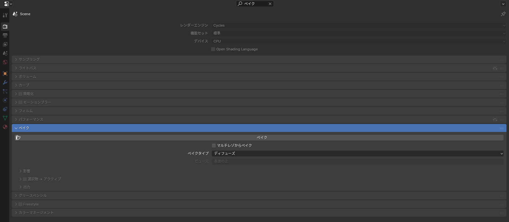

## Unity に渡るもの・渡らないもの

FBX で書き出したとき、マテリアルの情報は **ほとんど渡りません**。

| 項目 | Unity に渡るか |
|---|---|
| マテリアルの名前とスロットの割り当て | 渡る（どの面にどのマテリアルか） |
| UV | 渡る |
| ベースカラーにつないだ画像テクスチャ | ファイルを別途コピーすれば使える |
| 粗さ・メタリックなどの数値 | ほぼ渡らない |
| ノードで作った模様（ノイズ、グラデーションなど） | 渡らない |
| 複数の画像を混ぜた結果 | 渡らない |

つまり Blender で作るべきなのは、**マテリアルの分け方（スロット）と UV、そして画像ファイル** です。質感は Unity のシェーダー（liltoon など）で付けます。

## ノードで作った模様を画像にする（ベイク）

ノードで作ったグラデーションや、複数の画像を混ぜた結果を 1 枚の画像にするのが **ベイク** です。Unity に持っていくには、最終的に 1 枚のベースカラー画像にまとめます。

1. 画像テクスチャノードを追加し、**新規** で書き出し先の画像を作る（2048 × 2048）
2. その画像テクスチャノードを **選択した状態（白枠）** にしておく。**どこにもつながなくてよい**
3. レンダープロパティで **レンダーエンジン** を **Cycles** にする
4. 下の方にある **ベイク** パネルを開き、**ベイクタイプ** を **ディフューズ** にして、**影響** の **直接照明** と **間接照明** のチェックを外す（**カラー** だけ残す）
5. **ベイク** を押す。終わったら画像エディターで **画像 > 保存**


*プロパティ上部の検索欄に「ベイク」と入れると、ベイクのパネルだけが開いた状態で表示される。「影響」を開いて「カラー」だけにすると、ライトの影響を受けない純粋な色が焼ける*

::: warning
ベイク先の画像テクスチャノードが選択されていないと、別の画像に上書きされることがあります。ベイクの前に、書き出し先のノードが白枠で選ばれているか必ず確認してください。
:::

## マテリアルの数を減らす

VRChat のランクは、アバター全体のマテリアルスロットの数でも決まります（2026 年 10 月時点の目安で、PC では 8 個までが Good、Android（Quest）では 1 個までが Good。値は VRChat 公式の Avatar Performance Ranking System で確かめてください）。服を足すたびに増えるので、少なくする工夫が要ります。

- 服 1 着のパーツ（上着・ボタン・ベルト）を **1 つのマテリアル** にまとめ、色の違いはテクスチャで描く
- 複数のパーツを 1 つの UV に並べる（**UV > パック** で収める）
- すでに別々のマテリアルで作ってしまった場合は、**Material Combiner** アドオンでテクスチャをまとめられる（[アドオン一覧](/addons)）

## テクスチャのサイズ

| 用途 | 目安 |
|---|---|
| 大きい服（上着、ワンピース） | 2048 × 2048 |
| 小物（靴、アクセサリー） | 1024 × 1024 以下 |
| Quest 対応 | テクスチャメモリは全体で 18 MB 以内が Good（目安）。1024 以下を基本に |

Unity 側でも **Max Size** を下げられるので、Blender では 2048 で作っておき、Unity で必要に応じて下げるのが楽です。

## ファイルの置き方

Unity に持っていくときは、次のようにそろえておくと迷いません。

```
Shirt/
├── Shirt.fbx          ← Blender から書き出し
└── Textures/
    └── Shirt_Color.png ← ベースカラー
```

Unity ではこのフォルダごと `Assets` にドラッグし、マテリアルを新しく作ってテクスチャを割り当てます。詳しい手順は [Unity での設定](/learn/avatar-clothing/unity-setup) で扱います。

## よくあるつまずき

- **Unity でマテリアルが白い**: 正常です。Unity 側でマテリアルを作って画像を割り当ててください
- **ベイクしたら真っ黒**: ベイク先の画像ノードが選ばれていない、または UV がありません。手順 2 と、UV 展開が済んでいるかを確認してください
- **ベイクに時間がかかる**: レンダープロパティの **サンプリング > レンダー** のサンプル数を 16 くらいに下げてください。カラーだけのベイクなら少なくても十分です
