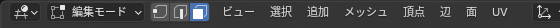
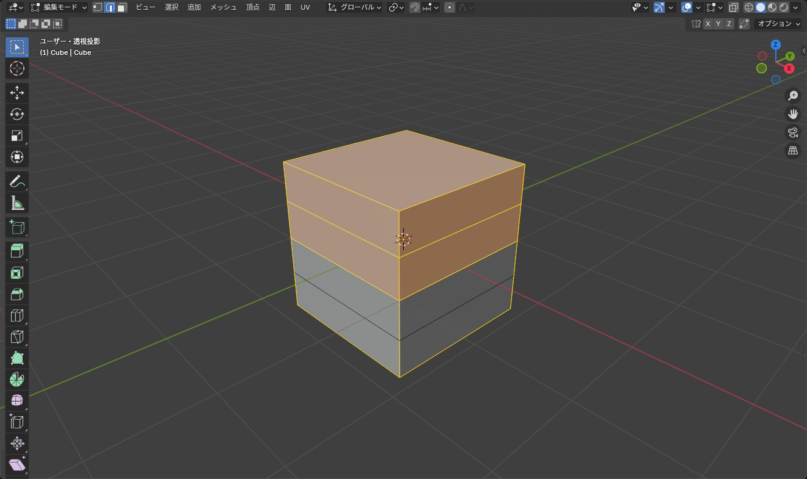

## 編集モードに入る

オブジェクトを選択して <kbd>Tab</kbd> を押すと **編集モード** になり、メッシュの中身（頂点・辺・面）を直接いじれるようになります。もう一度 <kbd>Tab</kbd> でオブジェクトモードに戻ります。

- ヘッダー左端の表示が「編集モード」に変わる
- 頂点が黒い点で表示される
- 編集モードで <kbd>G</kbd> / <kbd>R</kbd> / <kbd>S</kbd> を押すと、オブジェクト全体ではなく **選択した頂点・辺・面** が動く

## 頂点・辺・面の選択モード

ヘッダー左の 3 つのアイコン、またはキーで切り替えます。

*左から頂点・辺・面。Shift+クリックで複数のモードを同時にオンにできる*

| キー | モード | 向いている作業 |
|---|---|---|
| <kbd>1</kbd> | 頂点 | 細かい位置調整 |
| <kbd>2</kbd> | 辺 | ループカット後の調整、シームを付ける |
| <kbd>3</kbd> | 面 | 押し出し、面の削除 |

選択の操作はオブジェクトモードと同じです（クリック、<kbd>Shift</kbd>+クリック、ドラッグでボックス選択、<kbd>A</kbd> で全選択）。

## 便利な選択

### ループ選択

辺の上で <kbd>Alt</kbd>+クリックすると、その辺が含まれる **辺ループ** が一周選ばれます。面モードなら面ループになります。円柱の一周分を選んで一斉に拡縮する、といった操作でよく使います。

*Alt+クリックする辺の「向き」によって、縦方向のループか横方向のループかが変わる*

<kbd>Ctrl</kbd>+<kbd>Alt</kbd>+クリックだと **辺リング**（ループと直交する方向）が選べます。

### リンク選択

- <kbd>L</kbd>: マウスの下にある、つながったメッシュをまとめて選択
- <kbd>Ctrl</kbd>+<kbd>L</kbd>: 今選択しているものにつながった部分をすべて選択

1 つのオブジェクトに複数のパーツ（本体とボタンなど）が入っているとき、パーツ単位で選ぶのに使います。

### 選択範囲を広げる・狭める

<kbd>Ctrl</kbd>+<kbd>Numpad +</kbd> で選択範囲を隣の頂点まで広げ、<kbd>Ctrl</kbd>+<kbd>Numpad -</kbd> で狭めます。

### 裏側も選ぶ

ソリッド表示では、見えている面の頂点しか選べません。ボックス選択で裏側まで選びたいときは <kbd>Alt</kbd>+<kbd>Z</kbd> で **透過表示** にします。

::: warning
「ボックス選択で全部選んだのに、動かしたら裏が残った」はほぼこれが原因です。左右対称の調整をするときは透過表示をオンにする癖をつけてください。
:::

## 隠す

編集モードでも <kbd>H</kbd> / <kbd>Alt</kbd>+<kbd>H</kbd> で頂点や面を隠せます。奥まった場所を編集するときに手前を隠しておくと作業しやすくなります。

## ショートカットのまとめ

| キー | 操作 |
|---|---|
| <kbd>Tab</kbd> | 編集モードの出入り |
| <kbd>1</kbd> / <kbd>2</kbd> / <kbd>3</kbd> | 頂点 / 辺 / 面 |
| <kbd>Alt</kbd>+クリック | ループ選択 |
| <kbd>L</kbd> / <kbd>Ctrl</kbd>+<kbd>L</kbd> | リンク選択 |
| <kbd>Alt</kbd>+<kbd>Z</kbd> | 透過表示 |
| <kbd>G</kbd> / <kbd>R</kbd> / <kbd>S</kbd> | 選択した要素の移動 / 回転 / スケール |

次の記事では、形を作るための操作（押し出し・差し込み・ループカット）に進みます。
