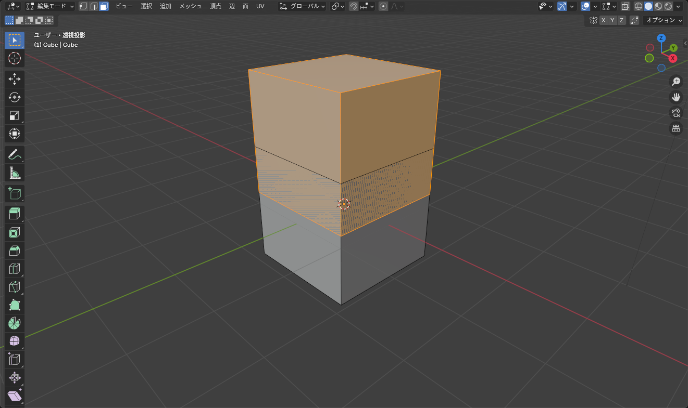
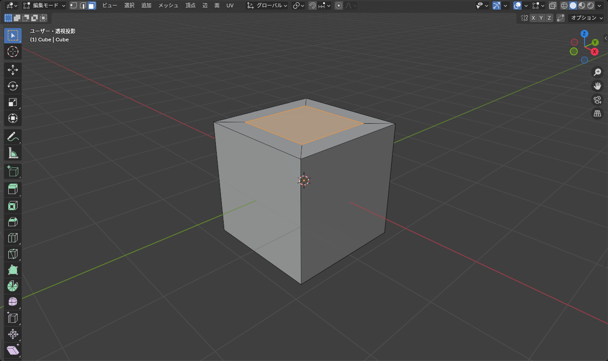
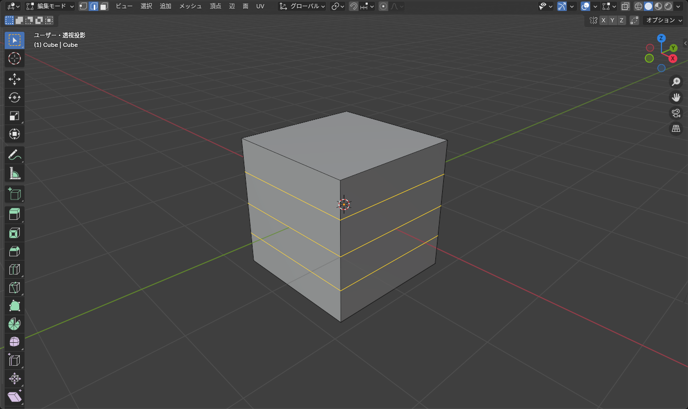

## 押し出し（Extrude）

面を選んで <kbd>E</kbd> を押すと、その面が **引き出され**、側面に新しい面ができます。マウスで距離を決めてクリックで確定、数値入力もできます。

このページの 3 つの操作は、下の 3D ビューで続けて試せます（押し出し → 差し込み → へこませる → ループカット）。

::: practice extrude-inset-loopcut
:::

*押し出し直後は、面の向き（法線）に沿って動く。軸キーを押すとその軸に固定できる*

- 頂点や辺を押し出すこともできる。辺を押し出すと面ができ、頂点を押し出すと辺ができる
- 押し出した直後に右クリックでキャンセルすると、**面は複製されたまま移動だけが取り消される**。重なった面が残るので、その場合は <kbd>Ctrl</kbd>+<kbd>Z</kbd> で戻す

::: warning
<kbd>E</kbd> を押してから <kbd>Esc</kbd> や右クリックでやめるのが、重複した頂点ができるいちばん多い原因です。「押し出さなかったつもり」でも <kbd>Ctrl</kbd>+<kbd>Z</kbd> で取り消してください。
:::

複数の面を選んで <kbd>E</kbd> を押すと、まとめて 1 つの塊として押し出されます。面ごとに個別に押し出したいときは **<kbd>Alt</kbd>+<kbd>E</kbd>** > **個々の面で押し出し** を使います。

## 面を差し込む（Inset）

面を選んで <kbd>I</kbd> を押すと、面の内側にひと回り小さい面ができます。窓・ボタン・パネルの枠などを作る出発点です。

*差し込んだあとに E で押し出すと、くぼみや出っ張りになる*

- 複数の面を選んで <kbd>I</kbd> を押すと、全体をひとつの輪郭として差し込む。**<kbd>I</kbd> をもう一度押す** と「個別」に切り替わり、面ごとに差し込む
- 操作中に <kbd>Ctrl</kbd> を押すと、奥行き（深さ）も同時に付けられる

## ループカット（Loop Cut）

<kbd>Ctrl</kbd>+<kbd>R</kbd> を押してメッシュの上にマウスを置くと、黄色い線でカットの位置が示されます。クリックで本数を決め、そのままマウスを動かして位置を調整し、もう一度クリックで確定します。

*位置調整のときに右クリックすると、ちょうど真ん中に入る*

- 黄色い線が出ている間に **ホイールを回す** と本数が増える
- 真ん中にきっちり入れたいときは、位置調整で **右クリック**（または <kbd>Esc</kbd>）
- 入れたあとで本数や位置を変えたいときは、画面左下の操作パネル（<kbd>F9</kbd>）から

ループカットは **四角形の面がつながっているところ** にしか入りません。三角形や五角形以上の面で止まってしまうときは、トポロジーがそこで崩れています（詳しくは [トポロジーの整理](/learn/modeling/topology)）。

## 3 つの組み合わせ

| 作りたいもの | 手順 |
|---|---|
| 箱に蓋のふちを付ける | 上面を <kbd>I</kbd> で差し込み → 内側の面を <kbd>E</kbd> で下に押し出す |
| 円柱から腕を作る | 円柱の上面を <kbd>E</kbd> で押し出し → <kbd>S</kbd> で少し細く → 繰り返し |
| 袖のくびれ | <kbd>Ctrl</kbd>+<kbd>R</kbd> でくびれの位置に辺を入れる → <kbd>Alt</kbd>+クリックでその辺ループを選択 → <kbd>S</kbd> で縮める |

::: tip
操作の直後に出る左下のパネルには、押し出しの距離、差し込みの幅、ループカットの本数が数値で入っています。マウスで大まかに決めてから、ここで数値を整えるとやり直しが減ります。
:::

## よくあるつまずき

- **押し出しが変な方向に行く**: 面の向き（法線）が裏返っています。[トポロジーの整理](/learn/modeling/topology) の「法線の向き」を見てください
- **ループカットの線が出ない**: マウスが辺の上にない、または四角形以外の面に当たっています。辺の真上にマウスを置いてください
- **差し込みが外側に広がる**: マウスを動かす向きが逆です。<kbd>I</kbd> を押した位置から内側へ動かすか、左下のパネルで幅を正の値にしてください
