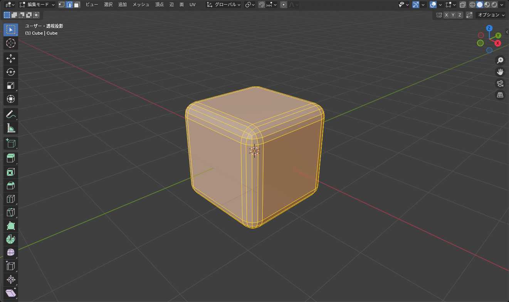
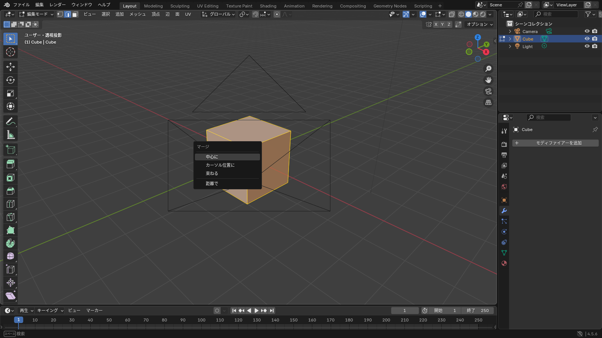

## ベベル（Bevel）

辺を選んで <kbd>Ctrl</kbd>+<kbd>B</kbd> を押し、マウスを動かすと角が **面取り** されます。ホイールを回すと分割数が増えて、丸みのある角になります。

下の 3D ビューで、ベベル・マージ（距離で）・面を張る（<kbd>F</kbd>）を順番に試せます。このビューのベベルは分割数 1 だけで、ナイフ（<kbd>K</kbd>）には対応していません。

::: practice bevel-merge
:::

*分割数 1 なら斜めの面、3 以上で丸い角になる*

- 頂点を選んで <kbd>Ctrl</kbd>+<kbd>Shift</kbd>+<kbd>B</kbd> だと **頂点ベベル**（角の頂点を面に変える）
- 左下のパネルで「幅」と「セグメント」（分割数）を数値で決められる
- スケールが 1 でないオブジェクトでは、ベベルの幅が軸ごとに違ってしまう。先に <kbd>Ctrl</kbd>+<kbd>A</kbd> > **スケール** を適用する

アバターの服では、ベベルで頂点数が増えすぎることがあります。袖口や襟の角など、目立つところだけに使ってください。

## ナイフ（Knife）

<kbd>K</kbd> を押すとナイフツールになります。メッシュの上をクリックしていくと、その線でメッシュが切れます。<kbd>Enter</kbd> で確定、<kbd>Esc</kbd> でやめます。

- クリックした点を結ぶように切れる。頂点や辺の上では自動でスナップする
- <kbd>Shift</kbd> を押しながらだと辺の中点にスナップ
- <kbd>C</kbd> を押すと角度を 45° 刻みに固定
- <kbd>Z</kbd> を押すと **裏側まで貫通して** 切れる

ループカットが入らない場所（三角形の面など）に辺を足したいときに使います。ただし、ナイフで切ると三角形や五角形の面ができやすいので、できるだけループカットで済ませる方が後が楽です。

## 頂点をくっつける（マージ）

頂点を複数選んで <kbd>M</kbd> を押すと、マージのメニューが出ます。

*「距離で」は選択した頂点のうち、近いもの同士を自動でくっつける*

| 項目 | 動き |
|---|---|
| 中心に（At Center） | 選んだ頂点を中心に集めて 1 つにする |
| カーソル位置に（At Cursor） | 3D カーソルの位置に集める |
| 束ねる（Collapse） | つながった頂点のかたまりごとに 1 つにまとめる |
| 距離で（By Distance） | 近い頂点を自動でまとめる。**重複頂点の掃除** に使う |
| 最初 / 最後に選択した頂点に | 頂点を 1 つずつクリックして選んだときだけ出る。その頂点の位置に集める |

::: tip
「距離で」は、<kbd>A</kbd> で全選択してから実行するのが定番です。押し出しのキャンセルで重なった頂点や、ミラーの中央で二重になった頂点を一度に消せます。画面左下に「○個の頂点を削除」と出るので、何個消えたかわかります。
:::

## 面を張る

頂点や辺を選んで <kbd>F</kbd> を押すと、その間に面（頂点が 2 つなら辺）ができます。穴をふさぐときに使います。

- 穴の縁の辺ループを <kbd>Alt</kbd>+クリックで選んで <kbd>F</kbd> → 1 枚の大きな面（N ゴン）でふさがる
- きれいな四角形で埋めたいときは、<kbd>Alt</kbd>+<kbd>F</kbd>（フィル）や **面 > グリッドフィル**

## 削除と溶解

<kbd>X</kbd> を押すと削除メニューが出ます。「削除」と「溶解」は結果が違います。

| 項目 | 動き |
|---|---|
| 頂点 / 辺 / 面を削除 | 選んだものと、それに接する面が消える。穴が開く |
| 辺を溶解（Dissolve Edges） | 辺だけ消えて、両側の面が 1 つにつながる。穴は開かない |
| 制限的溶解（Limited Dissolve） | 平らな部分の余分な辺・頂点をまとめて消す。頂点数を減らすときに |

「辺を減らしたいが穴は開けたくない」ときは溶解です。

## 切り離す・分離する

| キー | 動き |
|---|---|
| <kbd>Alt</kbd>+<kbd>M</kbd> > 選択 | 選んだ部分を切り離す。**同じオブジェクトのまま**、くっついていない別のパーツになる |
| <kbd>P</kbd> > 選択 | 選んだ部分を **別のオブジェクト** に分離する |
| <kbd>Ctrl</kbd>+<kbd>J</kbd>（オブジェクトモード） | 別のオブジェクトを 1 つに統合する |

アバターの体から袖の部分を複製して服にするとき、複製した面を <kbd>P</kbd> で分離して別オブジェクトにします（[服の形を作る](/learn/avatar-clothing/base-shape) で実際にやります）。

## よくあるつまずき

- **ベベルが片側だけ変**: 近くに重複した頂点があります。先に <kbd>M</kbd> > **距離で** を実行してください
- **面を張ったら黒くなった**: 面の裏表が逆です。<kbd>Shift</kbd>+<kbd>N</kbd> で法線を再計算します
- **マージしたら形が崩れた**: 「中心に」で離れた頂点まで選んでいました。<kbd>Ctrl</kbd>+<kbd>Z</kbd> で戻して「距離で」を使うか、くっつけたい頂点だけを選び直してください
