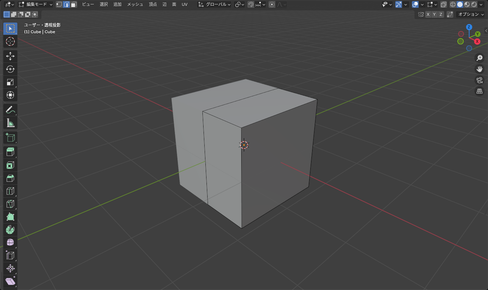
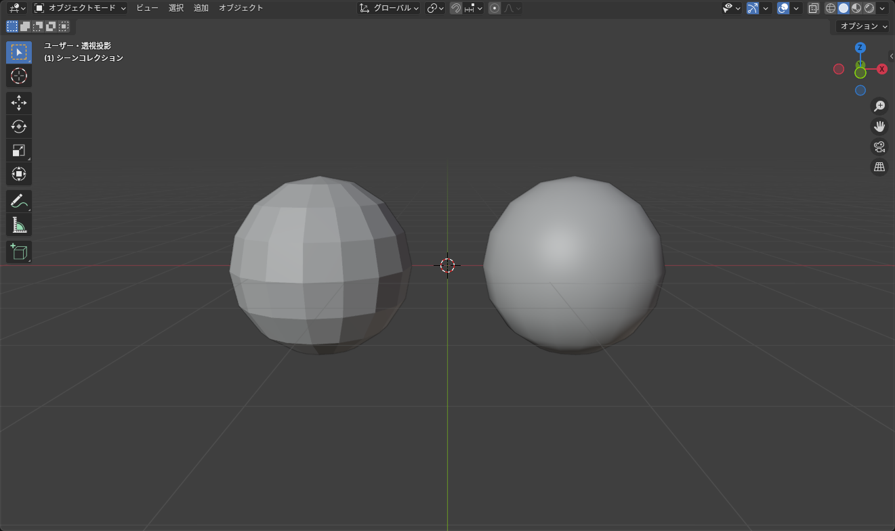

## 左右対称に作る手順

人体や服のように左右対称のものは、**半分だけ作ってミラーで反対側を作る** のが基本です。

1. 立方体を追加し、<kbd>Tab</kbd> で編集モードへ
2. <kbd>Ctrl</kbd>+<kbd>R</kbd> で X 方向に真ん中のループカットを入れる（位置調整で右クリックすると中央に入る）
3. <kbd>3</kbd> で面選択モードにし、左半分（X がマイナス側）の面を選んで <kbd>X</kbd> > **面** で削除
4. <kbd>Tab</kbd> でオブジェクトモードに戻り、モディファイアーで **ミラー** を追加
5. **クリッピング** と **マージ** をオンにする

1 〜 4 の流れを下の 3D ビューで試せます（ミラーは上の「ミラー」ボタンで代用します。クリッピングやマージの設定はありません）。

::: practice mirror
:::

*右半分を編集すると左半分も同時に変わる。編集モードでも結果が表示される*

::: tip
クリッピングをオンにすると、中央の頂点を反対側に動かせなくなります。中央の頂点を X = 0 からずらしたくないときに便利です。逆に、中央を開いた形（前開きのジャケットなど）にしたいときは一時的にオフにします。
:::

### ミラーの基準

ミラーは **原点を通る面** で反転します。あらかじめ次を確認してください。

- 原点がワールド原点にある（<kbd>Shift</kbd>+<kbd>S</kbd> > カーソル → ワールド原点 → **原点を 3D カーソルへ移動**）
- 回転とスケールが適用されている（<kbd>Ctrl</kbd>+<kbd>A</kbd> > **回転とスケール**）

### 別のオブジェクトを基準にする

ミラーの **ミラーオブジェクト** に別のオブジェクト（例: アバターの体）を指定すると、そのオブジェクトの原点と向きで反転します。服の原点をいじりたくないときに使います。

## なめらかに見せる

### スムーズシェード

オブジェクトモードで右クリック > **スムーズシェード**（Shade Smooth）を選ぶと、面と面の境目をぼかして、なめらかに見せます。頂点数は増えません。

*左がフラット、右がスムーズ。同じメッシュでも見え方が大きく変わる*

ただし、立方体のように角があるものに掛けると、角まで変にぼやけます。角は残したい場合は **自動スムーズシェード**（Shade Auto Smooth）を使います。一定以上の角度（既定 30°）の辺は角として残り、それ以下はなめらかになります。

| 項目 | 向いているもの |
|---|---|
| フラットシェード | 箱、機械的なもの |
| スムーズシェード | 体、布など丸いもの |
| 自動スムーズシェード | 丸い部分と角が混ざっているもの（ほとんどの服はこれ） |

### サブディビジョンサーフェス

本当に頂点を増やしてなめらかにするのが **サブディビジョンサーフェス** モディファイアーです。

- レベル 1 で面が 4 倍、レベル 2 で 16 倍になる。アバター用なら **ビューポートもレンダーもレベル 1** までを目安に
- 全体が丸くふくらむので、角を残したい場所の両脇に **ループカットで辺を足す**（辺が近いほど角が立つ）

::: warning
サブディビジョンは頂点数が爆発的に増えます。VRChat のアバターには頂点数の制限（PC では 70,000 三角形で「Good」が上限）があるので、服全体に掛けるのではなく、必要な部分だけに掛けるか、代わりにスムーズシェードで済ませてください。
:::

## 法線の向き

面には表と裏があり、裏向きの面はマテリアルプレビューで黒く見えたり、Unity で透明になったりします。

- **オーバーレイ > 面の向き**（Face Orientation）をオンにすると、表が青、裏が赤で表示される
- 全選択して <kbd>Shift</kbd>+<kbd>N</kbd>（**法線 > 外側に再計算**）でそろえる

ミラーのあとは特に裏返りやすいので、仕上げのときに一度確認してください。

## よくあるつまずき

- **ミラーした側が少し離れている / 重なっている**: 中央の頂点が X = 0 にありません。中央の頂点を全部選んで <kbd>S</kbd> → <kbd>X</kbd> → `0` → <kbd>Enter</kbd> で揃えます
- **スムーズにしたら黒い筋が出る**: 重複した頂点か、裏返った面があります。<kbd>M</kbd> > **距離で** と <kbd>Shift</kbd>+<kbd>N</kbd> を実行してください
- **自動スムーズのメニューが見つからない**: Blender 4.1 以降は **オブジェクト > 自動スムーズシェード** にあります（以前の「自動スムーズ」のチェックボックスはなくなり、モディファイアーとして追加されます）
