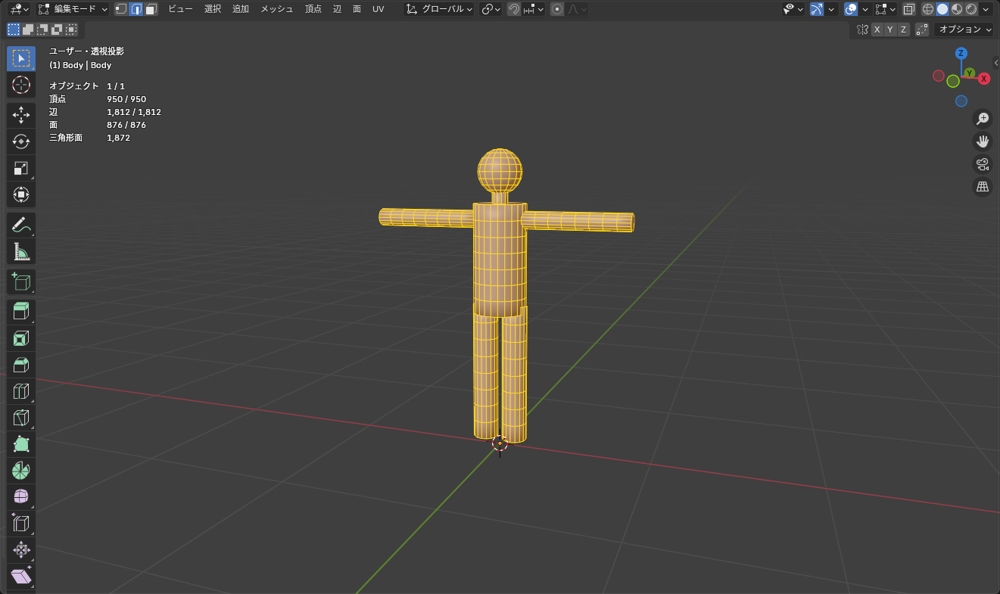
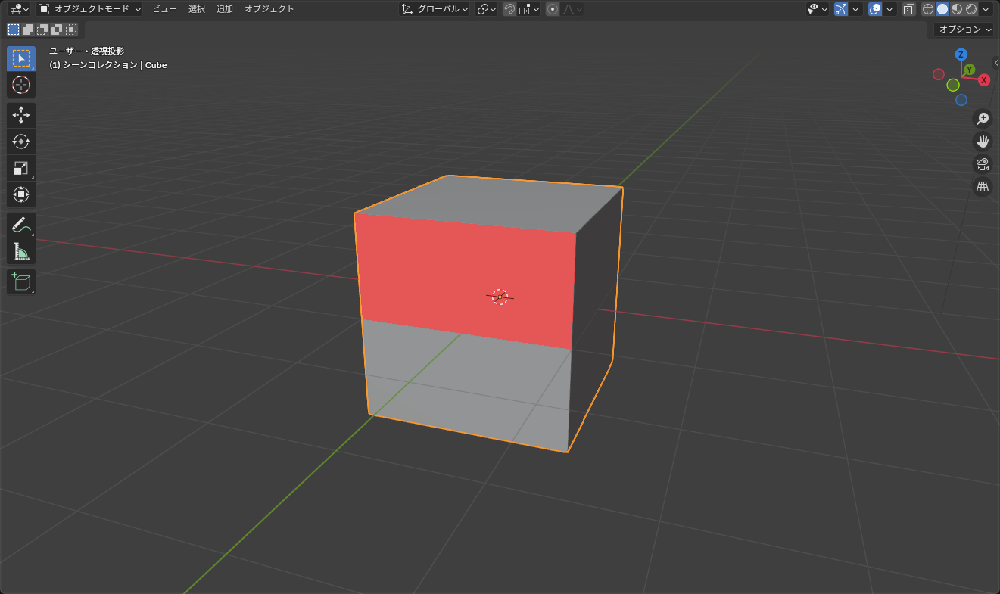

## トポロジーとは

**トポロジー** は、頂点・辺・面のつながり方のことです。同じ形でも、つながり方がきれいだと次のことが楽になります。

- ループカットが素直に入る
- サブディビジョンでなめらかになる
- アーマチュアで曲げたときに変な折れ方をしない
- UV 展開でゆがみにくい

アバターの服は **関節で曲がる** ので、トポロジーの良し悪しが見た目に直接出ます。

## 四角形で作る

面は **四角形（クアッド）** でそろえるのが基本です。

| 面の種類 | 扱い |
|---|---|
| 三角形 | 曲がると目立つことがある。平らな部分なら問題ない |
| 四角形 | 基本。ループカットが通る |
| 五角形以上（N ゴン） | ループカットが止まる、変形で破綻する。最終的に無くす |

N ゴンは、面を張った（<kbd>F</kbd>）ときや辺を溶解したときにできます。**選択 > すべてを選択（特徴で）> 辺数で面を選択**（Select > Select All by Trait > Faces by Sides）で「4 より大きい」を指定すると見つけられます。

### 関節まわりのループ

肘や膝のように曲がる場所には、**関節をまたぐループを 3 本程度** 入れておくと、曲げたときにきれいにつぶれます。1 本しかないと折り紙のように折れ、多すぎると頂点が増えるだけです。

## 頂点数を確認する

**オーバーレイ > 統計**（Overlays > Statistics）をオンにすると、画面左上に頂点・面・三角形の数が出ます。

下の 3D ビューでは、上の「統計」ボタンで同じ表示が出ます。辺を足すと数が増え、「辺を溶解」で穴を開けずに元に戻るのを確かめてください。

::: practice topology
:::

*編集モードでは「選択 / 全体」の形で表示される*

VRChat のアバターは **三角形（Tris）** の数で評価されます。目安は次の通りです。

| ランク（PC） | 三角形 |
|---|---|
| Excellent | 32,000 まで |
| Good | 70,000 まで |
| Medium 〜 Poor | 70,000 を超えると Medium 以下 |

これは **アバター全体** の数なので、服 1 着にかけられるのはその一部です。服だけで 1 〜 2 万三角形を超えていたら、減らすことを考えます。

### 減らし方

- **デシメート** モディファイアー（比率 0.5 など）: 自動で減らす。トポロジーは崩れるので、動かさない小物向き
- **制限的溶解**（<kbd>X</kbd> > 制限的溶解）: 平らな部分の辺を消す
- サブディビジョンのレベルを下げる、または外す
- 見えない面（服の下の体、服の内側）を削除する

## 掃除の手順

書き出す前に、全選択（<kbd>A</kbd>）してから次を順番に行います。

1. <kbd>M</kbd> > **距離で**: 重複した頂点をまとめる
2. <kbd>Shift</kbd>+<kbd>N</kbd>: 法線を外側にそろえる
3. **メッシュ > クリーンアップ > 孤立を削除**（Mesh > Clean Up > Delete Loose）: 面のない頂点・辺を消す
4. **メッシュ > クリーンアップ > 穴を埋める** は、穴をふさぎたいときだけ

### 法線の向きを目で確認する

**オーバーレイ > 面の向き** をオンにすると、表が青、裏が赤で表示されます。

*赤い面は Unity で透明になる。全部青になるまで直す*

<kbd>Shift</kbd>+<kbd>N</kbd> で直らない面は、その面だけ選んで **メッシュ > 法線 > 反転**（Mesh > Normals > Flip）で裏返します。

::: warning
ソリッド化モディファイアーを掛けている面の向きは、**モディファイアーを掛ける前のメッシュ** で確認してください。ソリッド化は表側に厚みを付けるので、裏返った面があると厚みが逆方向に出ます。
:::

## 分かれたパーツの確認

1 つのオブジェクトに、くっついていないパーツがいくつ入っているかは、<kbd>L</kbd> で部分ごとに選んでみるとわかります。意図せず分かれている（頂点が重なっているだけでつながっていない）場所は、**距離で** マージでつながります。

逆に、本来つなげたくない部分（服と体など）が 1 つのオブジェクトになっているときは、<kbd>L</kbd> で選んで <kbd>P</kbd> で分離します。

## よくあるつまずき

- **ループカットが途中で止まる**: 経路に三角形か N ゴンがあります。<kbd>K</kbd>（ナイフ）で辺を足して四角形にします
- **スムーズシェードで黒いしわ**: 重複頂点か裏返った面です。上の掃除の手順を実行してください
- **「距離で」で形が崩れた**: マージ距離が大きすぎます。左下のパネルで「マージ距離」を 0.0001 など小さくしてください
