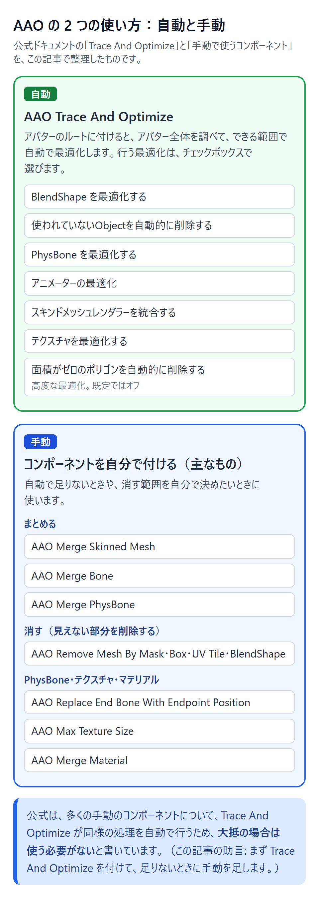
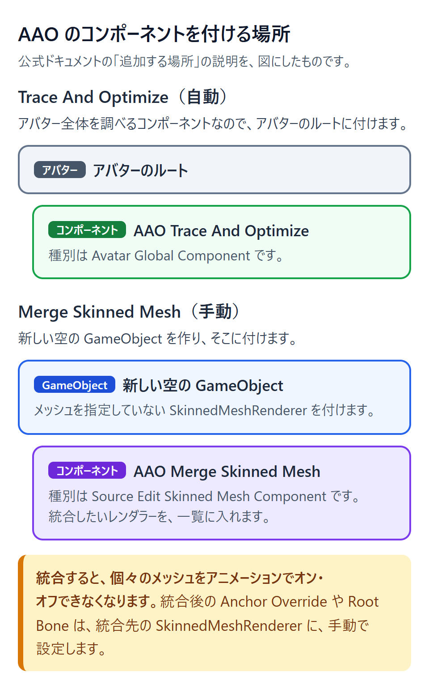
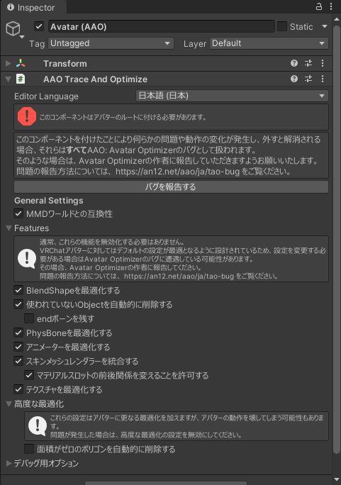
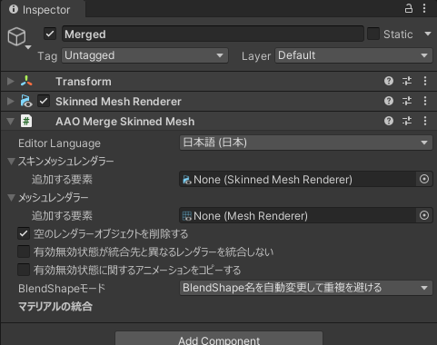

::: point
- AAO は非破壊で、プレハブを展開せずにコンポーネントを追加するだけで使える
- まず Trace And Optimize を付け、足りないときに手動のコンポーネントを足す（この記事の助言）
- 非破壊のツールを使うと、Control Panel のランクはあてにならないと公式ドキュメントが書いている
- Play モードのランクは Actual Performance Window で、複製は見た目と動きの確認に使う
:::

## Avatar Optimizer（AAO）とは

**Avatar Optimizer**（AAO）は、VRChat のアバターを軽くするための機能をまとめたツールです。作者は anatawa12 さんで、ライセンスは MIT です。公式のトップページには、「アバター軽量化用のちょっとした非破壊ユーティリティ群」と書かれています。

AAO の目的は、**アバターの見た目をほとんど変えずに、性能を上げること**です。公式ドキュメント（基本コンセプト）には、意図しない動作の変化はバグとして扱うと書かれています。

この記事では、次の言葉を使います。「リファレンス本文」は各コンポーネントのページ、「changelog」は公式ドキュメント内の変更履歴を指します。AAO は版が上がると挙動が変わることがあるので、使うときは [リリース一覧](https://github.com/anatawa12/AvatarOptimizer/releases) も確かめてください。

[](/learn/optimize-aao/images/avatar-optimizer-two-ways.png)
*AAO の 2 つの使い方（公式ドキュメントを、この記事で整理したもの。手動は主なものだけ）*

### 非破壊とは

AAO は **非破壊** です。プレハブ（Prefab）を展開せず、コンポーネントを追加するだけで使えます。プロジェクトの中のアバターは変わりません。AAO は、Play モードに入るときや、アバターをビルドするときに作られる一時的なコピーにだけ作用します。

「非破壊」の考え方は、[Avatar Optimizer のドキュメント（基本概念）](https://vpm.anatawa12.com/avatar-optimizer/ja/docs/basic-concept/) に書かれています。

### 対応環境

公式では、VPM（VRChat Package Manager。パッケージを配布・導入する仕組み）に対応したツールとして、ALCOM や VCC が挙げられています。

AAO の依存関係（VPM リポジトリのメタデータ。パッケージの説明情報）は、次のとおりです。

| 項目 | 内容 |
|---|---|
| Unity | 2022.3 |
| VRChat SDK（Avatars） | 3.7.0 以上 3.11.0 未満 |
| NDMF（NDM Framework） | 1.8.0 以上 2.0.0 未満 |

- Unity 2019 は、AAO 1.8.0 でサポートが終わりました。2019 で使うときは 1.7.x を使います（changelog の 1.8.0 に「Unity 2019 Support」の削除と、「2019 のユーザーは 1.7.x を使う」（訳。原文は "For 2019 users, please use 1.7.x."）と記載）。
- Unity 6000.x には、1.9.18 から最初の対応（changelog の英語表記は「Initial minimal support for Unity 6000.x」）が入りました。changelog には、英語で「Those versions are not yet officially supported, but something should start working.」（まだ公式には対応していないが、動き始めるはず）と書かれています。

::: warning
上の表は、VPM リポジトリのメタデータが根拠です。実際に使う Unity と VRChat SDK の組み合わせは、版ごとの対応を書いた changelog（VRChat SDK 3.7.0・3.8.1・3.10.6、Unity 2019・2022・6000.x など）で確かめてください。
:::

## 入れ方

AAO は、VPM リポジトリ（パッケージの配布先）を使って公開されています。公式は ALCOM での追加を推奨していて、VCC でも同じリンクから追加できると書いています。

### ALCOM で入れる（推奨）

1. ALCOM（VPM のツールの一つ）で、VPM リポジトリ `https://vpm.anatawa12.com/vpm.json` を追加します。
2. プロジェクトに、パッケージ `com.anatawa12.avatar-optimizer` を追加します。表示名は `AAO: Avatar Optimizer` です。

公式ページでは、ALCOM を使うことが推奨されています。VCC（VRChat Creator Companion）に存在するバグなどにより、正しく動かない可能性があるためです。

### そのほかの方法

- **UnityPackage**（VPAI インストーラー）: インストーラーの unitypackage を Unity にインポートするだけで入れられます。公式の日本語版のトップページには、「unitypackageをインポートするだけでもこのツールをインストールできます。（ALCOMから追加する方法と全く同じようになります）」と書かれています。VPAI インストーラーについて、「[アセットの配布について](https://vpm.anatawa12.com/avatar-optimizer/ja/docs/developers/distributing-prefabs/)」のページには、「VPAI インストーラーは、Avatar OptimizerのようなVPMパッケージを、unitypackageをインポートするだけでインストールするためのツールです。」と書かれています。
- **vrc-get**（コマンドラインで VPM のパッケージを入れるツール）: 次のコマンドで入れられます。`/path/to/your-unity-project` は、Unity プロジェクトのフォルダーのパスに置き換えます。

```
vrc-get repo add https://vpm.anatawa12.com/vpm.json
cd /path/to/your-unity-project
vrc-get install com.anatawa12.avatar-optimizer
```

- **VPM CLI**（VPM パッケージを管理するコマンドラインツール）: 次のコマンドで入れられます。

```
vpm add repo https://vpm.anatawa12.com/vpm.json
cd /path/to/your-unity-project
vpm add package com.anatawa12.avatar-optimizer
```

## 何が減るか（パフォーマンスランクの項目との対応）

AAO は、パフォーマンスランクの項目のうち、一部を減らせます。PhysBone（髪や服などを揺らす VRChat の仕組み）や、スキンドメッシュ（ボーンで変形するメッシュ）などの項目が対象です。自動で行われるものと、コンポーネントを付けて手動で行うものがあります。表の項目名は、画面に表示される名前に合わせています。項目の上限の値は、[パフォーマンスランク](/learn/vrchat/performance-rank) にあります。

| 項目 | AAO での扱い | 主な機能 |
|---|---|---|
| テクスチャメモリー | 自動と手動（AAO Merge Material の対応づけは、この記事の整理） | 自動: Optimize Texture ／ 手動: AAO Max Texture Size、AAO Merge Material |
| 三角ポリゴンの数 | 自動と手動 | 自動: Automatically Remove Zero Sized Polygons（既定ではオフ。1.7.1 以降は Advanced Optimizations。下の warning を参照） ／ 手動: AAO Remove Mesh By Mask・Box・UV Tile・BlendShape |
| スキンドメッシュの数 | 自動と手動 | 自動: Merge Skinned Meshes ／ 手動: AAO Merge Skinned Mesh |
| 基本メッシュの数 | 手動 | AAO Merge Skinned Mesh のメッシュレンダラー（統合対象の MeshRenderer） |
| マテリアルスロットの数 | 自動と手動 | 自動: Merge Skinned Meshes、Allow Shuffling Material Slots ／ 手動: AAO Merge Skinned Mesh のマテリアルの統合、AAO Merge Material |
| ボーンの数 | 自動と手動 | 自動: Remove unused Objects ／ 手動: AAO Merge Bone |
| PHYSBONE コンポーネントの数 | 自動と手動 | 自動: Optimize PhysBone Settings、Remove unused Objects ／ 手動: AAO Merge PhysBone |
| PHYSBONE トランスフォームの数 | 自動と手動（AAO Merge Bone の対応づけは、この記事の整理） | 自動: Optimize PhysBone Settings ／ 手動: AAO Replace End Bone With Endpoint Position、AAO Merge Bone |
| PHYSBONE コライダーの数 | 自動と手動（コライダーの Merge の対応づけは、この記事の整理） | 自動: Optimize PhysBone Settings ／ 手動: AAO Merge PhysBone のコライダー（Merge） |
| アニメーターの数 | 自動（条件つき） | 自動: Remove unused Objects（Animator Controller が無い Animator） |
| コンタクトの数 | 自動（条件つき） | 自動: Remove unused Objects（Animator Controller で使われていないパラメーターを持つ Contact Receiver） |

## Trace And Optimize でできること

AAO を使うときは、まず **AAO Trace And Optimize** を付けます。アバター全体を走査（スキャン）して、できる範囲で自動的に最適化を行うコンポーネントです。行う最適化は、チェックボックスで選べます。

公式ドキュメントでは、このコンポーネントは見た目に影響を与えないことを前提に、慎重に作られていると書かれています。見た目や機能に問題が出た場合は、AAO のバグとして報告してほしい、とも書かれています。

### 付け方

- アバターのルートに付けます（公式は「アバターのルート」とだけ書いています。この記事の補足: VRC Avatar Descriptor がある GameObject）。
- 種別は Avatar Global Component です。
- コンポーネント名（Unity 上の表示名）は `AAO Trace And Optimize` です（AAO のソース v1.9.21 の AddComponentMenu）。

[](/learn/optimize-aao/images/avatar-optimizer-where-to-attach.png)
*コンポーネントを付ける場所（公式の説明を図にしたもの。下の Merge Skinned Mesh は手動のコンポーネントで、詳しくは「まとめる（統合する）」を見てください）*

### 自動で行われること

[](/learn/optimize-aao/images/avatar-optimizer-trace-and-optimize.png)
*Trace And Optimize の Inspector（日本語の表示。Features を開いた状態。下の表の 7 つ目の「面積がゼロのポリゴンを自動的に削除する」は、Features の外の「高度な最適化」の中にある）*

| オプション | 自動で行うこと | 主に効く項目 |
|---|---|---|
| BlendShape を最適化する（Optimize BlendShape） | BlendShape を自動で固定・除去・統合し、数を減らします。 | この記事の表では対応づけていません |
| 使われていないObjectを自動的に削除する（Remove unused Objects） | アニメーションなどを調べて、使われていない Object（GameObject・コンポーネント・テクスチャなど）を削除します。 | ボーンの数、テクスチャメモリー、PHYSBONE コンポーネントの数、PHYSBONE トランスフォームの数、アニメーターの数、コンタクトの数（条件つき） |
| PhysBone を最適化する（Optimize PhysBone Settings） | 次の 4 つの処理を行います（下の一覧）。 | PHYSBONE コンポーネントの数、PHYSBONE トランスフォームの数、PHYSBONE コライダーの数 |
| アニメーターの最適化（Optimize Animator） | Animator Controller（アニメーションの動きを決めるアセット）のレイヤーを整理します（下の説明）。 | レイヤーの構成 |
| スキンドメッシュレンダラーを統合する（Merge Skinned Meshes） | 分かれている必要のないスキンドメッシュレンダラーを統合します（自動では統合しないことがあり、そのときは手動の AAO Merge Skinned Mesh を使います）。 | スキンドメッシュの数、マテリアルスロットの数 |
| テクスチャを最適化する（Optimize Texture） | 見た目に影響を与えずに、UV パッキング（UV の配置を詰めること）とテクスチャサイズの縮小を行います（対応シェーダーのマテリアルだけが対象です）。 | テクスチャメモリー |
| 面積がゼロのポリゴンを自動的に削除する（Automatically Remove Zero Sized Polygons） | 面積がゼロのポリゴンを削除します。高度な最適化の一つです（既定ではオフ。1.7.1 以降は Advanced Optimizations。下の warning を参照）。 | 三角ポリゴンの数 |

表のオプション名は、公式ドキュメントの日本語表記です。（ ）内は英語版ドキュメントの表記です。Unity 上の英語表示は「Remove unused Objects Automatically」「Merge Skinned Mesh」、日本語表示は「アニメーターを最適化する」です（ドキュメントの「アニメーターの最適化」とは表記が違います）。ほかにも、ドキュメントは「スキンドメッシュレンダラーを統合する」ですが、日本語の画面は「スキンメッシュレンダラーを統合する」です（上の画像）。「PhysBone を最適化する」などは、画面では PhysBone の後に空白がありません。

**使われていないObjectを自動的に削除する**（Remove unused Objects）について、補足します。

- 原文には「切り替えるものと一緒に使われていて、他の方法で使われていないPhysBoneコンポーネントを自動的に切り替えるようにします」と書かれています。日本語版では「切り替えるもの」が何を指すかは曖昧ですが、英語版（「if they are only used by toggled objects」。切り替えられるオブジェクトだけで使われている場合）と changelog の 1.6.0 の説明（服を Simple Toggle で切り替えると、PhysBone も自動で切り替わる）で、意味が分かります。
- changelog の 1.6.0 には、Mesh の無い Renderer と、Animator Controller の無い Animator は、意味がないものとして削除されると書かれています。
- changelog の 1.7.0 には、パラメーターが定義されていても Animator Controller で使われていない PhysBone と Contact Receiver は、削除されると書かれています。

**PhysBone を最適化する**（Optimize PhysBone Settings）の内容は、次のとおりです。

- 全く同じ設定の PhysBone Collider を、1 つに統合します。
- 不要な場合に `Is Animated` のチェックを外します。
- 掴めないものなど、統合しても動作が変わらない複数の PhysBone を、1 つに統合します。「掴める」は、PhysBone のボーンをユーザーが掴んで動かせることです（VRChat の仕様）。
- Endpoint Position（end ボーンを使わず、先端の位置を値で決める設定）で問題なく表現できる場合に、end ボーン（PhysBone の末端のボーン）を削除して Endpoint Position に置き換えます。

**アニメーターの最適化**（Optimize Animator）の内容は、次のとおりです。最適化の詳細な仕様は、将来変わる可能性があると書かれています。

- AnyState のレイヤーと完全グラフのレイヤーを、Entry-Exit に変換します。
- Diamond/Linear の Entry-Exit を、BlendTree に変換します。
- 複数の BlendTree レイヤーを、1 つの Direct BlendTree にまとめます。
- State も Transition もないレイヤーを削除します。

いくつかの項目には、次の設定や注意があります。

- **end ボーンを残す**（Preserve EndBone）: 親が残っている end ボーンを、削除しないようにします。公式では、名前が end（大文字小文字の区別なし）で終わるボーンを end ボーンとして扱うと書かれています。
- **マテリアルスロットの前後関係を変えることを許可する**（Allow Shuffling Material Slots）: マテリアルスロットの順番を変えることを許可し、描画の負荷を下げる場合があります。公式には、作者の知る限り、マテリアルスロットの前後関係は特に意味を持たない、と書かれています。
- **MMD ワールドとの互換性**（MMD World Compatibility）: MMD（MikuMikuDance）のワールドで使われる BlendShape を固定しないなど、MMD ワールドとの互換性を考えた軽量化を行います。
- **Debug Options**: バグの回避などに使う高度な設定です。公式には、不安定で、不用意に変更するべきではないと書かれています。

::: tip
既定でオンかオフかは、この記事では一覧にしていません。changelog で分かるものは次のとおりです。

- **面積がゼロのポリゴンを自動的に削除する**: 1.7.1 で Advanced Optimizations に移され、既定オフと記載されています（changelog の原文は "not enabled by default"）。一部のシェーダーやアニメーションを壊すおそれがあるためです（changelog の 1.7.1 の説明）。
- **マテリアルスロットの前後関係を変えることを許可する**: 1.9.0 で既定オンになりました。

画面で、オンとオフの状態を確かめてください。

古い記事や資料では、Trace And Optimize が「Automatic Configuration」と呼ばれていることがあります。
:::

::: warning
「面積がゼロのポリゴンを自動的に削除する」は、一部のシェーダーやアニメーションによるスケール変化を壊す可能性があるため、注意して使ってください。
:::

### 除外できるか

Trace And Optimize には、一部の GameObject を最適化の対象から外す **Exclusions**（除外）という機能があります。changelog の 1.5.0 では、「Advanced Settings Section for Trace and Optimize」（高度な設定の欄）の項目として、「Added Exclusions for exclude some GameObjects from optimization」（一部の GameObject を最適化から除外するための Exclusions を追加）と書かれています。changelog の 1.7.1 には、「Advanced Options」の欄が「Debug Options」に改名されたと書かれています。その後、1.6.7・1.8.2・1.9.2 に Exclusions の修正があります。

現在のソース（v1.9.21）では、Exclusions は Debug Options の中にあります。Debug Options を開くと、確認のダイアログが出ます。対象は GameObject の配列です。公式は、バグの回避などに使う高度な設定を「不安定であり、不用意に変更するべきではありません」と書いています。

あわせて使える設定は、次のとおりです。

- 「end ボーンを残す」（Preserve EndBone）: 親が残っている end ボーンを残す設定です。GameObject を最適化から外す Exclusions とは別の設定です。
- 項目はチェックボックスで個別にオフにできます。どの項目が原因かを探すときに使えます。（この記事の整理です。）

## 手動で使うコンポーネント

Trace And Optimize の自動の処理では足りないときや、消す範囲を自分で決めたいときに使います。公式ドキュメントでは、多くのコンポーネントについて、Trace And Optimize が同様の処理を自動で行うため、大抵の場合は使う必要がないと書かれています。まず Trace And Optimize を付けて、足りないときに手動のコンポーネントを足すのがおすすめです（**この記事の助言**{.lbl .lbl-adv}）。

コンポーネント名は、公式ドキュメントの表記（`AAO` で始まる名前）で書いています。Unity 上の表示名（AAO のソース v1.9.21 の AddComponentMenu）は、次の点が表記と違います。`AAO Freeze BlendShapes`（ドキュメントは AAO Freeze BlendShape）、`AAO Merge Toon Lit Material`（ドキュメントは AAO Merge ToonLit Material。Toon と Lit の間に空白）。検索するときは、Unity 上の表示名で探してください。

### まとめる（統合する）

[](/learn/optimize-aao/images/avatar-optimizer-merge-skinned-mesh.png)
*AAO Merge Skinned Mesh の Inspector（日本語の表示。下の設定の項目が、この順に並ぶ。統合するレンダラーは、まだ入れていない状態）*

- **AAO Merge Skinned Mesh**: 1 つ以上の SkinnedMeshRenderer と MeshRenderer を、1 つの SkinnedMeshRenderer にまとめます。SkinnedMeshRenderer を統合すると、メッシュを変形させる処理の回数が減り、負荷が軽くなります。同じマテリアルを使うマテリアルスロットもまとめられるため、描画の負荷も減らせます。
  - 追加する場所: 新しい空の GameObject を作り、そこに SkinnedMeshRenderer（メッシュ未指定）と Merge Skinned Mesh を付けます（公式の原文は「メッシュを指定していない SkinnedMeshRenderer コンポーネントがある新規 GameObject」に追加）。種別は Source Edit Skinned Mesh Component です。
  - 設定（公式の日本語表記。（ ）内は英語版ドキュメントの表記）:
    - スキンメッシュレンダラー（Skinned Renderers）: 統合対象の SkinnedMeshRenderer の一覧です。
    - メッシュレンダラー（Basic Renderers）: 統合対象の MeshRenderer の一覧です。
    - 空のレンダラーオブジェクトを削除する（Remove Empty Renderer GameObject）。Unity 上の英語表示は「Remove Empty Renderer Object」: 統合対象の SkinnedMeshRenderer が付いている GameObject に、ほかのコンポーネントがなければ、その GameObject をヒエラルキーから取り除きます。既定はオンです（changelog の 0.4.4）。
    - 有効無効状態が統合先と異なるレンダラーを統合しない（Skip Enablement Mismatched Renderers）: 統合先と有効無効の状態が違うレンダラーを、ビルド時に統合対象から外します。既定は、新しく追加した Merge Skinned Mesh ではオン（changelog の 1.6.0）でしたが、1.8.0 で既定オフに変わりました（Inspector で有効にできます）。
    - 有効無効状態に関するアニメーションをコピーする（Copy Enablement Animation）: 統合対象の有効無効に関するアニメーションを、統合先の SkinnedMeshRenderer にコピーします。
    - BlendShape モード（BlendShape Mode）: BlendShape の扱い方を選びます。既定は、重複を避けるために BlendShape 名を自動で変えるモードです。
    - マテリアルの統合（Merge Materials）: 同じマテリアルを使うマテリアルスロットを、1 つにまとめるかを選びます。
  - 注意: 統合すると、個々のメッシュをアニメーションでオン・オフできなくなります。このコンポーネントが設定するのは、メッシュ・マテリアル・BlendShape・範囲（BOUNDS）です。そのほかの設定（Anchor Override など）は変わりません。そのため、統合後の Anchor Override などは、統合先の SkinnedMeshRenderer に手動で設定します（統合先は、AAO Merge Skinned Mesh と同じ GameObject にある SkinnedMeshRenderer）。Root Bone（SkinnedMeshRenderer の基準になるボーン）も、自動では設定されません（FAQ の案内）。
  - Cloth の付いた SkinnedMeshRenderer は、統合元にするとエラーになると、changelog の 1.7.0 に書かれています。Cloth のある Renderer は、BlendShape の自動最適化（changelog では AutoFreezeBlendShape）の対象から外れます（changelog の 1.7.0）。
  - 有効無効状態に関するアニメーションは、1 種類だけコピーできます。複数の GameObject（または GameObject と Renderer 自身）がアニメーションされている場合は、エラーになり、ビルドが止まります（changelog の 1.8.0）。
- **AAO Merge Bone**: GameObject を親の GameObject に統合し、元の GameObject を取り除きます。統合対象に付いているほかのコンポーネントも削除されます。
  - 設定の「名前の競合を避ける」を使うと、統合時に子の GameObject の名前を変えて、名前の重複によるアニメーションの破損を防げます。
  - 親にも Merge Bone があると、両方とも、さらに親の GameObject に統合されます。
  - Trace And Optimize が似た処理を自動で行うため、大抵の場合は使う必要はありません。
- **AAO Merge PhysBone**: 複数の PhysBone を 1 つにまとめます。統合後の MultiChildType は Ignore になります。
  - 新しい GameObject に追加します。統合対象は同じ GameObject の子である必要があります（公式の原文は「統合対象は同じGameObjectの子である必要があります。」）。その代わりに「このGameObjectの子にする」（Make Children of Me）を使うこともできます。
  - 設定の「オーバーライド」では、各項目を Copy（すべての統合対象で値が同じ場合のみ有効）か Override（新しい値を設定）から選びます。コライダーは Merge を選ぶと、統合対象のコライダーの一覧をまとめられます。Endpoint Position は Clear を選ぶと、Clear Endpoint Position を使えます。角度制限は Fix を選ぶと、Roll の値をそろえられます。
  - Endpoint Position を Clear にすると、PhysBone Affected Transforms が増えます（changelog の 1.7.0）。そのため、新しく作る Merge PhysBone の Endpoint Position の既定は Copy です（同じく 1.7.0）。
  - ルートの GameObject も PhysBone Affected Transforms に数えられるため、Merge PhysBone を 1 つ使うごとに 1 増えます。公式には、これは VRChat のパフォーマンスランクの仕組みのバグである可能性がある、と書かれています。
  - 統合後は、掴めるのは 1 か所だけになります。

### 消す（見えない部分を削除する）

::: warning
Remove Mesh 系のコンポーネントは、削除する範囲を間違えると、見える部分が消えたり、隠れる部分が残ったりします。
:::

- **AAO Remove Mesh By Mask**: マスクテクスチャで指定した範囲のポリゴンを削除します。服で隠れて見えない部分などを消すと、見た目に影響させずに描画負荷や BlendShape の処理負荷を減らせます。
  - 追加する場所: SkinnedMeshRenderer か MeshRenderer のある GameObject です。
  - 設定: マテリアルスロットの一覧（対象を選びます）、マスクテクスチャ（削除する範囲を色で指定する画像）、削除モード（`Remove Black` か `Remove White`）です。
  - 注意: マスクテクスチャは、物（アイテム）ごとに色が異なります。削除モードを間違えると、別の部分が消えます。アルファマスク（透明度で範囲を指定する画像）や、gatosyocora さんの MeshDeleterWithTexture 用のマスクも使えます。
- **AAO Remove Mesh By BlendShape**: 選んだ BlendShape で動く頂点と、その頂点を含むポリゴンを削除します。多くの素体（アバターのベースになる体のメッシュ）に入っている貫通防止用の BlendShape を使うと、簡単にメッシュを削除できると、公式に書かれています。
  - 追加する場所: SkinnedMeshRenderer のある GameObject です。種別は Modifying Edit Skinned Mesh Component です。
  - 設定: BlendShape の一覧、許容差、「Invert Selection」（反転）、プレビューの設定（「プレビューのために、切り替えたBlendShapeの値を自動的に変更する」。切り替えた BlendShape の値を自動で 100 か 0 にする設定）です。
  - 手順: 先にプレビューで範囲を確かめ、それから許容差を調整します。
    1. 削除したい部分の BlendShape を選びます。
    2. 「プレビューのために、切り替えたBlendShapeの値を自動的に変更する」をオンにし、編集モードのプレビューで、削除される範囲を確かめます。
    3. 範囲が合わないときだけ、許容差を調整して、もう一度プレビューで確かめます。
  - 許容差: 選んだ BlendShape が頂点を許容差より大きく動かしていたら、その頂点を削除します（公式の定義。実際には、その頂点を含むポリゴンが削除されます）。通常モード（Invert Selection がオフ。既定）では、許容差を大きくすると削除される範囲が減り、小さくすると増えます。Unity 内の説明（Tolerance のツールチップ。英語版も同じ向き）は、意図していない頂点が削除されたら値を大きく、思った通りに削除されなかったら小さくする、という書き方です。
  - 反転モード: Inspector の「Invert Selection」にチェックを入れると、選んだ BlendShape のどれも、許容差より大きく動かさない頂点を削除します（既定はオフ。changelog の 1.9.0 で追加）。
  - 公式の例（リファレンス本文の「消えて欲しい箇所が消えない場合は許容差の値を大きく、消えて欲しくない箇所が消えてしまう場合は許容差の値を小さくしましょう」。基本的な使い方（basic-usage）にも、「消えてほしい箇所が消えない場合は値を少し大きく、消えてほしくない箇所が消えてしまう場合は値を少し小さくしましょう」と、同じ向きの文言があります）と、Unity 内の説明は、公式の定義（選んだ BlendShape が頂点を許容差より大きく動かしていたら、その頂点を削除する。通常モード）と比べて、許容差を動かす向きが逆に書かれています。
- **AAO Remove Mesh By Box**: 1 つ以上の箱で指定した範囲のポリゴンを削除します。設定の詳細は、[公式ドキュメント](https://vpm.anatawa12.com/avatar-optimizer/ja/docs/reference/remove-mesh-by-box/) で確かめてください。
- **AAO Remove Mesh By UV Tile**: UV タイルで指定した範囲のポリゴンを削除します。Poiyomi や lilToon の UV Tile Discard の Vertex モードのように動作します。設定の詳細は、[公式ドキュメント](https://vpm.anatawa12.com/avatar-optimizer/ja/docs/reference/remove-mesh-by-uv-tile/) で確かめてください。

### BlendShape

- **AAO Freeze BlendShape**: BlendShape をメッシュに固定して、除去します。設定は、固定して除去する BlendShape の一覧だけです。
  - 値が 0 でない BlendShape は処理の負荷になります。アニメーションで値を変えない BlendShape を固定すると、負荷が軽くなります。
  - 値が常に 0 の BlendShape を固定しても、アバターの容量を削減できます。
  - 固定すると、アニメーションで値を変えられなくなります。
  - Trace And Optimize が自動で同様の処理を行うため、大抵の場合は使う必要はありません。
- **AAO Rename BlendShape**: メッシュの BlendShape の名前を変えます。公式のリファレンスには、「変更後の名前が重複している場合、エラーになります」と書かれています。

### PhysBone・テクスチャ・マテリアル

- **AAO Replace End Bone With Endpoint Position**: PhysBone の end ボーン（末端のボーン）を、Endpoint Position の設定に置き換えます。公式には、これにより PhysBone Affected Transforms の数を減らせると書かれています。
  - 設定は、Average（end ボーンのローカル座標の平均）か Override（Endpoint Position Override で指定した値）です。
  - 同じ GameObject にあるすべての PhysBone に適用されます。
  - この記事の注意として、先端の揺れ方が変わることがあるため、確かめてください。
- **AAO Clear Endpoint Position**: PhysBone の Endpoint Position の値を 0 にし、_EndPhysBone GameObject を追加します（公式ページの表記）。公式ページには、「今のところ、このコンポーネントに設定項目はありませんが、ボタンが1つあります。適用して今すぐcomponentを削除するをクリックすると、この操作が適用され、コンポーネントが削除されます。」と書かれています。なお、changelog の 1.7.0 には、Merge PhysBone の Endpoint Position を「Clear」にすると PhysBone Affected Transforms が増える、と書かれています。
- **AAO Max Texture Size**: テクスチャサイズの上限を設定します。特定のミップマップ（縮小した画像を段階ごとに用意したもの）のレベルを減らして縮小しますが、元のテクスチャフォーマットと設定は保持されます。任意の GameObject に付けられ、その子孫すべてに適用されます。
  - 複数の AAO Max Texture Size があるときは、最も近い親の設定が適用されます。
  - 1 つのテクスチャが、異なる設定の AAO Max Texture Size から同時に影響を受けるときは、最も大きいサイズの設定が使われます。
  - ミップマップのないテクスチャや、目標の大きさまで縮小するのに十分なミップマップのレベルがないテクスチャは、スキップされて警告が出ます。Crunch 圧縮（テクスチャの圧縮方式の一つ）のテクスチャも、スキップされて警告が出ます。
- **AAO Merge Material**: 同じシェーダーを使うマテリアルを、テクスチャを手動で並べて 1 つのマテリアルにまとめます。
  - 追加する場所: SkinnedMeshRenderer か MeshRenderer のある GameObject です。
  - 注意: AAO Merge Material で作ったマテリアルを使うマテリアルスロットは、AAO Merge Skinned Mesh では統合されません。別々のメッシュのマテリアルも統合したいときは、AAO Merge Skinned Mesh と同じ GameObject に AAO Merge Material を追加します。
  - 制限事項: マテリアルを置き換えるアニメーションには対応していません。公式には、「ParallaxやUVスクロールのような、テクスチャの参照される位置が使用時に変化するようなシェーダ機能はサポートされていません」と書かれています。パララックス（見る角度に応じて、模様がずれて奥行きに見える表現）も、この中に含まれます。

### 非推奨のコンポーネント

::: warning
次のコンポーネントは、公式ドキュメントで非推奨とされています。新しく使うのは避け、代わりのものを使ってください。

- **AAO Merge ToonLit Material**: 対応シェーダーは `VRChat/Mobile/Toon Lit` だけです（現時点）。公式には、このコンポーネントの動作が改善されることはない、と書かれています。代わりに、AAO Merge Material の使用が推奨されています。
- **AAO Make Children**: アバターの最適化とは関係がない、と書かれています。将来は、別の非破壊のアバター改変ユーティリティのコンポーネントに置き換えられる予定です。
- **AAO UnusedBonesByReferencesTool**: 代わりに、Trace And Optimize の「使われていないObjectを自動的に削除する」を使うよう書かれています。
:::

::: tip
「面積がゼロのポリゴンを自動的に削除する」（Automatically Remove Zero Sized Polygons）をオンにしたとき、AAO Remove Zero Sized Polygon は Trace And Optimize によって自動で追加されます。このコンポーネントは、上の非推奨の一覧には入っていません。公式では、手動で追加するより、Trace And Optimize を使うことをお勧めします、と書かれています。
:::

## 結果の確認

AAO の処理は、VRChat SDK の Control Panel では確かめにくいものです。次の方法で確かめます。

::: tip
公式ドキュメントは、非破壊のツールを使うアバターでは、Control Panel のパフォーマンスランクはあてにならなくなると書いています。そのため、Control Panel の数字はそのままでは信頼しないでください。
:::

1. **Play モードで確かめる**: 公式ドキュメントは、Play モードに入ったときのパフォーマンスランクを、anatawa12 さんの Gist Pack の Actual Performance Window で確認できると書いています。
2. **複製で処理後の姿を見る**: アバターの GameObject を右クリックして、`NDM Framework` > `Manual bake avatar` を選びます。AAO などの処理を適用した複製ができ、元のアバターは変わりません。見た目と動きを比べてください。公式ドキュメントは、VRChat 向けのアバターを VRM 形式で出力したい場合などに、この方法を使えると書いています。

ランクの見方は、[パフォーマンスランク](/learn/vrchat/performance-rank) にまとめています。

## うまくいかないとき

よくある症状と、公式ドキュメントの[よくある質問（FAQ）](https://vpm.anatawa12.com/avatar-optimizer/ja/docs/faq/) の案内を並べます。

| 症状 | 対応 |
|---|---|
| 見た目や動きが変わった | Trace And Optimize で見た目や動きが変わった場合は、AAO の不具合の可能性があります。ただし、ほかの AAO コンポーネントのバグの挙動に頼っている場合は除きます。報告してください。報告先は、[GitHub Issues](https://github.com/anatawa12/AvatarOptimizer/issues) や NDMF の Discord などです。公式には、報告用の Bug Report Helper のページもあります。 |
| メッシュが見えない | 公式 FAQ によると、多くの場合は、統合先のメッシュ（AAO Merge Skinned Mesh と一緒に付いている SkinnedMeshRenderer）の Root Bone を指定し忘れていることが原因です。AAO Merge Skinned Mesh は Root Bone を自動で設定しないため、手動で設定します。Modular Avatar を使っている場合は、アバターのルートに MA Mesh Settings を追加すると、アバター全体の Root Bone と範囲（BOUNDS）を設定できます。 |
| 統合したメッシュの明るさが違う | 公式 FAQ によると、多くの場合は、統合先のメッシュの Anchor Override を指定し忘れていることが原因です。AAO Merge Skinned Mesh は Anchor Override を自動で設定しないため、手動で設定します。Modular Avatar を使っている場合は、アバターのルートに MA Mesh Settings を追加すると、アバター全体の Anchor Override を設定できます。 |
| 統合後に、マテリアルプロパティのアニメーションが競合する | 既知の不具合で、現時点では競合します。統合したあとは、マテリアルのアニメーションが動くかを確かめてください（公式の備考は「マテリアルに関するアニメーションは統合前のものがそのまま機能します」と書いていて、書き方が食い違います。詳しくは [軽量化に使う 5 つのツールと早見表](/learn/optimize-basics/tools-overview)）。解決を求める issue は、[#340](https://github.com/anatawa12/AvatarOptimizer/issues/340)（マテリアルのアニメーションパラメータの競合の解決。open）です。公式 FAQ では、マテリアルプロパティに対してアニメーションされるメッシュを統合するときは、競合しないよう注意するよう書かれています。競合するときは警告が表示されます。 |
| 統合後に、マテリアルスロットのアニメーションが競合する | マテリアルを別のものに置き換えるアニメーションがあるときは、AAO Merge Skinned Mesh の「マテリアルの統合」の「統合する」をオフにします（公式 FAQ の方法）。 |
| OSC（ゲームや外部ツールと値をやりとりする通信の仕組み）のギミックで、PhysBone や Contact Receiver が効かない | AAO の Trace And Optimize は、OSC で使われているかを判別できないため、使われていないように見えるものを削除することがあります。公式 FAQ では、Asset Description ファイルを作成し、Parameters Read By External Tools に設定する方法が書かれています。 |
| VRChat SDK のハードリミットを超えて、アップロードできない | VRChat SDK 3.8.1 以降は、シーン上のアバターがハードリミット（アバターの上限値）を超えていても、ビルドとアップロードを開始できます。公式では、VRChat SDK を最新版に更新することが推奨されています。 |
| Android（Quest）で、ビルド前のチェックがアップロードを止める | 基本的な使い方のページが Android（Quest）向けのアップロードの件を挙げ、回避策は FAQ の「ビルド前のハードリミットチェック」の項を見るよう案内しています。この記事では手順を省きます。 |

## ほかのツールとの併用

### Modular Avatar

- AAO のパッケージの依存には、Modular Avatar は含まれていません。
- 公式の FAQ と Merge Skinned Mesh の項では、Modular Avatar の MA Mesh Settings コンポーネントの案内があります。アバターのルートに置くと、アバター全体の Root Bone と範囲（BOUNDS）を設定できます（FAQ の「非表示」の項）。Anchor Override も、アバター全体をまとめて設定できます（FAQ の「明るさ」の項）。
- 処理の順序（古い記述と、現在の既定）: changelog の 1.1.0 には、「modular avatar will be applied before AvatarOptimizer main logic and after removing EditorOnly」（Modular Avatar は、EditorOnly の削除のあと、AAO の主な処理より前に適用される）と書かれています。これは、1.1.0 で Play モードでの適用の仕組みを作り直したときの記述です。
  - 現在の既定は、changelog の 1.9.0 の「Avatar Optimizer will run as late as possible in NDMF Pipeline by default」（既定では、AAO は NDMF の処理の中で、できるだけ遅く実行される）です。

### 同じ GameObject に置くとき

- AAO Merge Material と AAO Merge Skinned Mesh を同じ GameObject に置くと、別のメッシュのマテリアルも統合できます。
- AAO Merge Material で作ったマテリアルは、AAO Merge Skinned Mesh ではさらに統合されません。

### TexTransTool

TexTransTool（TTT）について、AAO の changelog の 1.8.0 に「Improve RemoveMeshByMask compability with Tex Trans Tool」（RemoveMeshByMask と TTT の互換性の改善）があります。changelog の表記は「Tex Trans Tool」です（この記事の地の文では、TexTransTool（TTT）と書きます）。TTT と併用するときは、TTT の公式の情報も確かめてください。
