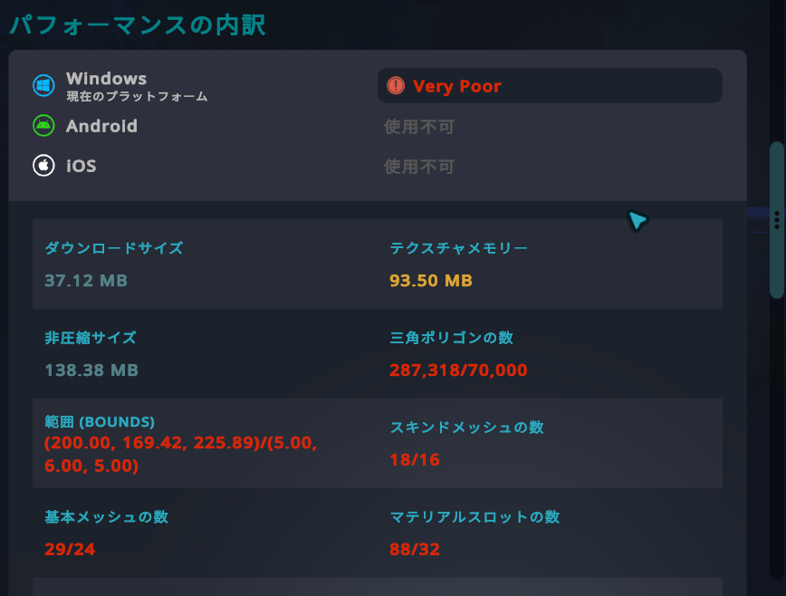
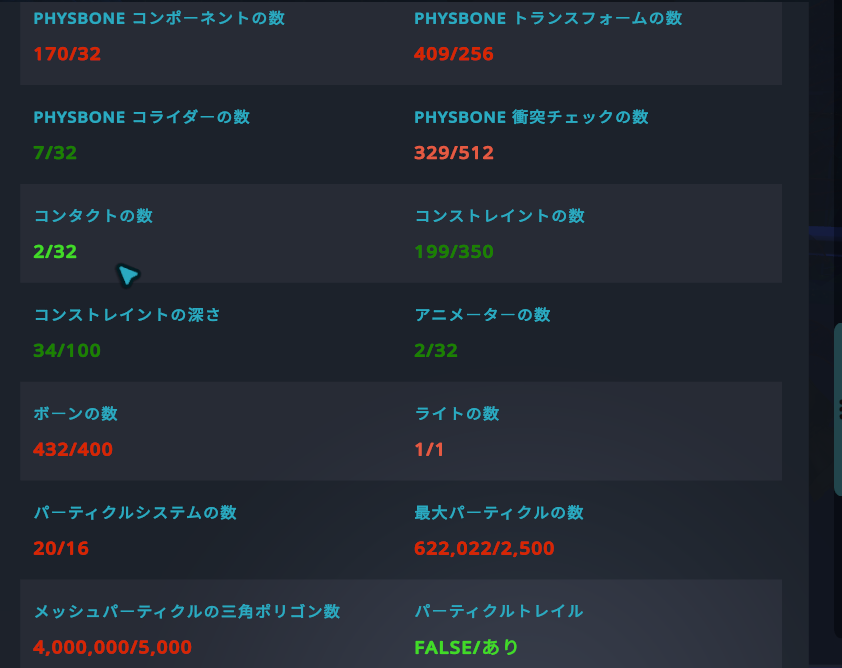
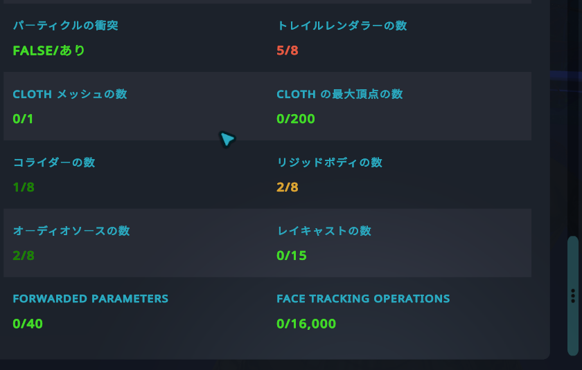

::: point
- 「/」の右の数字は、PC の Poor の上限で、左がこのアバターの値
- どれか 1 項目でも上限を超えると、次のランクになります
- 「FALSE/あり」の項目は、数ではなく True か False で表される
- 無効にしただけのものも、ランクの計算に入ります
:::

## はじめに

この記事では、VRChat SDK の「パフォーマンスの内訳」の画面の 3 枚の画像を順に見ながら、次のことを説明します。

- 各項目が何を数えているか
- 数字と色が何を表しているか
- どの項目から手をつけるか

ランクの決まりは [パフォーマンスランク](/learn/vrchat/performance-rank)、減らし方の手順は [アバターを軽くする](/learn/vrchat/optimization) にまとめています。

「**この記事の助言**{.lbl .lbl-adv}」は、この記事自身の助言です。

## 画面の読み方の決まり

### 「/」の右の数字は、PC の Poor の上限

「287,318/70,000」のように `/` で並んでいる項目は、左がこのアバターの値、右が **PC の Poor の上限** です。Poor の上限は、Poor でいられる最大の値です。どれか 1 項目でも上限を超えると、次のランクになります。数値の項目では、右の数字はすべて PC の Poor の上限と一致します。左の値が右の数字を超えている項目は、Poor の上限を超えています。

### 色の意味

画面には凡例（色の説明）が出ていません。文字の色は、その項目がランクを引き下げる先のランクに一致します。

色と上限の対応は、[パフォーマンスランク](/learn/vrchat/performance-rank) の表と見比べてください。

### 数字の無い項目

ダウンロードサイズと非圧縮サイズは、「/」の右の数字がなく、色の段階もありません。値だけが灰色で出ます。サイズの上限は、ランクの表とは別に、[Avatar Size Limits](https://creators.vrchat.com/avatars/avatar-size-limits) にあります。PC は Download 200 MB・Uncompressed 500 MB、Android は Download 10 MB・Uncompressed 40 MB です。この画面の値（Windows で 37.12 MB・138.38 MB）は、どちらも PC の上限より小さい値です。Build & Test を使う場合は、サイズの上限は適用されません。

テクスチャメモリーも、画面には上限（「/」の右の数字）が出ません（93.50 MB と値だけが出ます）。ランクごとの上限は、[パフォーマンスランク](/learn/vrchat/performance-rank) の表のとおりです。

### 「使用不可」（Android・iOS）

Android と iOS の欄には、「使用不可」（灰色）と出ます。

参考として、[Performance Ranks](https://creators.vrchat.com/avatars/avatar-performance-ranking-system) を挙げます。モバイルの Very Poor のアバターは、VRChat で表示されないことがあります。例として、三角ポリゴンが 20,000 を超えるモバイルのアバターは、ユーザーには見えません。「Show Avatar」を選べば、強制的に表示することはできます。このアバターは、Android の三角ポリゴンの上限（20,000）を大きく超えています。

将来、モバイルの Very Poor のアバターが Android・iOS から無くなることや、「Show Avatar」が使えなくなることがあります。

### 「FALSE/あり」（パーティクルトレイル・パーティクルの衝突）

この 2 項目は、数字ではなく「FALSE/あり」と出ます。左は、このアバターの値です。パーティクルシステムの 1 つにでも Particle Trails（トレイル。尾を引く表示）や Particle Collision（衝突）が有効になっていると True になります。

「あり」は、True になる段階です。PC は Medium と Poor で True、Android は Poor で True です（Excellent と Good は False）。

### 表の読み方

- 表の「定義・補足」は、VRChat の統計表の説明（定義）と、注記（補足）をまとめたものです。「補足: ―」は、この記事の表では補足を載せていない項目です。
- 「上限（PC / Android）」は、左が PC、右が Android の Poor の上限です。「モバイル（Android・iOS）では無効」は、Mobile Removed Components に挙げられた項目です。
- 「減らし方」の列は、減らし方を出典つきで書いています。出典は、Avatar Optimization Tips、Avatar Size Limits（サイズの減らし方）、Performance Ranks › Avatar Performance Ranking Stats › Face Tracking のいずれかです。「―」は、減らし方を載せていない項目です。

## 1. プラットフォーム欄とメッシュ系

*パフォーマンスの内訳の上の部分。プラットフォーム欄と、ダウンロードサイズからマテリアルスロットの数まで*

### プラットフォーム欄

- **Windows（現在のプラットフォーム）**: いま見ているパソコン向けの判定です。この画面では **Very Poor** です。
- **Android・iOS**: 「使用不可」（灰色）です。

### 項目

| 項目（画面の表示） | 定義・補足 | 上限（PC / Android） | 減らし方 |
|---|---|---|---|
| ダウンロードサイズ | 圧縮後のアバターの大きさ（asset bundle を圧縮したサイズ）。補足: SDK は、ビルド時に上限を超えるとアップロードを止める | ランクの表の項目ではない（サイズの上限は上の節を参照） | サイズを減らす手順があります（Avatar Size Limits。テクスチャの最大サイズ、音声の長さと品質、アニメーションのキーフレーム、ブレンドシェイプなど） |
| テクスチャメモリー | テクスチャが使うメモリーの推定値。補足: テクスチャは、システム RAM と GPU のメモリーの両方を使う | 150 MB / 40 MB | Unity のインポート設定で Max Size を下げ、高解像度のテクスチャを何枚も使わないことをおすすめします |
| 非圧縮サイズ | 展開（非圧縮）したあとの asset bundle の大きさ。補足: 個々のアセットは展開せず、bundle 全体で数える。テクスチャの圧縮を High Quality にすると、ダウンロードと非圧縮の両方が増える | ランクの表の項目ではない（サイズの上限は上の節を参照） | サイズを減らす手順は同上 |
| 三角ポリゴンの数 | モデルの三角ポリゴンの数（正式な項目名は Triangles。以前は誤って「Polygons」と呼ばれていた）。補足: Mesh Read/Write を、いずれかの mesh（particle systems を含む）で無効にすると、この項目は「Mesh Read/Write Disabled」と表示され、ランクは即座に Very Poor になる（「赤い項目から、どう手をつけるか」の下の注意を見てください） | 70,000 / 20,000 | 法線マップの焼き込み、decimation（間引き）や retopology（作り直し）によるメッシュの簡略化を検討するのがおすすめです |
| 範囲（BOUNDS） | アバター全体の大きさ（3 方向の寸法）。Trail Renderer と Line Renderer は計算に入らない。補足: 大きいと、常時は見えない大きなアニメーションがある可能性がある。範囲（BOUNDS）は、アバターの表示が制限される理由にはなりません（注記） | 5 × 6 × 5 m / 5 × 6 × 5 m | ― |
| スキンドメッシュの数 | Skinned Mesh Renderer（ボーンで動くメッシュ）のコンポーネントの数。補足: ― | 16 / 2 | メッシュを統合するのがおすすめです。Skinned Mesh Renderer は 1 つまで、静的（Static）メッシュは 3 つまでがおすすめです（ランクの上限とは別の推奨値） |
| 基本メッシュの数 | ボーンで動かない Mesh Renderer のコンポーネントの数。補足: ― | 24 / 2 | メッシュを統合するのがおすすめです。静的（Static）メッシュは 3 つまでがおすすめです（ランクの上限とは別の推奨値） |
| マテリアルスロットの数 | マテリアルを割り当てる枠の数。補足: パーティクルシステムは 1 枠、トレイル付きのパーティクルシステムは 2 枠、Line Renderer は 1 枠を使う | 32 / 4 | マテリアルが 10 を超えるなら、テクスチャアトラス（Texture Atlasing。複数のテクスチャを 1 枚にまとめたもの）を検討するのがおすすめです |

- 範囲（BOUNDS）の上限（5 × 6 × 5 m）の単位は m です。画面の値（200.00, 169.42, 225.89）には、単位が表示されていません。
- Android の欄について: PhysBone（ボーンを物理やほかのプレイヤーの影響で動かす仕組み（髪や服の揺れなどに使われる））・コンタクト（Contact。触れたときに反応する仕組み）・VRChat のコンストレイント（Constraint。別のオブジェクトに合わせて、位置・回転・大きさを動かす部品）は、モバイル（Android・iOS）で Very Poor の値（Poor の上限を超えた値）になると、Show Avatar の状態にかかわらず、すべて取り除かれます。別の条件として、Mobile Avatar Component Limits があります。PhysBone の数 8、PhysBones の影響を受けるトランスフォーム 64、コライダー 16、衝突チェック 64、コンタクト 16、コンストレイント 150、コンストレイントの依存の深さ 50 を超えると、制限の対象の部品がすべて取り除かれ、「Show Avatar」を選んでも回避できません。
- 描画の呼び出し（ドローコール）は、メッシュごとに 1 回ずつ必要になるのが基本で、減らすと描画の時間が短くなります（Unity マニュアル）。

### この画面の読み方

- 三角ポリゴンの数（287,318/70,000）、範囲（BOUNDS）、スキンドメッシュの数（18/16）、基本メッシュの数（29/24）、マテリアルスロットの数（88/32）は、いずれも上限を超えています（赤）。マテリアルスロットは、上限の約 2.75 倍です。
- テクスチャメモリー（93.50 MB）は Medium の範囲で、画面では黄色です。
- ダウンロードサイズと非圧縮サイズは、「/」の右の数字がなく、色の段階も、分母もありません。

## 2. PhysBone・コンタクト・コンストレイント・パーティクルなど

アニメーター（Animator）は、アニメーションを制御する部品です。PhysBone（ボーンを物理やほかのプレイヤーの影響で動かす仕組み（髪や服の揺れなどに使われる））・コンタクト（Contact。触れたときに反応する仕組み）・コンストレイント（Constraint。別のオブジェクトに合わせて、位置・回転・大きさを動かす部品）は、次の表に出てきます。モバイルで取り除かれる場合の注意は、上の「Android の欄について」を参照してください。

*パフォーマンスの内訳の中の部分。PhysBone からパーティクルトレイルまで*

### 項目

| 項目（画面の表示） | 定義・補足 | 上限（PC / Android） | 減らし方 |
|---|---|---|---|
| PHYSBONE コンポーネントの数 | PhysBone コンポーネントの数。補足: ― | 32 / 8 | ― |
| PHYSBONE トランスフォームの数 | PhysBone が影響を与えるトランスフォームの数（正式な項目名は PhysBones Affected Transforms）。補足: ― | 256 / 64 | ― |
| PHYSBONE コライダーの数 | PhysBone のコライダーのスクリプトの数。補足: ― | 32 / 16 | ― |
| PHYSBONE 衝突チェックの数 | 各コライダーが影響しうるトランスフォーム数の合計。補足: 同じトランスフォームが複数のコライダーに影響されると、その分だけ重ねて数える | 512 / 64 | ― |
| コンタクトの数 | Contact の数（フィルタリングが「Local Only」の Receiver は数えない）。補足: ― | 32 / 16 | ― |
| コンストレイントの数 | VRChat のコンストレイントと Unity のコンストレイントの総数。補足: ― | 350 / 150 | Unity の Constraint は使わず、VRChat の Constraint を使うのがおすすめです |
| コンストレイントの深さ | すべてのコンストレイントの依存関係の、最も深いつながり。補足: ― | 100 / 50 | いちばん長いつながりを短くするのがおすすめです（詳しくは「コンストレイントの深さを減らす」） |
| アニメーターの数 | Animator の数（ルートの Animator も数えるため、最低 1）。補足: Excellent では、ルート以外の Animator を追加できない | 32 / 2 | ― |
| ボーンの数 | アバターのリグ（骨組み）のボーンの数。補足: ― | 400 / 150 | 使わないボーンは、削除して親のボーンに統合することを検討するのがおすすめです |
| ライトの数 | Light コンポーネントの数。補足: ― | 1 / モバイル（Android・iOS）では無効 | アバターではライトを使わず、常時点灯のライトも使わないのがおすすめです |
| パーティクルシステムの数 | Particle System コンポーネントの数。補足: ― | 16 / 2 | パーティクルシステムの数を制限するのがおすすめです |
| 最大パーティクルの数 | 各 Particle System の maxParticles（最大粒子数）の合計。補足: ― | 2,500 / 200 | 同時に放出する粒子の最大数を制限するのがおすすめです |
| メッシュパーティクルの三角ポリゴン数 | 有効（active）なパーティクルシステムが出すメッシュパーティクルの三角ポリゴンの数（maxEmission × meshParticleVerts）。補足: ― | 5,000 / 400 | ― |
| パーティクルトレイル | Particle Trails を有効にしたパーティクルシステムが、アバターに 1 つでもあるか（True / False）。補足: ― | True / True | ― |

### この画面の読み方

- PHYSBONE コンポーネントの数（170/32）と、PHYSBONE トランスフォームの数（409/256）は、上限を超えています。
- PHYSBONE 衝突チェックの数（329/512）は、上限以下です。Medium の値を超えていて（Medium の値は、[パフォーマンスランク](/learn/vrchat/performance-rank) の表を参照）、画面では赤です。
- ボーンの数（432/400）は、上限をわずかに超えています。
- パーティクルシステムの数（20/16）は、上限を超えています。
- 最大パーティクルの数（622,022/2,500）と、メッシュパーティクルの三角ポリゴン数（4,000,000/5,000）は、上限の 200 倍以上です。
- ライトの数（1/1）は、上限ちょうどで、画面では赤です。
- PHYSBONE コライダーの数（7/32）、コンタクトの数（2/32）、コンストレイントの数（199/350）、コンストレイントの深さ（34/100）、アニメーターの数（2/32）は、上限以下で、画面では緑です。
- パーティクルトレイルは「FALSE/あり」で、緑です。

## 3. その他の項目

*パフォーマンスの内訳の下の部分。パーティクルの衝突から FACE TRACKING OPERATIONS まで*

### 項目

| 項目（画面の表示） | 定義・補足 | 上限（PC / Android） | 減らし方 |
|---|---|---|---|
| パーティクルの衝突 | Particle Collision を有効にしたパーティクルシステムが、アバターに 1 つでもあるか（True / False）。補足: ― | True / True | 多くの粒子を出すときは、衝突（collision）を使わないのがおすすめです |
| トレイルレンダラーの数 | Trail Renderer の数（尾を引く線を描く部品）。補足: 範囲（BOUNDS）の計算には入らない | 8 / 1 | ― |
| CLOTH メッシュの数 | Cloth コンポーネントの数（布の動きを物理で計算する部品）。補足: Cloth は、Skinned Mesh Renderer と組み合わせて使う（Unity マニュアル） | 1 / モバイル（Android・iOS）では無効 | Cloth の使用は控え、約 200 の頂点を超えるメッシュには使わないのがおすすめです |
| CLOTH の最大頂点の数 | 正式な項目名は Total Cloth Vertices。補足: ― | 200 / モバイル（Android・iOS）では無効 | ― |
| コライダーの数 | 正式な項目名は Physics Colliders（Collider は、Unity の物理の衝突の形を決める部品）。補足: ― | 8 / モバイル（Android・iOS）では無効 | ― |
| リジッドボディの数 | 正式な項目名は Physics Rigidbodies（Rigidbody は、Unity の物理演算で動く部品）。補足: ― | 8 / モバイル（Android・iOS）では無効 | ― |
| オーディオソースの数 | 正式な項目名は Audio Sources（Audio Source は、Unity の音を鳴らす部品）。補足: ― | 8 / モバイル（Android・iOS）では無効 | ― |
| ラインレンダラーの数（画面には出ない項目） | アバターにある Line Renderer の数（正式な項目名は Line Renderers）。補足: ― | 8 / 1 | ― |
| レイキャストの数 | VRCRaycast コンポーネントの数。補足: 全プラットフォームで 1 アバターあたり 80 個が上限（固定の上限） | 15 / 8 | ― |
| FORWARDED PARAMETERS | Face Tracking の Parameter Behavior で「Forward to Animator」を使う Avatar Parameter の数。補足: Forward to Animator は、その値で Animator の同名のパラメーターを更新する | 40 / 40 | Animator に必要な値だけを転送するのがおすすめです |
| FACE TRACKING OPERATIONS | Face Tracking の計算の作業量の推定値。Blendshapes Set ごとの tracking または viseme の mapping を、対象の BlendShape を持つ Face Tracking Meshes のメッシュごとに 1 回ずつ数える。Parameter Behavior の入力や、Custom mode の Expression の入力・演算子・関数も数える（数値の定数は数えない）。補足: 例は、表の下の箇条書きを参照 | 16,000 / 16,000 | 直接の BlendShape の対応づけと、Face Tracking 内の計算を優先するのがおすすめです |

- FACE TRACKING OPERATIONS の例: 1 つの Blendshapes Set に 100 の対応づけがあり、対象の 2 つのメッシュに同じ BlendShape がある場合は 200。同じ Blendshapes Set をもう 1 つ足すと、Default Weight が 0 でも、さらに 200。
- Custom expression には、別の上限（expression limits）があります。この上限はランクに影響しません。

### この画面の読み方

- トレイルレンダラーの数（5/8）は、上限以下です。Medium の値を超えていて（Medium の値は、[パフォーマンスランク](/learn/vrchat/performance-rank) の表を参照）、画面では赤です。
- リジッドボディの数（2/8）は Medium の範囲で、画面では黄色です。
- コライダーの数（1/8）とオーディオソースの数（2/8）は Good の範囲で、画面では濃い緑です。
- CLOTH メッシュの数（0/1）、CLOTH の最大頂点の数（0/200）、レイキャストの数（0/15）、FORWARDED PARAMETERS（0/40）、FACE TRACKING OPERATIONS（0/16,000）は、値が 0 で、緑です。
- パーティクルの衝突は「FALSE/あり」で、緑です。読み方は、冒頭の「FALSE/あり」の説明と同じです。

## 赤い項目から、どう手をつけるか

### まず、Very Poor の原因を見つける

どれか 1 項目でも Poor の上限を超えると、次のランク（Very Poor）になります。つまり、左の値が右の上限を超えている項目が、Very Poor の原因です。この画面では、次の 11 項目が当てはまります。

- 三角ポリゴンの数（287,318/70,000）
- 範囲（BOUNDS）
- スキンドメッシュの数（18/16）
- 基本メッシュの数（29/24）
- マテリアルスロットの数（88/32）
- PHYSBONE コンポーネントの数（170/32）
- PHYSBONE トランスフォームの数（409/256）
- ボーンの数（432/400）
- パーティクルシステムの数（20/16）
- 最大パーティクルの数（622,022/2,500）
- メッシュパーティクルの三角ポリゴン数（4,000,000/5,000）

PHYSBONE 衝突チェックの数（329/512）、ライトの数（1/1）、トレイルレンダラーの数（5/8）は、赤ですが上限を超えていません。Poor の範囲に入っている項目です。

### 手をつける順番（目安）

次は、この画面を見たうえでの、**この記事の助言**{.lbl .lbl-adv}です。

1. **上限の何倍も超えている項目から確かめる。** 最大パーティクルの数やメッシュパーティクルの三角ポリゴン数は、上限の 200 倍以上です。メッシュパーティクルの三角ポリゴン数は、maxEmission と meshParticleVerts の積です。
2. **数の多い PhysBone や、ボーン・メッシュ系を減らす。** 手順は [アバターを軽くする](/learn/vrchat/optimization) にまとめています。
3. **1 つ直すたびに、パフォーマンスの内訳をもう一度見る。** 赤い項目の数が減ったか、どの項目が変わったかを確かめます。

::: warning
**無効にしただけ** のオブジェクトも、ランクの計算に入ります。EditorOnly にすると、ビルドから外れます（Unity マニュアル）。以下は**この記事の助言**{.lbl .lbl-adv}です。使わない衣装や小物は、Tag を EditorOnly にするか、削除してください。

**Mesh Read/Write**（Unity の Read/Write Enabled。スクリプトからメッシュのデータを読み書きできるようにする設定）を、いずれかの mesh（particle systems を含む）で無効にすると、ランクは即座に Very Poor になります。
:::

## 参考

- [Avatar Performance Ranking System（VRChat 公式）](https://creators.vrchat.com/avatars/avatar-performance-ranking-system)
- [Avatar Size Limits（VRChat 公式）](https://creators.vrchat.com/avatars/avatar-size-limits)
- [Avatar Optimization Tips（VRChat 公式）](https://creators.vrchat.com/avatars/avatar-optimizing-tips)
- [Avatar Fallback System（VRChat 公式）](https://docs.vrchat.com/docs/avatar-fallback-system)。このページの冒頭には警告があります（要旨）。フォールバックは impostor に置き換えられつつあり、Web では選べるが VRChat の中では選べない、という内容です。
- [Tags（Unity マニュアル）](https://docs.unity3d.com/Manual/Tags.html)・[FBX Importer（Unity マニュアル。Read/Write）](https://docs.unity3d.com/Manual/FBXImporter-Model.html)・[描画の呼び出しの最適化（Unity マニュアル）](https://docs.unity3d.com/Manual/optimizing-draw-calls.html)

上限の値は見直されることがあるので、最新の値は、上の参考のページで確かめてください。
