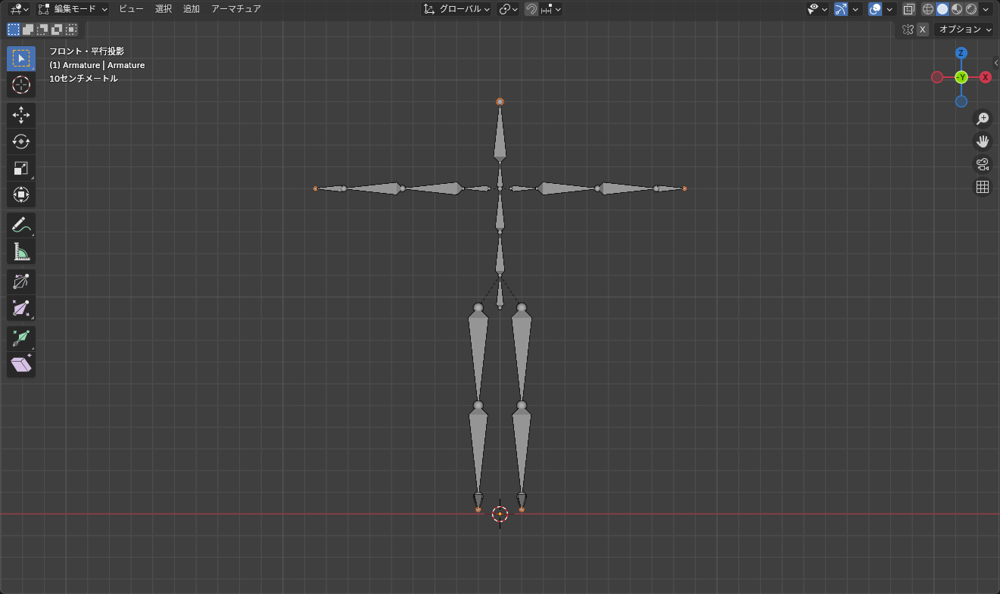
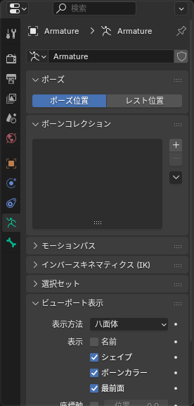

## アーマチュアとは

**アーマチュア** は骨組み（ボーンの集まり）のオブジェクトです。メッシュをアーマチュアに関連付けると、ボーンを動かしたときにメッシュがついてきます。

アバターの衣装を作るだけなら、**自分でアーマチュアを作ることはほぼありません**。アバターに最初から入っているアーマチュアを使います。ただし、ボーンがどう動くかを知っておくと、ウェイトの調整で迷わなくなります。この記事では小さなアーマチュアを作って仕組みを確かめます。

## 作る

1. <kbd>Shift</kbd>+<kbd>A</kbd> > **アーマチュア**（Armature）で追加する。1 本のボーンが置かれる
2. <kbd>Tab</kbd> で編集モードに入る
3. ボーンの先端（細い方）を選んで <kbd>E</kbd> で押し出すと、つながった子ボーンができる
4. 必要な分だけ押し出していく

*太い方が根元（ヘッド）、細い方が先端（テール）。先端から押し出すと親子関係が自動で付く*

アーマチュアは 3 つのモードを持ちます。

| モード | 用途 |
|---|---|
| オブジェクトモード | アーマチュア全体を動かす |
| 編集モード（<kbd>Tab</kbd>） | ボーンの位置・長さ・親子関係を決める（「休め」の姿勢） |
| ポーズモード（<kbd>Ctrl</kbd>+<kbd>Tab</kbd>） | ボーンを動かしてポーズを付ける。メッシュがついてくる |

::: tip
ポーズモードで動かした姿勢は編集モードには影響しません。ポーズを崩してしまったら、ポーズモードで全選択して <kbd>Alt</kbd>+<kbd>R</kbd>（回転をクリア）、<kbd>Alt</kbd>+<kbd>G</kbd>（位置をクリア）で元に戻せます。
:::

## メッシュの中に埋もれて見えないとき

アーマチュアはメッシュの中に入れるので、ソリッド表示では隠れて見えません。オブジェクトデータプロパティ（アーマチュアのアイコン）の **ビューポート表示 > 最前面**（In Front）をオンにすると、メッシュを透かして常に表示されます。

*「表示方法」でボーンの見た目（八面体・スティック）を変えられる。スティックが邪魔にならない*

## ボーンの名前

ボーンの名前は **非常に重要** です。VRChat（Unity の Humanoid）は、名前と階層からどれが腕・脚・頭なのかを判断します。アバターのアーマチュアに入っているボーンの名前は **変えないでください**。

自分でボーンを足すとき（スカートの揺れものなど）は、次の規則で付けます。

- 英語で、意味がわかる名前（`Skirt_1`、`Ribbon_L`）
- 左右対称のボーンは末尾を `_L` / `_R`（または `.L` / `.R`）にする。Blender の対称機能（X 軸ミラー）がこの名前を見て左右を対応させる
- 名前の変更はボーンを選んで <kbd>F2</kbd>、またはボーンプロパティの名前欄

## 親子関係

ボーンの親子関係は、**ボーンプロパティ > 関係 > 親**（Bone Properties > Relations > Parent）で確認・変更できます。

- 押し出しで作ったボーンは、押し出し元が親になっている
- 離れたボーンを親子にするには、子 → 親の順に選んで <kbd>Ctrl</kbd>+<kbd>P</kbd> > **オフセットを保持**（Keep Offset）
- **接続**（Connected）にチェックが付いていると、子の根元が親の先端にくっついたまま動く

親を動かすと子も一緒に動きます。「腰を動かすと全身が動く、腕を動かすと手がついてくる」のはこの仕組みです。

## 対称に編集する

人型のアーマチュアは左右対称なので、片側だけ編集して反対側に写します。

- 編集モードのヘッダー右側の **X 軸ミラー**（蝶のアイコン）をオンにすると、`_L` のボーンを動かしたときに `_R` も動く
- 片側のボーンだけ作ってから、**アーマチュア > 名前 > 自動ネーム（左右）** で名前を付け、**アーマチュア > 対称化**（Symmetrize）で反対側を作る方法もある

## よくあるつまずき

- **ボーンを押し出したら変な方向に伸びた**: 押し出し中に軸キーを押して固定してください。正面（<kbd>Numpad 1</kbd>）や横（<kbd>Numpad 3</kbd>）から見ながら作ると楽です
- **ポーズモードでボーンを動かしてもメッシュが動かない**: メッシュがアーマチュアに親子付けされていません。次の記事で設定します
- **ボーンが小さすぎて選べない**: 表示方法を「スティック」にするか、オブジェクトデータプロパティの「最前面」をオンにしてください
