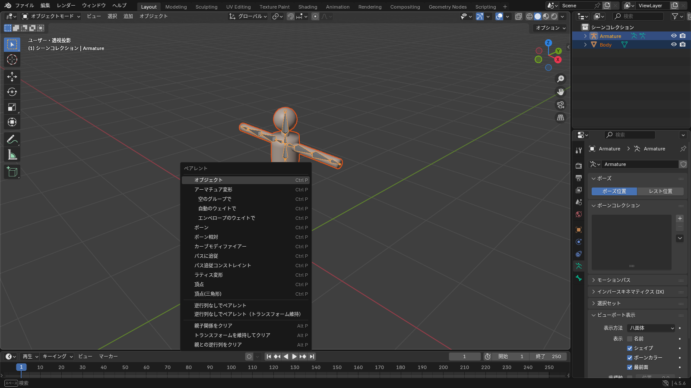
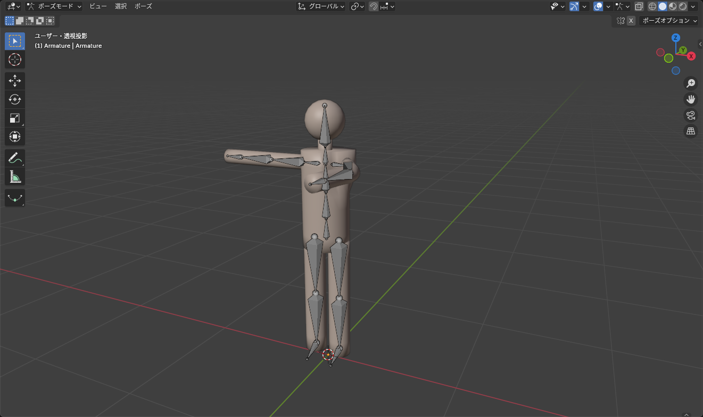

## ウェイトとは

メッシュの各頂点には、「どのボーンに、どれくらいついていくか」という値があります。これが **ウェイト** で、0（まったく動かない）〜 1（完全についていく）の範囲です。

- 上腕のボーンのウェイトが 1 の頂点は、上腕を回すと一緒に回る
- 肘の近くの頂点は、上腕 0.5・前腕 0.5 のように分け合うと、なめらかに曲がる
- 1 つの頂点のウェイトの合計は 1 になるのが基本（正規化）

ウェイトは **頂点グループ** として保存されます。ボーンと同じ名前の頂点グループが、そのボーンのウェイトです。

## 親子付けで自動ウェイト

いちばん簡単な方法は、Blender に自動で計算させることです。

1. オブジェクトモードで **メッシュ** を選択する
2. <kbd>Shift</kbd>+クリックで **アーマチュア** を選択する（アーマチュアがアクティブになる）
3. <kbd>Ctrl</kbd>+<kbd>P</kbd> > **自動のウェイトで**（With Automatic Weights）

*アーマチュアを最後に選ぶのがポイント。順番を逆にするとメニューが変わる*

これで、メッシュにアーマチュアモディファイアーが付き、ボーンからの距離に応じたウェイトが頂点グループとして作られます。

| 項目 | 動き |
|---|---|
| 自動のウェイトで | 距離からウェイトを自動計算。まずはこれ |
| 空のグループで | ボーンと同名の空の頂点グループだけ作る。あとで手で塗る、または転送するときに |
| エンベロープのウェイトで | ボーンの太さ（エンベロープ）で決める。あまり使わない |
| アーマチュア変形 | モディファイアーだけ付けて頂点グループは作らない |

## 動かして確かめる

1. アーマチュアを選び、<kbd>Ctrl</kbd>+<kbd>Tab</kbd> でポーズモードへ
2. ボーンをクリックして選び、<kbd>R</kbd> で回す
3. メッシュがついてくれば成功

*関節の部分がなめらかに曲がっていれば、ウェイトがうまく分かれている*

確認が終わったら、全選択して <kbd>Alt</kbd>+<kbd>R</kbd> で回転を戻します。

::: tip
ポーズモードのまま <kbd>Tab</kbd> でメッシュの編集モードに入ることもできます。アーマチュアのポーズを付けたまま、メッシュを編集して貫通を直す、といった作業ができます。
:::

## 自動ウェイトがうまくいかないとき

### 「ボーンヒートウェイトの計算に失敗」と出る

メッシュに問題があるときに出ます。

- 重複した頂点がある → 編集モードで全選択して <kbd>M</kbd> > **距離で**
- 面の向きがそろっていない → <kbd>Shift</kbd>+<kbd>N</kbd>
- スケールが適用されていない → <kbd>Ctrl</kbd>+<kbd>A</kbd> > **全トランスフォーム**
- メッシュが薄すぎる、ボーンから離れすぎている → 一時的に体の近くに寄せてから親子付けする

### 変な場所が動く

服の袖が脚のボーンについていく、といった場合は自動計算の限界です。次の記事の [ウェイトペイント](/learn/rigging/weight-paint) で手直しするか、アバターの体からウェイトを転送します（[ウェイトの転送](/learn/avatar-clothing/weight-transfer)）。

## アーマチュアモディファイアー

親子付けをすると、メッシュに **アーマチュア** モディファイアーが追加されます。

- **オブジェクト**: どのアーマチュアに従うか
- **頂点グループ** にチェック: 頂点グループ（ウェイト）で動かす。既定でオン
- 一時的に動かないようにしたいときは、ビューポート表示のアイコンをオフにする（削除しない）

::: warning
アーマチュアモディファイアーは **適用しないでください**。適用すると今のポーズの形でメッシュが固まり、二度と動かなくなります。FBX の書き出し設定で「モディファイアーを適用」にしても、アーマチュアは自動で除外されるので安心です。
:::

## 親子関係を外す

メッシュを選んで <kbd>Alt</kbd>+<kbd>P</kbd> > **トランスフォームを維持してクリア**（Clear and Keep Transformation）。アーマチュアモディファイアーと頂点グループは残るので、必要なら手で削除します。

## よくあるつまずき

- **Ctrl+P のメニューに「自動のウェイトで」がない**: 選択順が逆です。メッシュ → アーマチュアの順に選び直してください
- **一部の頂点だけ置き去りになる**: ウェイトがどのボーンにも付いていない頂点です。ウェイトペイントで塗るか、近くの頂点からウェイトをコピーします
- **メッシュが倍の大きさで動く**: アーマチュアモディファイアーが 2 つ付いています。1 つ消してください
