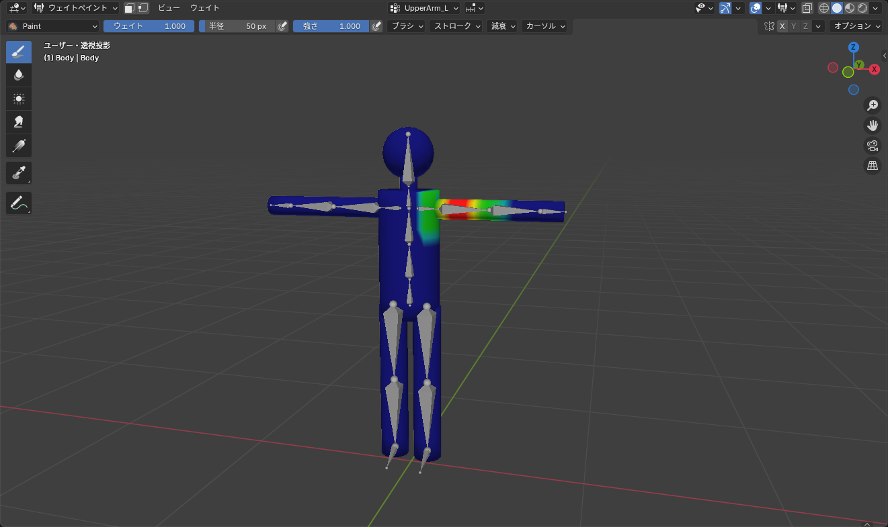
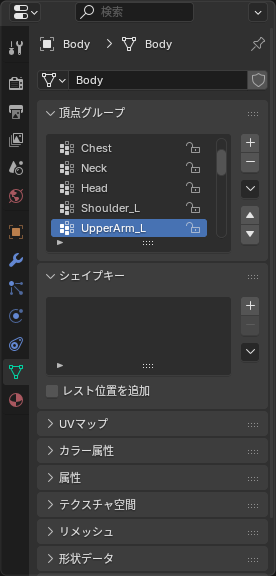

## ウェイトペイントモード

メッシュを選んで、ヘッダーのモードを **ウェイトペイント**（Weight Paint）にします（<kbd>Ctrl</kbd>+<kbd>Tab</kbd> のパイメニューからも選べます）。

メッシュが色で表示されます。**赤が 1（完全についていく）、青が 0（動かない）**、間は緑や黄色です。

*表示されているのは「アクティブな頂点グループ」のウェイトだけ。別のボーンを見るには切り替える*

## 見るボーンを切り替える

どのボーンのウェイトを表示・編集するかは、**オブジェクトデータプロパティ > 頂点グループ** の一覧で選びます。

*ボーンと同じ名前の頂点グループが並ぶ。クリックするとその色に切り替わる*

::: tip
アーマチュアを先に選び、<kbd>Shift</kbd>+クリックでメッシュを選んでからウェイトペイントモードに入ると、3D ビューポートで **ボーンを <kbd>Ctrl</kbd>+クリック** するだけで頂点グループが切り替わります。しかも、そのままポーズを付けて確認できます。この方法がいちばん速いです。
:::

## 塗る

ツールバーの **ドロー** ブラシでメッシュの上をドラッグすると、アクティブな頂点グループのウェイトが変わります。ブラシの設定は、ヘッダーかサイドバー（<kbd>N</kbd>）の **ツール** タブにあります。

| 設定 | 意味 |
|---|---|
| ウェイト | 塗る値。1 で赤く、0 で青く塗る |
| 半径 | ブラシの大きさ。<kbd>F</kbd> を押してドラッグでも変えられる |
| 強さ | 1 回でどれだけ近づけるか。<kbd>Shift</kbd>+<kbd>F</kbd> を押してドラッグ |
| ブレンド | 「ミックス」が普通の塗り。「追加」「減算」「ぼかし」なども |

よく使う塗り方は次の 3 つです。

- **ウェイト 1・強さ 1** で、完全にそのボーンに従わせたい場所を塗る
- **ウェイト 0** で、ついてきてほしくない場所を塗る（青にする）
- **ぼかし（Blur）** ブラシで、境目をなじませる

### 裏側まで塗る

既定では見えている面だけが塗られます。袖のように筒状のものを一周塗りたいときは、サイドバーの **ツール > オプション** にある **正面の面のみ**（Front Faces Only）をオフにし、**X ミラー** や **自動正規化** も必要に応じてオンにします。

## 自動正規化

**ツール > オプション > 自動正規化**（Auto Normalize）をオンにすると、塗った頂点の合計が常に 1 になるように、他のボーンのウェイトが自動で減ります。これをオンにしておくと「合計が 1 を超えて変に動く」「合計が 0 で置き去りになる」という失敗が減ります。

手動でそろえたいときは、**ウェイト > すべてを正規化**（Weights > Normalize All）を実行します。

## ウェイトメニューの便利な機能

ヘッダーの **ウェイト** メニューにある機能です。

| 項目 | 動き |
|---|---|
| すべてを正規化 | 全頂点のウェイト合計を 1 にそろえる |
| スムーズ | ウェイトの変化をなめらかにする。関節のガタつきに |
| 合計を制限 | 影響するボーンの数を制限する。**VRChat 向けには 4 本以下** にしておくと安全 |
| クリーン | 0 に近いウェイトを消す。ゴミ掃除 |
| ウェイトを転送 | 別のメッシュからウェイトをコピーする（服の作業で使う） |

## きれいに曲げるコツ

- **関節の中心を 0.5 / 0.5 に**: 上腕と前腕の境目は、両方のウェイトを半分ずつにする
- **境目は 2〜3 ループ分のグラデーション** にする。1 ループで 1 → 0 に変わると折れ曲がる
- ポーズを付けながら塗る。曲げたときの見た目で判断する
- 塗りすぎたら <kbd>Ctrl</kbd>+<kbd>Z</kbd>。ウェイトペイントも取り消せる

## よくあるつまずき

- **塗っても色が変わらない**: 頂点グループが「ロック」されている（鍵アイコン）か、別のグループがアクティブです。頂点グループ一覧を確認してください
- **塗ったところ以外も変わる**: 自動正規化で他のボーンのウェイトが調整されています。意図した動きなら問題ありません
- **一部の頂点が青のまま残る（動かない）**: その頂点がどのグループにも入っていません。ウェイト 1 で塗るか、**ウェイト > 頂点をサンプル** で近くの値をコピーします
- **ボーンを Ctrl+クリックしても切り替わらない**: アーマチュア → メッシュの順で選んでからウェイトペイントモードに入っていません。一度オブジェクトモードに戻って選び直してください
