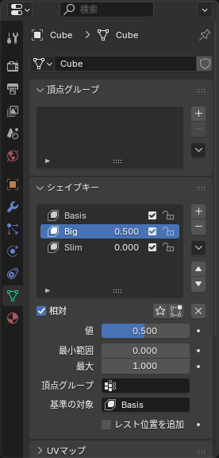

## シェイプキーとは

**シェイプキー**（Shape Key）は、同じメッシュの「別の形」を記憶しておく仕組みです。値を 0〜1 で動かすと、元の形から記憶した形へなめらかに変化します。

VRChat アバターでは次の用途に使われています。

- **表情**: まばたき、口の開閉、笑顔など（Unity では BlendShape と呼ばれる）
- **体形の調整**: 胸の大きさ、脚の太さなど
- **服の調整**: 「この服を着るときは体を少し細くする」といった貫通対策

アバターの服を作るときは、**アバターの体形シェイプキーと同じものを服にも作る** ことで、体形を変えても服が追従するようにします。

## 作る

1. メッシュを選び、**オブジェクトデータプロパティ**（緑の三角のアイコン）> **シェイプキー** を開く
2. **+** を押す。最初の 1 つは **Basis**（基本の形）になる
3. もう一度 **+** を押すと `Key 1` ができる。名前をダブルクリックして変える（`Big`、`Slim` など）
4. `Key 1` を選んだ状態で <kbd>Tab</kbd> で編集モードに入り、頂点を動かす
5. <kbd>Tab</kbd> でオブジェクトモードに戻り、**値** のスライダーを動かすと形が変わる

*編集モードに入る前に、どのキーが選ばれているかを必ず確認する。Basis を選んだまま編集すると元の形が変わる*

::: warning
**Basis を選んだまま編集モードで頂点を動かすと、すべてのシェイプキーの元になる形が変わります**。編集するときは、必ず目的のシェイプキーをクリックしてから <kbd>Tab</kbd> を押してください。
:::

## 値の意味

| 設定 | 意味 |
|---|---|
| 値（Value） | 0 で Basis、1 でそのキーの形。間は補間される |
| 最小 / 最大 | 値の範囲。-1〜2 のように広げることもできる |
| 相対（Relative To） | どのキーからの差分か。普通は Basis のまま |

複数のキーの値を同時に上げると、変化が足し合わされます。

## 服をアバターの体形に合わせる

アバターに `Big`（胸を大きくする）のようなシェイプキーがあり、服もそれに合わせて膨らませたい、というケースです。

### 方法 1: 手で作る

1. 服に同じ名前のシェイプキーを作る
2. アバターの `Big` の値を 1 にする
3. 服の `Big` を選んで編集モードに入り、体に合わせて頂点を動かす

正確ですが手間がかかります。

### 方法 2: サーフェス変形で写す

アバターの体の変形を、服に自動で写す方法です。

1. 服に **サーフェス変形**（Surface Deform）モディファイアーを追加し、**ターゲット** にアバターの体を指定して **バインド** を押す
2. アバターの体形シェイプキーの値を 1 にする。服も一緒に変形する
3. 服のモディファイアーのメニューから **シェイプキーとして保存**（Save as Shape Key）を実行する
4. できたシェイプキーの名前をアバターと同じにする（`Big` など）
5. アバターのシェイプキーを 0 に戻し、確認したらサーフェス変形モディファイアーを削除する

これで、Unity の Modular Avatar の **Blendshape Sync** で、アバターの体形変化に服が追従します（[Unity での設定](/learn/avatar-clothing/unity-setup)）。

::: tip
サーフェス変形のバインドが失敗する（「ターゲットに重なった面があります」など）ときは、体のメッシュ側に重複頂点があります。体を複製して <kbd>M</kbd> > **距離で** を掛けたものをターゲットにすると通ります。
:::

## シェイプキーを削除・適用する

- **削除**: 一覧で選んで **−**
- **形を固定する**: 残したい形の値を 1 にして、**v** メニュー > **新規シェイプをミックスから作成**（New Shape from Mix）で新しいキーを作る。あるいは **v** メニュー > **全シェイプキーを適用**（Apply All Shape Keys）で、今の見た目を Basis にしてシェイプキーをすべて消す

## FBX への書き出し

シェイプキーは FBX に **そのまま含まれます**（Unity で BlendShape になります）。ただし、書き出し設定の **モディファイアーを適用**（Apply Modifiers）がオンだと、**シェイプキーは書き出されません**。シェイプキーのあるメッシュを書き出すときは、先にモディファイアーを適用してから、この設定をオフにします。詳しくは [FBX 書き出し](/learn/avatar-clothing/export-fbx) を見てください。

## よくあるつまずき

- **値を動かしても何も変わらない**: そのキーに変化がありません。キーを選んで編集モードで頂点を動かしてください
- **編集モードで動かした頂点が全部のキーに影響する**: Basis を編集していました。<kbd>Ctrl</kbd>+<kbd>Z</kbd> で戻し、目的のキーを選び直してください
- **シェイプキーがあるとモディファイアーを適用できない**: Blender の制限です。一時的にシェイプキーを削除するか、アドオン（Cats など）の機能で適用してください
