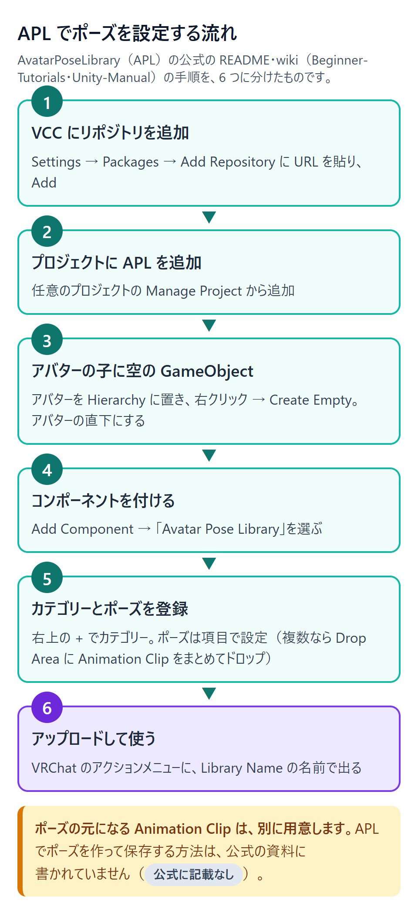
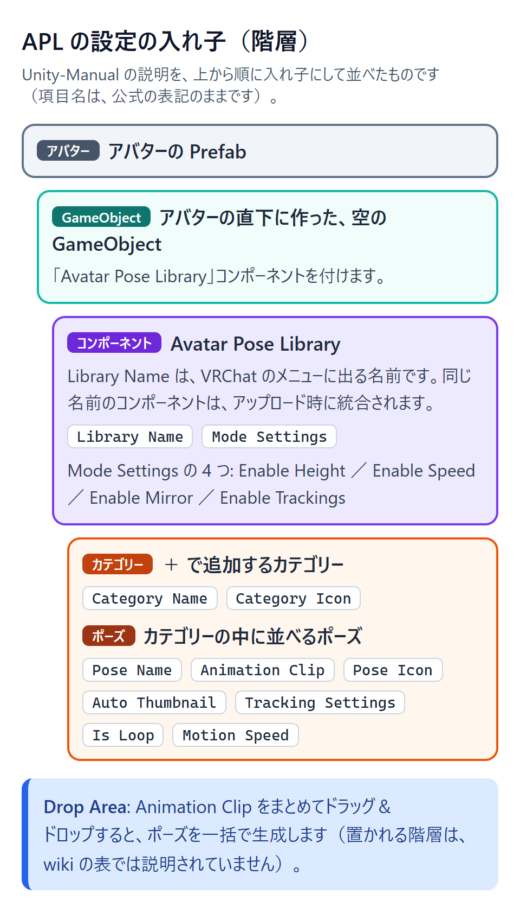
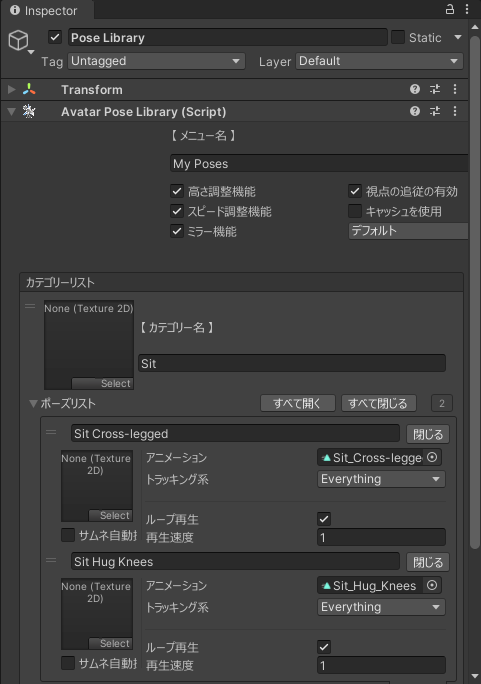

::: point
- APL は既存の AnimationClip を登録して呼び出すツールなので、ポーズ自体は別に作った AnimationClip を用意する
- 公式の資料では、依存パッケージの版やパラメーター数の削減の数字が食い違って書かれているため、両方の書き方を原文のまま載せる
- Resources/ のファイルは、公式パッケージの一部としてだけ再配布できるので、ポーズのデータを配布する前に LICENSE を読む
:::

[AvatarPoseLibrary（APL）](https://github.com/HhotateA/AvatarPoseLibrary) は、Unity 上で VRChat 向けのアバター用のポーズを管理・適用するためのツールです（[README](https://github.com/HhotateA/AvatarPoseLibrary/blob/main/README.md) の説明）。この記事では、APL の入れ方と、ポーズを登録する手順、VRChat での使い方を説明します。パラメーター（Expression Parameters）への影響と、注意点もまとめます。

::: tip
この記事で使う言葉は、次のとおりです。

- **公式に記載なし**{.lbl .lbl-none}: そのツールの公式の資料（README・wiki・リポジトリ内の資料）を検索して、書かれていないと確かめた、という意味です。確かめた範囲は、その都度書いています。
- **この記事の助言**{.lbl .lbl-adv}: この記事が勧める手順や注意で、公式の説明ではない、という意味です。
:::

::: warning
APL は、既存の AnimationClip（Unity のアニメーションの動きを保存したファイル）を登録して、VRChat のメニューから呼び出すツールです。
[Unity-Manual](https://github.com/HhotateA/AvatarPoseLibrary/wiki/Unity-Manual) は、ポーズの元になるものを「ポーズに関連付けられたAnimationClipです。」と説明しています。
そのため、ポーズそのものは、別の方法で作った AnimationClip を用意してください。
APL の公式の資料には、ポーズを作って保存する方法（Scene ビューで関節を動かして保存するなど）は書かれていません（**公式に記載なし**{.lbl .lbl-none}）。
この記事では、その方法は扱いません。
:::

[](/learn/vrchat-features/images/avatar-pose-library-flow.png)
*APL でポーズを設定する全体の流れ（導入から使うまで。README・wiki の手順を、この記事で 6 つにまとめたもの。ポーズの設定の細かい手順は、「ポーズを設定する」の 1〜6）*

## この記事の版と確かめ方

この記事は、APL の [1.2.44](https://github.com/HhotateA/AvatarPoseLibrary/releases/tag/1.2.44) を基に書いています。このリリースは 2026 年 9 月 21 日（日本時間。UTC では 9 月 20 日）に公開されました。対応する Unity は 2022.3 です（リポジトリの [package.json](https://github.com/HhotateA/AvatarPoseLibrary/blob/main/Packages/com.hhotatea.avatar-pose-library/package.json) の `unity` の項目）。2026 年 11 月 6 日に、公式の資料を確かめて書きました。

公式の wiki の最終の更新は 2026 年 4 月 4 日で、1.2.44 のリリースより前です。

## 用意するもの

- **Unity 2022.3**（APL の対応版）
- **VRChat のアバター SDK（`com.vrchat.avatars`）**
- **NDMF（`nadena.dev.ndmf`）**（Non-Destructive Modular Framework の略。アバターを非破壊で改変するための基盤です）
- **Modular Avatar（`nadena.dev.modular-avatar`）**（衣装などを、アバターを壊さずに組み込むツールです）。Q&A は「APLはModular Avatarを前提として設計されています。」と書いています（[Q&A](https://github.com/HhotateA/AvatarPoseLibrary/wiki/Q&A)）。

依存パッケージの版は、公式の資料の中で 2 通りに書かれています。どちらも原文のまま並べます。

| パッケージ | 導入ページの記載（[How-to-Install](https://github.com/HhotateA/AvatarPoseLibrary/wiki/How-to-Install)） | リポジトリの package.json |
|---|---|---|
| `com.vrchat.avatars` | `"com.vrchat.avatars": "3.8.0"` | `">=3.7.0"` |
| `nadena.dev.ndmf` | `"nadena.dev.ndmf": "1.7.9"` | `">=1.5.0"` |
| `nadena.dev.modular-avatar` | `"nadena.dev.modular-avatar": "1.12.5"` | `">=1.10.0"` |

導入ページの版は、「あらかじめ以下の依存パッケージをプロジェクトに追加しておく」と書かれた版です。package.json の値は、そのパッケージの条件です。どちらを使うべきかは、公式の資料では説明されていません（**公式に記載なし**{.lbl .lbl-none}。確かめた範囲: wiki の How-to-Install、リポジトリの package.json）。導入ページの NDMF 1.7.9 は、AAO（Avatar Optimizer）の要件（1.8.0 以上）より低いため、AAO と一緒に使う場合は、NDMF を 1.8.0 以上 2.0.0 未満にしてください（AAO の要件。[AAO の記事](/learn/optimize-aao/avatar-optimizer) を参照）。

::: warning
導入の前に、Unity のプロジェクトのバックアップを取ってください。
:::

## 入れ方

### VCC から入れる

APL は、[VCC（VRChat Creator Companion）](/learn/vrchat/vcc-project) から入れるのがおすすめだと、README に書かれています。README の手順は次のとおりです。

1. VCC を開き、**Settings** に移動します。
2. **Packages** タブをクリックします。
3. **Add Repository** をクリックします。
4. 入力欄に、次の URL を貼り付けます。
   ```text
   https://HhotateA.github.io/AvatarPoseLibrary/index.json
   ```
5. **Add** をクリックします。
6. リポジトリの情報を確認し、**I Understand** をクリックします。
7. 任意のプロジェクトの **Manage Project** から APL を追加します。

wiki の [Beginner-Tutorials](https://github.com/HhotateA/AvatarPoseLibrary/wiki/Beginner-Tutorials) には、APL の公式サイトにある「VCCに追加」ボタンから入れる、別の手順があります。その手順では、「Creator Companion を開く」を選び、「I Understand、AddRepository」をクリックします。

ALCOM（VCC の代わりに使える、VRChat 公式ではないコミュニティのツール）から入れる手順は、**公式に記載なし**{.lbl .lbl-none}（確かめた範囲: README、wiki の How-to-Install と Beginner-Tutorials）です。

### UnityPackage から入れる

1. 先に、「用意するもの」の依存パッケージを、Unity のプロジェクトに入れておきます。
2. [リリースのページ](https://github.com/HhotateA/AvatarPoseLibrary/releases/latest/) から [UnityPackage](/glossary#unitypackage) を取得します。
3. Unity のプロジェクトを開き、UnityPackage をドラッグ＆ドロップします。
4. 追加されるファイルを確かめて、**Import** をクリックします。

## ポーズを設定する

::: warning
アバターを変更する前に、プロジェクトのバックアップを取ってください。今のアバターの動き（表情やジェスチャーなど）も、録画やスクリーンショットで記録しておくと、後で比べられます（**この記事の助言**{.lbl .lbl-adv}。公式の説明ではありません）。
:::

手順は、wiki の [Beginner-Tutorials](https://github.com/HhotateA/AvatarPoseLibrary/wiki/Beginner-Tutorials) の流れに、[Unity-Manual](https://github.com/HhotateA/AvatarPoseLibrary/wiki/Unity-Manual) の項目の説明を合わせたものです。

1. アバターの [Prefab](/glossary#prefab) を、Hierarchy ウィンドウにドラッグ＆ドロップします。
2. Hierarchy 上で右クリックし、**Create Empty** を選びます。作った GameObject を、アバターの子にします。Unity-Manual は「アバターの直下にGameObjectを生成します。」と書いています。
3. その GameObject を選び、Inspector で **Add Component** をクリックします。検索欄に「Avatar Pose Library」と入力し、表示されたコンポーネントを選びます。
4. コンポーネントの右上の **+** をクリックして、カテゴリーを追加します。
5. カテゴリーの中に、ポーズを登録します。各項目は、次の表のとおりです。
6. 複数のポーズをまとめて追加するときは、**Drop Area** に AnimationClip をまとめてドラッグ＆ドロップします。

| 項目 | 公式の説明の要約（[Unity-Manual](https://github.com/HhotateA/AvatarPoseLibrary/wiki/Unity-Manual)） |
|---|---|
| Library Name | VRChat のメニューに表示される名前です。この名前が同じコンポーネントは、アップロード時に統合されます。 |
| Mode Settings | Enable Height、Enable Speed、Enable Mirror、Enable Trackings を切り替えます。同じ Library Name では、単一の設定になります。 |
| Category Icon / Category Name | カテゴリーごとのメニューのアイコンと名前です。 |
| Pose Name | ポーズのメニュー名です。初期値は AnimationClip の名前です。 |
| Pose Icon | ポーズのメニューのアイコンです。Auto Thumbnail が有効なときは設定できません。 |
| Auto Thumbnail | アップロード時に、サムネイルを自動で撮影し、アバターの画像に差し替えます。 |
| Animation Clip | ポーズに関連付けられた AnimationClip です。 |
| Tracking Settings | ポーズ再生中のトラッキングの設定です。VRChat のメニューからも変更できます。 |
| Is Loop | ポーズをループ再生します。静的なアニメーションでは、初期設定で有効になっています。 |
| Motion Speed | 再生速度の初期値です。 |
| Drop Area | AnimationClip をまとめてドラッグ＆ドロップすると、ポーズを一括で生成します。 |

Mode Settings の 4 つの項目には、それぞれ次の説明があります（Unity-Manual の原文）。

- Enable Height: 「ポーズ再生中の、アバターの地面の高さを設定できるようになります。」
- Enable Speed: 「ポーズの再生速度を変更できるようになります。これが有効な場合、静的なアニメーションも自動的に生物らしいランダムなアニメーションに変換されます。」
- Enable Mirror: 「ポーズを左右反転できるようになります。」
- Enable Trackings: 「トラッキングメニューを表示します。」

[](/learn/vrchat-features/images/avatar-pose-library-structure.png)
*設定の入れ子（Unity-Manual の説明を、この記事で図にしたもの）*

[](/learn/vrchat-features/images/avatar-pose-library-inspector.png)
*新しく作った VRChat 用のプロジェクトに APL 1.2.44 を入れて、Unity 2022.3.22f1 で開いた Inspector（日本語の表示）。カテゴリー「Sit」に 2 つのポーズを登録し、ポーズを開いた状態。アニメーションは、空のクリップを仮に入れている*

日本語の画面では、項目の名前が日本語で表示されます。画面の名前と、wiki の名前の対応は、パッケージの表示名の資源（1.2.44。日本語と英語の両方）で確かめました（**この記事の確認**{.lbl .lbl-adv}）。

| 画面の表示（日本語） | wiki の名前（英語） |
|---|---|
| メニュー名 | Library Name |
| カテゴリーリスト ／ カテゴリー名 | Category List ／ Category Name |
| ポーズリスト ／ すべて開く ／ すべて閉じる | Pose List ／ Open All ／ Close All |
| アニメーション | Animation Clip |
| トラッキング系 | Tracking Settings |
| ループ再生 ／ 再生速度 | Is Loop ／ Motion Speed |
| サムネ自動撮影 | Auto Thumbnail（パッケージの英語の表示は「Auto」） |
| ここにアニメーションをドロップ | Drop Area（パッケージの英語の表示は「Drop AnimationClips here to add Poses」） |
| 高さ調整機能 ／ スピード調整機能 ／ ミラー機能 ／ トラッキング機能 | Enable Height ／ Enable Speed ／ Enable Mirror ／ Enable Trackings（パッケージの英語の表示は Enable Tracking） |

撮った画面には、wiki の「Mode Settings」の一覧にない項目（「視点の追従の有効」「キャッシュを使用」など）も出ていました。

::: tip
Q&A には、「Animation Clip を APL にドラッグ＆ドロップ → Generate を押す」だけで基本的な設定が完了すると書かれています（[Q&A](https://github.com/HhotateA/AvatarPoseLibrary/wiki/Q&A)）。ただし、wiki の Unity-Manual と Beginner-Tutorials の項目の一覧に、「Generate」という名前の項目はありません。パッケージの表示名（英語・日本語）と Editor のコードにも、この名前のボタンは見当たりませんでした。Drop Area のツールチップ（英語版）には、"You can generate poses by dropping animation clips here in bulk." と書かれています。この記事では、Drop Area に入れる手順を書いています。

ポーズ行の右クリックメニューには「Create Pose（新規作成）」の項目もあります。**公式に記載なし**{.lbl .lbl-none}（確かめた範囲: README、wiki）です。リポジトリの Editor コードでは、空の項目を追加するだけ（公式の説明ではなく、この記事がコードを読んだ結果）。この記事では使いません。
:::

## 保存して共有する

設定が済んだ GameObject は、Project タブにドラッグ＆ドロップすると、Prefab にできます。Unity-Manual は、この Prefab と AnimationClip をセットで UnityPackage として出力すると、APL を持つ人同士で設定を共有できると書いています（[Unity-Manual](https://github.com/HhotateA/AvatarPoseLibrary/wiki/Unity-Manual)）。配布する前に、下の「注意・うまくいかないとき」にあるライセンスの注意を読んでください。

Prefab を使う側の手順は、Unity-Manual の「Prefabの使用」に書かれています。

1. APL を含む依存パッケージが、Unity のプロジェクトに入っているかを確かめます。
2. APL 対応の UnityPackage を Import します。
3. バックアップを取ってから、設定済みの Prefab を、アバターの直下にドラッグ＆ドロップします。
4. アバターをアップロードし、導入を確認します。

## VRChat での使い方

アップロードしたアバターでは、VRChat のアクションメニューに、Library Name の名前の項目が出ます（[VRC-Manual](https://github.com/HhotateA/AvatarPoseLibrary/wiki/VRC-Manual)）。VRC-Manual と Beginner-Tutorials が書いている使い方は、次のとおりです。

- **カテゴリー**: メインメニューは、ポーズのカテゴリーごとに分かれています。
- **ポーズの選択**: 「1度押すとポーズの有効化、もう一度押すことで無効化できます。」（VRC-Manual）。Beginner-Tutorials は「ポーズを選択すると即時再生されます」と書いています。
- **設定**: リセット、高さ、再生速度、左右反転、トラッキング設定があります。再生速度は、「50%で通常速度です」と書かれています。リセットは、再生中のポーズを中断し、設定も初期化します。
- **トラッキング**: 各部位を、アニメーション優先かトラッキング優先かを選べます。「移動抑制を有効にすると、コントローラーでの移動が無効になります。」と書かれています。

Beginner-Tutorials は、Quest の場合は、左手のメニューから「表情」や「パラメータ」を選ぶところから始めると書いています。

## パラメーター（Expression Parameters）への影響

APL のパラメーターへの影響は、公式の資料の中で書き方が違います。どちらも原文のまま並べます。Q&A とリポジトリのソースは、どちらも「有効にすると増え、無効にすると減る」向きです。削減数の単位は、公式の資料に書かれていません。

- Unity-Manual の Mode Settings の説明:
  - 「Enable Height: … （パラメーター数が8削減されます）」
  - 「Enable Speed: … （パラメーター数が8削減されます）」
  - 「Enable Mirror: … （パラメーター数が1削減されます）」
  - 「Enable Trackings: … （パラメーター数の削減にはなりません）」
- Q&A の「パラメーター数が心配です。」の答え:
  - 「少しでも削減したい場合は、**Enable Height**、**Enable Speed**、**Enable Mirror** の 3 項目を無効化することで、17パラメーター削減できます。」

リポジトリの `Editor/Logic/ParameterBuilder.cs` では、Height と Speed は有効にすると Float のパラメーターを 1 つずつ、Mirror は有効にすると Bool のパラメーターと Float のパラメーター（MirrorCycleOffset）を 1 つずつ追加します。Unity-Manual の「8」「1」と Q&A の「17」は、この追加数とは一致しません（数の単位は、公式の資料に書かれていません）。

Q&A は、複数のポーズを 1 つの Int パラメーターで制御する設計だとも書いています（[Q&A](https://github.com/HhotateA/AvatarPoseLibrary/wiki/Q&A)）。ポーズ数の上限については、Q&A に「最新版にて65280ポーズ（16パラメータ）が上限となっています。」とあります。Q&A の数字は、数の単位が書かれていないため、分かりにくいです。Q&A は、ポーズごとにアバターのデータ量とビルド時間が増えるため、実質的な上限は 1000 前後だと書いています（ビルド時間は後述）。

APL のソース（1.2.44 の Editor コードなど、確かめた範囲）には、パラメーターの数を知らせる警告の処理は見当たりませんでした（この記事の調べ）。パラメーターの数は、VRChat SDK の Expression Parameters の表示で確かめてください（**この記事の助言**{.lbl .lbl-adv}）。Expression Parameters の基本は、[Expression メニューとパラメーター](/learn/vrchat-features/expressions) を見てください。

## 注意・うまくいかないとき

::: warning
- **非破壊について**: Q&A は、「アバターに対して非破壊的に改変を行っているので、問題が発生した場合でもAPLをアンインストールすれば問題なく動作します。」と書いています。これは作者の説明です。念のため、アップロードの前にバックアップを取ってください。
- **名前の衝突**: Q&A は、APL が作る Animator（アニメーションの切り替えを制御する Unity の部品）のレイヤーやパラメーターは、ユニークな名前空間で管理されていると書いています。ただし、特殊な構成のアバターでは、手動の調整が必要な場合もあると書かれています。
- **テレメトリ（利用状況データ）**: Unity Editor からは、利用状況のデータが送られます（[Analytics.md](https://github.com/HhotateA/AvatarPoseLibrary/blob/main/Analytics.md)、[privacy.html](https://github.com/HhotateA/AvatarPoseLibrary/blob/main/Website/privacy.html)）。初回起動時に「最小限のみ」か「詳細送信を許可」を選びます（画面のボタンは「最小限」「許可」）。変更は `Tools > Avatar Pose Library > Privacy Settings` からできます。Analytics.md は、「どちらのモードでもイベントは送信されます。」と書いています。送られる内容は、モードによって違います。最小限のモードでも送信されます。
- **ライセンス**: README は「MIT ライセンス」と書いています。一方、[LICENSE](https://github.com/HhotateA/AvatarPoseLibrary/blob/main/LICENSE) は、「Files under Resources/ may only be redistributed as part of the official AvatarPoseLibrary package. Please remove any modifications. All other files are licensed under the MIT License.」と書いています。ポーズのデータを配布する前に、LICENSE を読んでください（**この記事の助言**{.lbl .lbl-adv}）。README の LICENCE のリンク先（`Packages/com.hhotatea.avatar-pose-library/LICENCE`）は存在しません（ルートには `LICENSE` があります）。README の「許諾なしで再配布OK」という説明は、Resources/ には当てはまりません（LICENSE が Resources/ を制限しているため）。
- **サポート対象外の機能**: wiki の [Secret](https://github.com/HhotateA/AvatarPoseLibrary/wiki/Secret) には、メニューの階層化などの機能があります。Secret は、「これらの機能は全てサポート対象外です。」と書いています。この記事の手順には入れていません。
:::

### 既知の問題

- **ほかのツールとの併用**: [Troubleshooting](https://github.com/HhotateA/AvatarPoseLibrary/wiki/Troubleshooting) は、可愛いポーズツール（ゆにスタジオ様）の「他のAnimatorControllerのトラッキング機能を統合する」機能を使うと、APL の Animator が壊れるようだと書いています。「こちらに対する対策アップデートの予定はありません」と書かれ、この機能をオフにすることを勧めています。
- **リップシンクや表情が固定される**: Troubleshooting は、「WriteDefaultなどの値によって、動作が不安定になるケースが報告されています。」と書いています。Write Defaults の説明は、[表情と FX の基礎](/learn/vrchat-features/fx-basics) を見てください。Q&A は、WriteDefault の設定を見直すことと、APL の Inspector のプリセットのメニューにある「ポーズのみ」を試すことを勧めています。Troubleshooting は、AnimationClip に含まれる表情のキーを削除すると、正常に動作する可能性があると書いています（「可能性があります」）。元のクリップは直接消さず、複製してから試してください（**この記事の助言**{.lbl .lbl-adv}）。
- **頭の固定を解除すると腰が浮く**: Q&A は、「VRChatの仕様です。（たぶん）」と書いています。頭の位置に合わせて、高さや姿勢を微調整することを勧めています。
- **フルトラ（全身トラッキング）で棒立ちになる**: Q&A は、設定項目のフルトラッキング時の移動アニメーションを無効にしている場合に棒立ちになる報告があったと書いています。そのうえで、「移動アニメーションを有効にすることで改善するようです。」と書いています。
- **VRChat 上で動かない**: Q&A は、VRChat の整合性チェックを試すことを勧めています。改善しないときは、[作者の Discord](https://discord.gg/j393GwU4Es) で相談できます。

### ビルド時間とデータ量

Q&A には、ポーズ数とビルド時間の表があります（提供: aster 様）。APL なしは 4 秒、256 ポーズは 16 秒、1024 ポーズは 1 分 59 秒です。また、ポーズ 1 種につき 100kb ほどと書かれています。Q&A は、ポーズごとにデータ量とビルド時間が増えるため、実質的な上限は 1000 前後だとも書いています。

## 関連ページ

- [Expression メニューとパラメーター](/learn/vrchat-features/expressions)
- [表情と FX の基礎](/learn/vrchat-features/fx-basics)
- [Modular Avatar で衣装を着せる](/learn/unity/modular-avatar-outfit)
- [VCC でプロジェクトを作る](/learn/vrchat/vcc-project)
